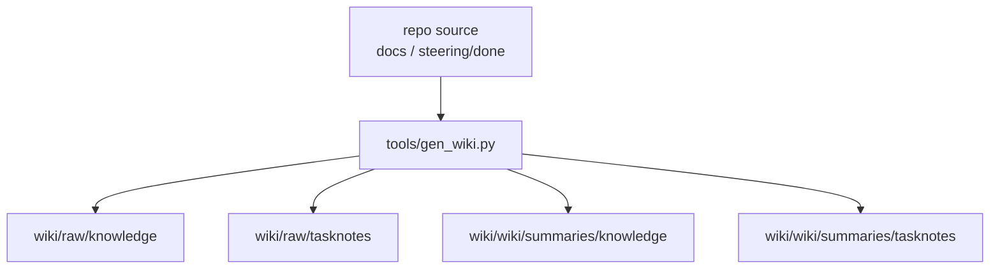

# 2026年5月22日 練習用プロジェクトでminimal ingestとsummariesを通す

> 状態：⑧ Closing 完了
> 次のゲート：（CC）`steering/2026年5月22日 Karpathy方針でindexとlogの最小形を通す.md` を開き、`index.md` と `log.md` の実生成に進む

---

## 1) Journey（どこへ行くか）

> 補足：深層的目的 `wiki/` を「置き場だけある状態」から「raw と summaries が再現可能に増える状態」へ進め、後続の query / checklist / 試運転が机上設計で止まらないようにする
> 補足：やらないこと この note では全 docs 全 tasknotes の ingest、query 実装、checklist 実変換までは扱わない

1. 前提条件
   1. 💦 ユーザー判断で wiki 実体は repo 直下 `wiki/`、ingest 主体は Python スクリプト、UX は既存 docs 直接調査と決まっている
   2. 💦 `docs/` が正本であり、`wiki/raw/knowledge` は source snapshot 層として generator で再構築する前提である
   3. 💦 `steering/done` の shortlist は前ノートで 25 件に絞れており、spot ingest はその中から代表 1 件を選べる

2. Before
   1. 💦 `wiki/` には skeleton しかなく、raw path と summary path をどう mirror するかがまだ実物で検証されていない
   2. 💦 markdown と yaml を同じ生成器でどう扱うか、TL;DR 粒度をどこまで deterministic に寄せるかが未確定である
   3. ❌ もどかしい

3. After
   1. 💦 `docs/customer-jobs.md` と代表 tasknote 1 件が `wiki/raw/...` と `wiki/wiki/summaries/...` に mirror 生成される
   2. ✅ `tools/gen_wiki.py` の最小責務、CLI 引数、summary template、UX 根拠 docs の入口が tasknote に固定される
   3. ❤️ 安心

4. 例外
   1. spot ingest の代表 tasknote は shape 検証用なので、全件 ingest 順序そのものは前ノートの oldest-first shortlist を維持する
   2. deterministic TL;DR が弱いと分かった場合は、後続 note で summary quality 層だけ差し替えてよい

5. 境界条件
   1. 今回の最小実装は `1 knowledge + 1 tasknote` を raw copy と markdown summary に落とすところまでに限定する
   2. index / log / query / checklist / candidate 抽出は後続 note へ分離する

6. 委任度
   1. 🟢 全体として CC 単独で進められる：source 選定、mirror path、summary 雛形、テスト、最小 script 実装まで repo 内で閉じる
   2. 🟢 CCのみで可：`tools/gen_wiki.py` の最小 CLI、markdown/yaml summary 雛形、spot ingest の検証
   3. 🟡 後で人の判断があり得る：TL;DR の文章品質、全件 ingest の chunk 粒度、UX checklist の最終見出し

---

## 2) ユーザーストーリーマップ

> Gherkin の前に、今回の仕事をどの順番で進めるかだけをそろえる。
> 委任度：🟢 spot ingest の最小形までは CC が進められる
> 残る曖昧さ：full ingest 時の large docs chunk 粒度はまだ確定していない

### 話題一覧

#### 話題1：spot ingest の source と mirror path を固定する

##### ユーザー：私

1. 当初計画
    1. 👀 knowledge spot は `docs/customer-jobs.md` を採る
    2. 👀 tasknote spot は `steering/done/20260509-stakeholder-voices-bootstrap.md` を採る
    3. 🧭 raw は `wiki/raw/{knowledge|tasknotes}/<repo 相対 path>`、summary は `wiki/wiki/summaries/.../*-summary.md` に mirror すると決める

#### 話題2：summary の最小 template と UX 根拠 docs の入口を固定する

##### ユーザー：私

1. 当初計画
    1. 📝 summary は frontmatter + `TL;DR` + `主要トピック` + `キーワード` + `注意点` の markdown 1 枚に統一する
    2. 📚 UX checklist 候補 source として `customer-jobs`, `customer-journeys`, `product-requirements-map/platform/av/narrative/battle`, `story-concepts`, `stakeholder_voices` を固定する
    3. 🔗 `guardrails` と `AGENTS.md` は UX source ではなく「壊してはいけない境界」の補助根拠として扱う

#### 話題3：script 主体の最小責務をテストで確定する

##### ユーザー：私

1. 当初計画
    1. 🔴 failing test で raw copy と summary 生成 path を先に固定する
    2. 🟢 最小 code で test を通し、markdown と yaml の両方を summary できる形まで広げる
    3. ✅ 検証後にこの note と親 orchestration note を更新する

---

## 3) Gherkin（完了条件）

> 委任度：🟢 spot ingest と summary 雛形までは CC が完走できる
> 残る曖昧さ：なし

### シナリオ一覧

- [x] シナリオ1：repo 相対 path が raw と summaries に mirror される

1. 🧱 `docs/` と `steering/done/` の source は wiki 側へまだ写っていない
2. 🎬 `gen_wiki.py` に source path を渡して raw copy と summary 生成を実行する
3. ✅ `wiki/raw/.../<repo path>` と `wiki/wiki/summaries/.../*-summary.md` が揃う

- [x] シナリオ2：markdown source の summary template が deterministic に埋まる

1. 🧱 current docs/tasknotes は markdown で、後続 query の土台になる
2. 🎬 見出し、先頭本文、キーワード候補から TL;DR / 主要トピック / キーワード / 注意点を埋める
3. ✅ summary が人手ゼロでも最低限読める構造になる

- [x] シナリオ3：yaml knowledge も同じ script で summary 化できる

1. 🧱 後続の `stakeholder_voices.yml` と `architecture_rules.yml` は yaml である
2. 🎬 top-level key と代表 subkey を summary へ整形する
3. ✅ markdown source だけに閉じない ingest 主体が先に確認できる

---

## 4) Design（どうやるか）

### 責務分担概要

- `tools/gen_wiki.py` は source を読み、`wiki/raw` snapshot と `wiki/wiki/summaries` markdown を生成する
- raw は repo 相対 path を保持し、summary は raw path を mirror した `*-summary.md` を返す
- TL;DR は LLM 依存にせず deterministic 生成で始め、quality 改善は後続 note に分離する

### 責務分担概要図

### 責務分担詳細

- `tools/gen_wiki.py` （➕：repo 相対 source を raw snapshot と summary に変換する最小 CLI）
- `test/test_gen_wiki.py` （➕：raw mirror / summary mirror / markdown / yaml の red-green を固定する）
- `wiki/raw/knowledge/docs/customer-jobs.md` （➕：UX 根拠 source の最小 spot）
- `wiki/raw/tasknotes/steering/done/20260509-stakeholder-voices-bootstrap.md` （➕：要求翻訳 tasknote の最小 spot）
- `wiki/wiki/summaries/knowledge/docs/customer-jobs-summary.md` （➕：knowledge summary の出力先）
- `wiki/wiki/summaries/tasknotes/steering/done/20260509-stakeholder-voices-bootstrap-summary.md` （➕：tasknote summary の出力先）

### 【参照】

- Steering: `steering/2026年5月22日 LLM Wiki shared packageを導入して自律実行ルートを固定する.md`
- Steering: `steering/done/2026年5月22日 練習用プロジェクトのclosed tasknotes投入候補と順番を固定する.md`
- Steering: `steering/llm-wiki/child-tasknotes/04-練習用プロジェクトでminimal ingestとsummariesを通す.md`
- Docs: `docs/customer-jobs.md`
- Docs: `docs/customer-journeys.md`
- Docs: `docs/product-requirements-platform.md`
- Docs: `docs/product-requirements-map.md`
- Docs: `docs/product-requirements-av.md`
- Docs: `docs/product-requirements-narrative.md`
- Docs: `docs/product-requirements-battle.md`
- Docs: `docs/stakeholder_voices.yml`
- Docs: `AGENTS.md`

### 変更範囲

- やること:
  - current-date child `04` note を起票して source / output / template を固定する
  - `test/test_gen_wiki.py` を追加して failing test から mirror path を定義する
  - `tools/gen_wiki.py` を最小実装して spot ingest を通す
- やらないこと:
  - 全 docs / 全 tasknotes ingest
  - query 実装
  - checklist 実変換
  - summary quality の LLM 最適化

### 検証

- 検証コマンド:
  - `python -m pytest test/test_gen_wiki.py -q`
  - `python tools/gen_wiki.py --knowledge docs/customer-jobs.md --tasknote steering/done/20260509-stakeholder-voices-bootstrap.md`
  - `find wiki/raw wiki/wiki/summaries -type f | sort`
- 成功条件:
  - raw と summary が想定 path に生成される
  - test が green で終わる
  - summary frontmatter と section 構造が template を満たす
- 未実施時の扱い:
  - test が無い / fail のままなら child `05` へ進まない

---

## 5) Tasklist

- [x] shared child `04` を repo 固有前提で読み直した
- [x] existing docs を調査し、UX checklist 候補 source の入口を固定した
- [x] spot ingest source を `docs/customer-jobs.md` と `steering/done/20260509-stakeholder-voices-bootstrap.md` に決めた
- [x] `test/test_gen_wiki.py` に failing test を追加した
- [x] red を確認した
- [x] `tools/gen_wiki.py` を最小実装した
- [x] green を確認した
- [x] 実 source で CLI を 1 回流し、`wiki/raw` と `wiki/wiki/summaries` の実物を確認した

---

## 6) Result（成果物）

- UX checklist 候補 source の入口を次に固定した
  - primary: `docs/customer-jobs.md`, `docs/customer-journeys.md`, `docs/product-requirements-map.md`, `docs/product-requirements-platform.md`, `docs/product-requirements-av.md`, `docs/product-requirements-narrative.md`, `docs/product-requirements-battle.md`, `docs/story-concepts.md`
  - crosswalk: `docs/stakeholder_voices.yml`
  - boundary support: `AGENTS.md`, `docs/product-requirements-guardrails.md`
- spot ingest は UX 起点確認を優先し、knowledge を `customer-jobs`、tasknote を `stakeholder-voices-bootstrap` にした
- full ingest 順序そのものは前ノートの oldest-first shortlist を維持し、今回の source 選定は shape 検証用と位置づけた
- `test/test_gen_wiki.py` を追加し、`tools/gen_wiki.py` が無い red と、markdown/yaml summary を含む green を `2 passed` で確認した
- `tools/gen_wiki.py` を追加し、`--knowledge` / `--tasknote` の repo 相対 path から `wiki/raw/...` と `wiki/wiki/summaries/...` を mirror 生成できるようにした
- 実 repo では次の 4 ファイル生成まで確認した
  - `wiki/raw/knowledge/docs/customer-jobs.md`
  - `wiki/raw/tasknotes/steering/done/20260509-stakeholder-voices-bootstrap.md`
  - `wiki/wiki/summaries/knowledge/docs/customer-jobs-summary.md`
  - `wiki/wiki/summaries/tasknotes/steering/done/20260509-stakeholder-voices-bootstrap-summary.md`

---

## 7) Discussion（残課題の起票）

### 残課題メモ

- large docs の chunk 粒度はまだ決め切っていない。`customer-journeys.md` と `stakeholder_voices.yml` を ingest する前に追加 spot が要る可能性がある
- `scripts/commit-tasknote.sh` 不在の process gap は継続中で、tasknote の細粒度 commit 運用は repo 側で未整備のままである
- 別tasknoteにした場合のタイトル or パス：`steering/done/2026年5月22日 Karpathy方針へ寄せてindexとlogを先に通しarea current-stateを採用しない.md`

### 反省とルール化

- 記入先：`wiki/README.md`, `steering/2026年5月22日 LLM Wiki shared packageを導入して自律実行ルートを固定する.md`
- 次にやること：今回生成した `wiki/raw/...` と `wiki/wiki/summaries/...` を材料に、Karpathy 寄りの `index.md` / `log.md` 最小形を実生成する

---

## 8) Closing

- 状態: done
- 次のゲート: `steering/2026年5月22日 Karpathy方針でindexとlogの最小形を通す.md` を開いて、`index.md` / `log.md` の実生成へ進む
- close 条件:
    - [x] failing test を先に置いた
    - [x] red を確認した
    - [x] `tools/gen_wiki.py` を実装して green に戻した
    - [x] 実 source で `wiki/raw` と `wiki/wiki/summaries` の実物を確認した

---

## 9) 参考文献

- `steering/llm-wiki/child-tasknotes/04-練習用プロジェクトでminimal ingestとsummariesを通す.md`
- `steering/done/2026年5月22日 練習用プロジェクトのclosed tasknotes投入候補と順番を固定する.md`
- `docs/customer-jobs.md`
- `docs/customer-journeys.md`
- `docs/product-requirements-platform.md`
- `docs/product-requirements-map.md`
- `docs/product-requirements-av.md`
- `docs/product-requirements-narrative.md`
- `docs/product-requirements-battle.md`
- `docs/product-requirements-guardrails.md`
- `docs/stakeholder_voices.yml`
- `AGENTS.md`
