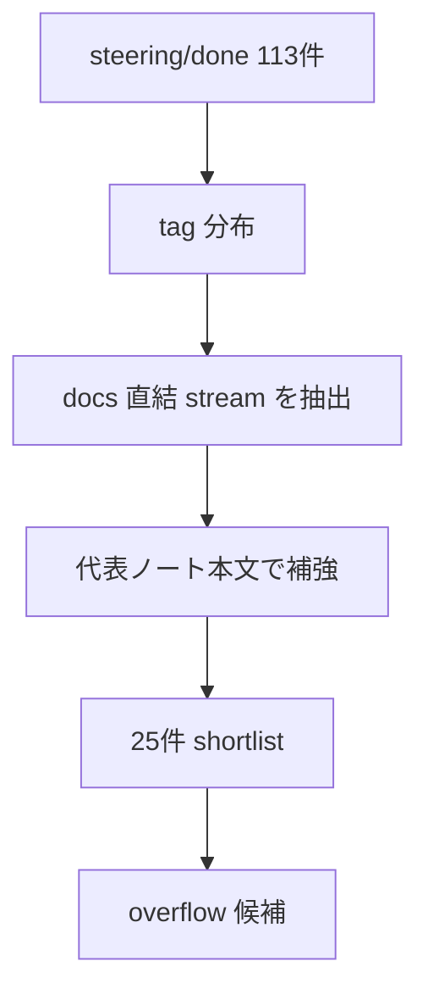

# 2026年5月22日 練習用プロジェクトのclosed tasknotes投入候補と順番を固定する

> 状態：⑧ Closing 完了
> 次のゲート：（CC）`steering/llm-wiki/child-tasknotes/04-練習用プロジェクトでminimal ingestとsummariesを通す.md` を現在日付 tasknote に切り直し、docs 1件 + tasknote 1件の spot ingest 方針を決める

---

## 1) Journey（どこへ行くか）

> 補足：深層的目的 latest docs だけでは読めない「なぜそう変えたか」を閉じた tasknotes で補い、query が理由まで辿れる状態へ進める
> 補足：やらないこと `steering/done/` 全件投入や、全ノート本文の完全要約までは今回やらない

1. 前提条件
   1. 💦 `steering/done/` には Markdown だけで 113 件あり、全件投入は noise が大きい
   2. 💦 tag 分布を見ると `guardrails`, `ssot`, `architecture`, `framework-rule`, `docs`, `yaml`, `stakeholder` が docs 補完に強い
   3. 💦 `latest docs` は前ノートで固定したので、今回は「latest docs の理由を補う closed note」だけに絞れる

2. Before
   1. 💦 どの closed tasknote を raw/tasknotes に入れるか基準が無いままだと、近縁ノートを全部入れてしまいがち
   2. 💦 architecture_rules / stakeholder_voices のように連番タスクが多い領域では、細かい改善ノートまで全部入れると summary が膨らむ
   3. ❌ もどかしい

3. After
   1. 💦 closed tasknotes の投入候補が 25 件まで絞られ、stream ごとの意味づけができている
   2. ✅ oldest-first を基本にしつつ、docs 変更理由が強いノートだけ raw/tasknotes へ入れる順番が決まる
   3. ❤️ スッキリ

4. 例外
   1. `stakeholder_voices` 系のように docs migration の連作は、初回 ingest では全件ではなく代表ノートを優先する
   2. 後で query で説明不足が出た場合は overflow 候補から追加投入してよい

5. 境界条件
   1. 今回の上限は 30 件。最終 shortlist は 25 件に留める
   2. 目的は closed tasknote の「全部保存」ではなく docs changed reasons の補強である

6. 委任度
   1. 🟢 全体として CC 単独で進められる：タグ、ファイル名、代表本文の 3 点で一次・二次フィルタを回せる
   2. 🟢 CCのみで可：guardrails / architecture / stakeholder_voices を主軸に oldest-first の順序を固定する
   3. 🟡 後で人の判断があり得る：stakeholder_voices の連作をどこまで raw/tasknotes に厚く入れるか

---

## 2) ユーザーストーリーマップ

> Gherkin の前に、今回の仕事をどの順番で進めるかだけをそろえる。
> 委任度：🟢 shortlist までは CC が進められる
> 残る曖昧さ：stakeholder_voices 連作の追加投入は後で増減し得る

### 話題一覧

#### 話題1：機械的フィルタで docs 直結 stream を拾う

##### ユーザー：私

1. 当初計画
    1. 📊 `steering/done` の tag 分布を出す
    2. 🎯 `guardrails`, `ssot`, `architecture`, `framework-rule`, `docs`, `yaml`, `stakeholder` に寄せて候補を拾う
    3. ✂️ 30 件以下まで落とす

#### 話題2：代表本文を読んで「理由が latest docs にない」ものを残す

##### ユーザー：私

1. 当初計画
    1. 👀 `guardrails-1`, `architecture-rules-yaml`, `stakeholder-voices-bootstrap` の本文を読む
    2. 🧭 docs 変更理由を説明している stream だけを残す
    3. 📝 似た役割の細かい改善ノートは overflow に回す

#### 話題3：投入順を oldest-first で固定する

##### ユーザー：私

1. 当初計画
    1. 🕰️ 基盤形成の古い stream から先に並べる
    2. 🧱 architecture / docs migration を中盤に置く
    3. 🔗 stakeholder_voices 系の docs migration を後半に束ねる

---

## 3) Gherkin（完了条件）

> 委任度：🟢 shortlist 固定まで CC が完走できる
> 残る曖昧さ：なし

### シナリオ一覧

- [x] シナリオ1：closed tasknotes が 30 件以下に絞られる

1. 🧱 `steering/done` には 113 件の候補がある
2. 🎬 docs 直結タグと本文代表を使ってフィルタする
3. ✅ raw/tasknotes 初回投入候補が 30 件以下になる

- [x] シナリオ2：latest docs を補う stream が残る

1. 🧱 latest docs の背景理由は closed tasknotes に散っている
2. 🎬 `guardrails`, `ssot`, `architecture`, `stakeholder_voices` の stream を優先する
3. ✅ latest docs の why-change を辿る候補だけが残る

- [x] シナリオ3：投入順が oldest-first で固定される

1. 🧱 ばらばらに投入すると current-state が経緯順にならない
2. 🎬 形成順に並べた candidate list を作る
3. ✅ raw/tasknotes へ入れる順が file order と reason 付きで決まる

---

## 4) Design（どうやるか）

### 責務分担概要

- まず tag 分布で stream を拾う
- 次に representative note の本文で stream の意味を確認する
- 最後に oldest-first の candidate list と overflow list に分ける

### 責務分担概要図

### 責務分担詳細

- `steering/done/20260412-guardrails-1-ssot-codegen.md` （➕：`assets/*.yaml -> tools/gen_data.py -> src/generated/*.py` の起点）
- `steering/done/20260508-architecture-rules-yaml.md` （➕：`architecture_rules.yml` を staged migration source にした理由）
- `steering/done/20260509-stakeholder-voices-bootstrap.md` （➕：`stakeholder_voices.yml` の役割と checker/fix/repair 導入理由）

---

## 5) Tasklist

- [x] `steering/done` の件数を確認した
- [x] tag 分布を取得した
- [x] docs 直結 stream の一次候補を抽出した
- [x] 代表本文 3 本を読んで理由を補強した
- [x] shortlist 25 件と overflow 候補を固定した

---

## 6) Result（成果物）

### shortlisted_candidates

1. `steering/done/20260412-guardrails-1-ssot-codegen.md`
   - SSoT + Codegen 基盤の起点。`assets/*.yaml -> tools/gen_data.py -> src/generated/*.py` の理由源
2. `steering/done/20260412-guardrails-2-hooks.md`
   - AI 変更を build/test gate に通す運用理由
3. `steering/done/20260412-guardrails-3-headless-test.md`
   - headless verify を guardrail に含めた理由
4. `steering/done/20260412-guardrails-4-pyxres-validation.md`
   - pyxres validation の導入理由
5. `steering/done/20260412-guardrails-5-save-compat.md`
   - save compatibility を guardrail に含めた理由
6. `steering/done/20260412-guardrails-6-web-delivery-test.md`
   - web delivery smoke を guardrail に含めた理由
7. `steering/done/20260420-j51-repo-architecture-restructure.md`
   - repo 構造の大きな整理。`repository-structure.md` 周辺の経緯を補う
8. `steering/done/20260424-guardrails-prd-framework-rule-sync.md`
   - guardrails PRD と `framework-rule.md` の同期理由
9. `steering/done/20260425-pyxres-as-world-map-ssot.md`
   - pyxres = SSoT と world map 扱いの転換点
10. `steering/done/20260425-tests-that-prevent-runtime-crashes.md`
    - runtime crash prevention を docs/guardrails と結びつけた理由
11. `steering/done/20260505-architecture-md-decision.md`
    - architecture 文書をどう分解・移行するかの意思決定
12. `steering/done/20260505-docs-sync-with-recent-steering.md`
    - docs 群を最近の steering と揃えた理由をまとめて持つ
13. `steering/done/20260508-architecture-rules-yaml.md`
    - `architecture_rules.yml` 初版導入の理由源
14. `steering/done/20260509-architecture-guardian.md`
    - guardian loop を導入した理由。verification 系の why-change を補う
15. `steering/done/20260509-architecture-rules-check-fix-repair-split.md`
    - architecture rules の check/fix/repair を分離した節目
16. `steering/done/20260509-architecture-md-removal.md`
    - `docs/architecture.md` を捨て、`repository-structure.md` へ戻した経緯
17. `steering/done/20260509-stakeholder-voices-bootstrap.md`
    - `stakeholder_voices.yml` の bootstrap 理由源
18. `steering/done/20260509-stakeholder-voices-source-traceability.md`
    - stakeholder voices に source traceability を足した理由
19. `steering/done/20260509-stakeholder-voices-coverage-report.md`
    - coverage report 導入と requirement coverage の経緯
20. `steering/done/20260509-stakeholder-voices-battle-prd-migration.md`
    - battle PRD を stakeholder voices へ写した理由
21. `steering/done/20260509-stakeholder-voices-map-prd-migration.md`
    - map PRD を stakeholder voices へ写した理由
22. `steering/done/20260509-stakeholder-voices-platform-prd-migration.md`
    - platform PRD を stakeholder voices へ写した理由
23. `steering/done/20260510-stakeholder-voices-av-guidance-theme-migration.md`
    - AV guidance/theme を stakeholder voices へ写した理由
24. `steering/done/20260510-stakeholder-voices-guardrails-prd-migration.md`
    - guardrails PRD を stakeholder voices へ写した理由
25. `steering/done/20260510-stakeholder-voices-narrative-autonomy-tail-migration.md`
    - narrative autonomy/tail を stakeholder voices へ写した理由

### overflow_candidates

- `steering/done/20260509-architecture-rules-checker.md`
- `steering/done/20260509-architecture-rules-checker-improvements.md`
- `steering/done/20260509-architecture-rules-label-ja.md`
- `steering/done/20260509-architecture-rules-tree-facts.md`
- `steering/done/20260509-architecture-rules-tree-coverage-expansion.md`
- `steering/done/20260509-stakeholder-voices-acceptance-layer.md`
- `steering/done/20260510-stakeholder-voices-trace-status-separation.md`
- `steering/done/20260505-imagebank-as-scene-model.md`
- `steering/done/20260505-imagebank-direct-cleanup.md`
- `steering/done/20260505-rewrite-tests-for-imagebank-ssot.md`

### rationale_for_omissions

- architecture checker の細粒度改善ノートは、`architecture-rules-yaml` と `check-fix-repair-split` があれば first-pass の why-change を十分に補える
- stakeholder voices の acceptance layer / trace status separation は有益だが、初回 ingest では bootstrap / traceability / coverage / PRD migration を優先する
- imagebank / BGM の SSoT バグ修正群は後で query に不足が出た場合の追加枠に回す

---

## 7) Discussion（残課題の起票）

### 残課題メモ

- shortlist は 25 件で止めた。初回 ingest としては十分だが、`stakeholder_voices` 側の説明不足が出たら overflow から追加する
- `ssot` の現場系バグ修正ノートは多いが、初回は「制度を作ったノート」を優先し、「制度の運用バグ修正」は後回しにした
- 次の実作業は child `04` の current-date 化と、docs 1件 + tasknote 1件の spot ingest 設計
- 別tasknoteにした場合のタイトル or パス：`steering/done/2026年5月22日 練習用プロジェクトでminimal ingestとsummariesを通す.md`

### 反省とルール化

- 記入先：`wiki/README.md`
- 次にやること：shortlist を前提に ingest 主体と summary 粒度を child `04` で固定する

---

## 8) Closing

- 状態: done
- 次のゲート: `steering/done/2026年5月22日 練習用プロジェクトでminimal ingestとsummariesを通す.md` を起票して spot ingest を設計する
- close 条件:
    - [x] `steering/done` を 30 件以下の shortlist に絞った
    - [x] oldest-first の順序を固定した
    - [x] overflow 候補も別で残した

---

## 9) 参考文献

- `steering/llm-wiki/child-tasknotes/02-練習用プロジェクトのclosed tasknotes投入候補と順番を固定する.md`
- `steering/done/20260412-guardrails-1-ssot-codegen.md`
- `steering/done/20260508-architecture-rules-yaml.md`
- `steering/done/20260509-stakeholder-voices-bootstrap.md`
- 事実メモ：`find steering/done -maxdepth 1 -type f -name '*.md' | wc -l` は 113
- 事実メモ：`steering/done` の tag 分布に `guardrails`, `ssot`, `architecture`, `framework-rule`, `docs`, `yaml`, `stakeholder` が多い
