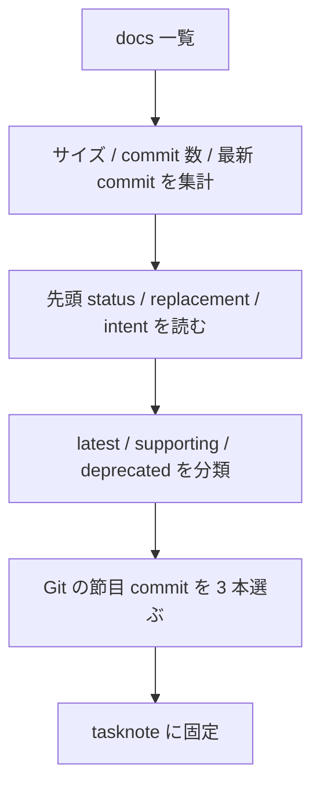

# 2026年5月22日 練習用プロジェクトの正本docsとGit snapshot候補を棚卸しする

> 状態：⑧ Closing 完了
> 次のゲート：（CC）`steering/llm-wiki/child-tasknotes/02-練習用プロジェクトのclosed tasknotes投入候補と順番を固定する.md` を現在日付 tasknote に切り直し、closed tasknotes の投入候補を 30 件程度まで絞る

---

## 1) Journey（どこへ行くか）

> 補足：深層的目的 LLM Wiki の raw/knowledge に何を入れるべきかを先に固定し、古い docs や履歴ノイズで query がぼやけない状態へ進める
> 補足：やらないこと この note では raw への実コピーや chapter 分割、summary 生成までは行わない

1. 前提条件
   1. 💦 `code-quest-pyxel` には `architecture.md` と `ux-policy.md` は存在せず、docs 群は Markdown と YAML にまたがっている
   2. 💦 `architecture_rules.yml` は `status: draft` だが `intended_replacement_for: docs/repository-structure.md` を持ち、機械可読な architecture 正本候補になっている
   3. 💦 `old-customer-jobs.md` のように名前で旧版と分かるものと、`repository-structure.md` のように移行中でまだ捨てられないものが混在している

2. Before
   1. 💦 latest docs と history snapshots の境界が無く、何でも raw に入れてしまうと query が現在の要求と昔の経緯を混同しやすい
   2. 💦 `architecture_rules.yml` と `repository-structure.md` の関係、`customer-jobs.md` と `old-customer-jobs.md` の関係を先に固定できていない
   3. ❌ 迷う

3. After
   1. 💦 latest docs / supporting docs / deprecated docs が分かれ、次の raw/knowledge 取り込み対象が絞れている
   2. ✅ Git 履歴の節目 snapshot 候補が 3 本に絞られ、why-now の経緯を後から足せる
   3. ❤️ 安心

4. 例外
   1. `architecture_rules.yml` は draft なので、最終的な唯一正本と断定はしない。ただし LLM Wiki では architecture 入力の第一候補として扱う
   2. 大型 docs の章分割粒度はこの note で決め切らず、child `04` に持ち越す

5. 境界条件
   1. 今回やるのは棚卸しと分類だけであり、docs の書き換えや raw 取り込みは行わない
   2. `product-requirements-*` は「全部採るか捨てるか」ではなく、area 別 latest docs 群としてまとめて扱う

6. 委任度
   1. 🟢 全体として CC 単独で進められる：docs 一覧・履歴・先頭メタ情報から latest/deprecated の初期分類を決められる
   2. 🟢 CCのみで可：`old-` を deprecated 扱いし、architecture は `architecture_rules.yml + repository-structure.md + framework-rule.md` の 3 層で整理する
   3. 🟡 後で人の判断があり得る：`architecture_rules.yml` の draft をどの時点で sole source に昇格させるか

---

## 2) ユーザーストーリーマップ

> Gherkin の前に、今回の仕事をどの順番で進めるかだけをそろえる。
> 委任度：🟢 棚卸しと初期分類までは CC が進められる
> 残る曖昧さ：大型 docs の章分割粒度は child `04` まで保留

### 話題一覧

#### 話題1：docs 一覧と現況メタを固定する

##### ユーザー：私

1. 当初計画
    1. 👀 `docs/` 直下のファイル一覧を出す
    2. 📏 サイズ、commit 数、最新 commit を並べて「重いもの」と「動きの多いもの」を見分ける
    3. 🧾 先頭の status / replacement / intent を読んで役割を固定する

#### 話題2：latest / supporting / deprecated の三分割を決める

##### ユーザー：私

1. 当初計画
    1. 🟢 現行要求として読む docs を latest に置く
    2. 🟡 移行中・補助的な docs は supporting として残す
    3. 🔴 明らかに旧版のものだけ deprecated に落とす

#### 話題3：Git 履歴の節目 snapshot を 3 本に絞る

##### ユーザー：私

1. 当初計画
    1. 🕰️ docs 命名や構造が切り替わった commit を探す
    2. ✂️ 横断方針が変わった commit を 1〜2 本だけ拾う
    3. 📝 後続 raw/knowledge へ入れる snapshot 候補として理由付きで固定する

---

## 3) Gherkin（完了条件）

> 委任度：🟢 棚卸し結果の記録まで CC が完走できる
> 残る曖昧さ：なし

### シナリオ一覧

- [x] シナリオ1：latest docs の初期集合が定まる

1. 🧱 docs 群には current / draft / old が混在している
2. 🎬 先頭メタとファイル名、履歴密度を見て分類する
3. ✅ raw/knowledge に入れる現行 docs 群が latest として列挙される

- [x] シナリオ2：deprecated docs が 0 か 1 か明確になる

1. 🧱 旧版の docs を誤って latest に混ぜると query が過去の方針を引用する
2. 🎬 明らかな旧版を deprecated として分離する
3. ✅ deprecated に落とす対象が明示され、なぜ落とすかも書かれる

- [x] シナリオ3：history snapshots の節目が 3 本に絞られる

1. 🧱 全 commit を raw に入れるとノイズが多い
2. 🎬 docs 構造変更、方針転換、architecture ガバナンス移行の節目 commit を選ぶ
3. ✅ snapshot 候補が `(commit, file scope, reason)` で記録される

---

## 4) Design（どうやるか）

### 責務分担概要

- `docs/` の現物と先頭メタ情報を正にする
- Git 履歴は「最新の要求」を補う節目だけ拾う
- 分類は `latest_docs / supporting_docs / deprecated / history_snapshots` の 4 つに分ける

### 責務分担概要図

### 責務分担詳細

- `docs/architecture_rules.yml` （➕：machine-readable architecture source candidate。`status: draft` だが `repository-structure.md` の置換先として扱う）
- `docs/repository-structure.md` （➕：人向け architecture detail。移行中の supporting doc として残す）
- `docs/framework-rule.md` （➕：M1-M5 の規約本体。latest docs）
- `docs/customer-jobs.md` （➕：現行 job 定義。latest docs）
- `docs/old-customer-jobs.md` （❌：旧版。deprecated）
- `docs/customer-journeys.md` （➕：体験要求の母体。latest docs）
- `docs/product-requirements-*.md` （➕：area 別 current requirements。latest docs）
- `docs/stakeholder_voices.yml` （➕：draft の supporting knowledge source。traceability 用）
- `docs/story-concepts.md` （➕：ナラティブ補助 source。latest docs の supporting edge）

---

## 5) Tasklist

- [x] `docs/` 直下のファイル一覧を取得した
- [x] 各 docs のサイズ、commit 数、最新 commit を集計した
- [x] 主要 docs の先頭メタと status / replacement を読んだ
- [x] `latest_docs / supporting_docs / deprecated` の初期分類を決めた
- [x] `history_snapshots` 候補を 3 本に絞った

---

## 6) Result（成果物）

### latest_docs

- `docs/framework-rule.md`
  - M1〜M5 の規約本体。履歴 11 commit。現行ルールの読み口として latest 扱い
- `docs/customer-jobs.md`
  - 現行 jobs 定義。履歴 13 commit。`old-customer-jobs.md` の置換後とみなす
- `docs/customer-journeys.md`
  - 体験要求の母体。履歴 25 commit。要求群の根拠として latest 扱い
- `docs/product-requirements-av.md`
- `docs/product-requirements-battle.md`
- `docs/product-requirements-guardrails.md`
- `docs/product-requirements-map.md`
- `docs/product-requirements-narrative.md`
- `docs/product-requirements-platform.md`
  - area 別 current requirements 群。`product-requirements-*` は全部 latest に入れ、後続で area 別に取り込む
- `docs/story-concepts.md`
  - 履歴 1 commit だが 2026-05-07 の CJ44 改訂で新設された narrative 補助 doc。latest 扱い

### supporting_docs

- `docs/architecture_rules.yml`
  - `status: draft`、`intended_replacement_for: docs/repository-structure.md`。architecture 入力の第一候補
- `docs/repository-structure.md`
  - まだ現行参照先として生きている人向け詳細。`architecture_rules.yml` への staged migration 中なので deprecated には落とさない
- `docs/stakeholder_voices.yml`
  - `status: draft`。traceability catalog として有用だが、今回の first-pass latest docs には含めず supporting に置く

### deprecated

- `docs/old-customer-jobs.md`
  - 名前で旧版が明示され、履歴も 1 commit のみ。`docs/customer-jobs.md` を current、こちらを deprecated とする

### history_snapshots

- `9ac794f` `2026-04-22` `docs: move product requirement docs to root`
  - PRD 群が root 配置へ移った最初の大きな docs 再配置。`product-requirements-*` の前史として残す価値が高い
- `4273504` `2026-05-07` `docs(cj44): CJ44「シンプルさは変更速度の前提条件」を新設、関連 6 文書を整合`
  - docs 横断で「シンプルさ優先」へ振れた節目。`story-concepts.md` 新設も含む
- `704767a` `2026-05-09` `refactor: split architecture rule check fix repair`
  - `architecture_rules.yml` と `repository-structure.md` の staged migration を補強する architecture ガバナンスの節目

### deferred_to_later_steps

- 大型 docs の章分割粒度
  - `customer-journeys.md`, `architecture_rules.yml`, `stakeholder_voices.yml`, `product-requirements-guardrails.md` は child `04` で決める
- closed tasknotes の投入候補
  - child `02` で絞る

---

## 7) Discussion（残課題の起票）

### 残課題メモ

- `architecture_rules.yml` は draft だが実務上は第一候補、`repository-structure.md` は人向け詳細として当面併存、という二層運用になる
- `stakeholder_voices.yml` は大きく有用だが、初回 latest docs へ混ぜるとノイズが増えるので supporting に留めた
- 次の実作業は child `02` の current-date 化と、closed tasknotes 候補の一次フィルタ
- 別tasknoteにした場合のタイトル or パス：`steering/done/2026年5月22日 練習用プロジェクトのclosed tasknotes投入候補と順番を固定する.md`

### 反省とルール化

- 記入先：`wiki/README.md`
- 次にやること：latest docs を固定したので、次は closed tasknotes を 30 件程度まで絞る

---

## 8) Closing

- 状態: done
- 次のゲート: `steering/done/2026年5月22日 練習用プロジェクトのclosed tasknotes投入候補と順番を固定する.md` を起票して候補を絞る
- close 条件:
    - [x] latest docs を current / supporting / deprecated に分けた
    - [x] history snapshot 候補を 3 本に絞った
    - [x] 大型 docs の章分割を child `04` へ送ると明記した

---

## 9) 参考文献

- `steering/llm-wiki/child-tasknotes/01-練習用プロジェクトの正本docsとGit snapshot候補を棚卸しする.md`
- `docs/architecture_rules.yml`
- `docs/repository-structure.md`
- `docs/framework-rule.md`
- `docs/customer-jobs.md`
- `docs/old-customer-jobs.md`
- `docs/customer-journeys.md`
- `docs/product-requirements-av.md`
- `docs/product-requirements-battle.md`
- `docs/product-requirements-guardrails.md`
- `docs/product-requirements-map.md`
- `docs/product-requirements-narrative.md`
- `docs/product-requirements-platform.md`
- `docs/stakeholder_voices.yml`
- `docs/story-concepts.md`
- 事実メモ：`git log --follow --oneline -- docs/<file>` による履歴確認
