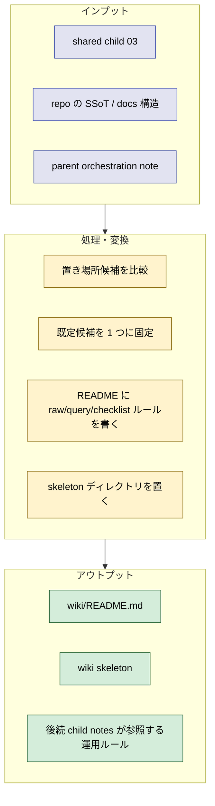

# 2026年5月22日 練習用プロジェクト向けLLM Wiki skeletonと命名ルールを置く

> 状態：⑧ Closing 完了
> 次のゲート：（CC）親 orchestration note から後続の `index.md` / `log.md` 系 tasknote を辿る

---

## 1) Journey（どこへ行くか）

> 補足：深層的目的 LLM Wiki の「どこに置くか」「何を正本にしないか」を先に固定し、以後の ingest/query/checklist 作業が迷走しないようにする
> 補足：やらないこと この note では raw 全投入、summary 生成、checklist 実変換までは行わない

1. 前提条件
   1. 💦 `code-quest-pyxel` では `docs/` が正本であり、wiki 側は generated / snapshot 層として扱うのが自然である
   2. 💦 `steering/llm-wiki/child-tasknotes/03-練習用プロジェクト向けLLM Wiki skeletonと命名ルールを置く.md` は shared package の下書きであり、現在日付の実行 note が別途必要である
   3. 💦 `query は read-only` を運用ルールに落とさないと、後続セッションが自然に raw を更新しに行く危険がある

2. Before
   1. 💦 wiki の置き場所候補が複数あり、`docs/wiki/` や `steering/llm-wiki/wiki/` のような責務混線を招きやすい
   2. 💦 raw をコピーで置くか、参照で済ませるか、generator で作るかが未確定のままになっている
   3. ❌ もどかしい

3. After
   1. 💦 `wiki/` を既定候補にした skeleton と README が置かれ、shared package の議論が実体に接続される
   2. ✅ raw / wiki / query / checklists の境界、YAML 命名、read-only query ルールが読めば分かる
   3. ❤️ スッキリ

4. 例外
   1. 後でユーザーが `wiki/` を repo 直下に置きたいと判断した場合は、この note の既定候補を差し替えてよい
   2. generator ベース方針が重すぎると分かった場合は、pilot として参照方式へ一時退避してよい。ただし `docs/` のコピー二重化は最後の手段にする

5. 境界条件
   1. 今回作るのは skeleton と命名・運用ルールだけであり、actual ingest や summary 生成は child `04` 以降に分離する
   2. query 規約は README に書くが、query 実装そのものは child `06` で扱う

6. 委任度
   1. 🟢 全体として CC 単独で進められる：repo 固有事情と shared package の比較で既定値を決められる
   2. 🟢 CCのみで可：`wiki/` 採用、generator ベース raw 方針、README の運用ルール化
   3. 🟡 後で人の判断が要る：最終的な置き場所の採否、generator 実装の粒度

---

## 2) ユーザーストーリーマップ

> Gherkin の前に、今回の仕事をどの順番で進めるかだけをそろえる。
> 委任度：🟢 skeleton 起票と README 雛形までは CC が進められる
> 残る曖昧さ：最終的に top-level `wiki/` へ戻すかどうか

### 話題一覧

#### 話題1：置き場所を 1 候補に絞る

##### ユーザー：私

1. 当初計画
    1. 👀 候補 `wiki/`, `steering/llm-wiki/wiki/`, `docs/wiki/`, `generated/wiki/` を比較する
    2. 🧭 ユーザー判断を優先して repo 直下 `wiki/` を既定候補にする
    3. 📝 なぜ他候補を採らないかも README に残す

#### 話題2：raw と generated の境界を固定する

##### ユーザー：私

1. 当初計画
    1. ✂️ `raw/knowledge` を `docs/` のコピー正本にしないと決める
    2. 🏗️ `docs/` から `wiki/raw/` を作る generator ベースを既定方針にする
    3. 🔤 YAML raw は `.yml` のまま、summary は同名 `*-summary.md` と決める

#### 話題3：read-only query の運用ルールを明文化する

##### ユーザー：私

1. 当初計画
    1. 📚 README に `query は raw を更新しない` を明文化する
    2. 🔗 query は根拠リンク必須、情報不足は不足と返すと決める
    3. 🧰 raw が古いと判断した場合は maintenance note に送る導線だけ置く

---

## 3) Gherkin（完了条件）

> 委任度：🟢 skeleton と README の整備までは CC が完走できる
> 残る曖昧さ：なし

### シナリオ一覧

- [ ] シナリオ1：wiki の置き場所が 1 候補に固定される

1. 🧱 repo には wiki 置き場の候補が複数ある
2. 🎬 `wiki/` を既定候補として採用し、理由を README に書く
3. ✅ 後続セッションは置き場所の再議論から始めなくてよい

- [ ] シナリオ2：raw と generated の境界が README で読める

1. 🧱 `docs/` が正本である一方、wiki 側も knowledge を持ちたくなる
2. 🎬 raw / wiki / summaries / query / maintenance / checklists の役割を README に書く
3. ✅ 正本二重化と責務混線を避けるルールが明文化される

- [ ] シナリオ3：read-only query の暴走防止ルールが置かれる

1. 🧱 query 実行時に raw を更新しに行くリスクがある
2. 🎬 `Edit` / `Write` 禁止、根拠リンク必須、不足明記、maintenance 退避を README に書く
3. ✅ 後続の query tasknote が raw 更新を「ついで実装」しない

---

## 4) Design（どうやるか）

- **関連スキル・MCP**：`manage-tasknotes`, `writing-plans`

### 【参照】

- Steering: `steering/2026年5月22日 開発基盤：LLM Wiki shared packageを導入して自律実行ルートを固定する.md`
- Steering: `steering/llm-wiki/child-tasknotes/03-練習用プロジェクト向けLLM Wiki skeletonと命名ルールを置く.md`
- Docs: `AGENTS.md`
- Docs: `docs/framework-rule.md`
- Docs: `docs/repository-structure.md`

### 変更範囲

- やること:
  - `wiki/` skeleton と README を置く
  - raw / wiki / query / checklist の境界を README に明文化する
  - YAML naming と read-only query ルールを固定する
- やらないこと:
  - raw への docs 投入
  - summary 生成
  - query 実装
  - checklist 変換

### 検証

- 検証コマンド:
  - `find wiki -maxdepth 3 -type d | sort`
  - `sed -n '1,220p' wiki/README.md`
  - `rg -n 'read-only|root|maintenance|summary' wiki/README.md`
- 成功条件:
  - `wiki/README.md` が存在し、置き場所判断と運用ルールを説明している
  - skeleton の必須ディレクトリが存在する
  - `query` の read-only ルールが明文化されている
- 未実施時の扱い:
  - README が無ければ child `04` 以降へ進まない

---

## 5) Tasklist

- [x] shared child `03` を現在日付 tasknote に切り直した
- [x] `wiki/README.md` を新規作成した
- [x] `wiki/raw/knowledge`, `wiki/raw/tasknotes`, `wiki/wiki/summaries`, `wiki/wiki/indexes`, `wiki/wiki/areas`, `wiki/wiki/query`, `wiki/wiki/candidates`, `wiki/checklists` を作った
- [x] README に置き場所判断、raw 方針、YAML naming、read-only query、maintenance 導線を書いた
- [x] `find wiki -maxdepth 3 -type d | sort` で skeleton を検証した

---

## 6) Result（成果物）

- child `03` の shared 下書きを、`code-quest-pyxel` で実際に進めるための現在日付 tasknote に切り直した
- 最初の既定判断として `wiki/` 採用、generator ベース raw 方針、read-only query ルール明文化を固定した
- `wiki/README.md` を追加し、正本境界・read-only query・YAML naming・layout を明文化した
- `wiki/wiki/maintenance.md` を追加し、query 中に stale source を見つけたときの退避先を固定した
- skeleton の leaf directory を `.gitkeep` 付きで置き、後続の raw/summaries/indexes/query/checklists が作業木上で見えるようにした
- `find wiki -maxdepth 4 -type d | sort` と `rg -n 'read-only|maintenance|summary' wiki/README.md` で skeleton と README の要点を検証した

---

## 7) Discussion（残課題の起票）

### 残課題メモ

- `scripts/commit-tasknote.sh` 不在のため、tasknote 作成直後 commit の運用は repo 側で代替が要る
- この note 自体の deliverable は完了。後続の導線は親 orchestration note と `index.md` / `log.md` 系 note 側で継続する
- 別tasknoteにした場合のタイトル or パス：`steering/2026年5月22日 開発基盤：Karpathy方針でindexとlogの最小形を通す.md`

### 反省とルール化

- 記入先：`wiki/README.md`
- 次にやること：親 orchestration note から `index.md` / `log.md` の実生成へ進む

---

## 8) 参考文献

- `steering/llm-wiki/child-tasknotes/03-練習用プロジェクト向けLLM Wiki skeletonと命名ルールを置く.md`
- `steering/2026年5月22日 開発基盤：LLM Wiki shared packageを導入して自律実行ルートを固定する.md`
- `AGENTS.md`
- `docs/framework-rule.md`
- `docs/repository-structure.md`
