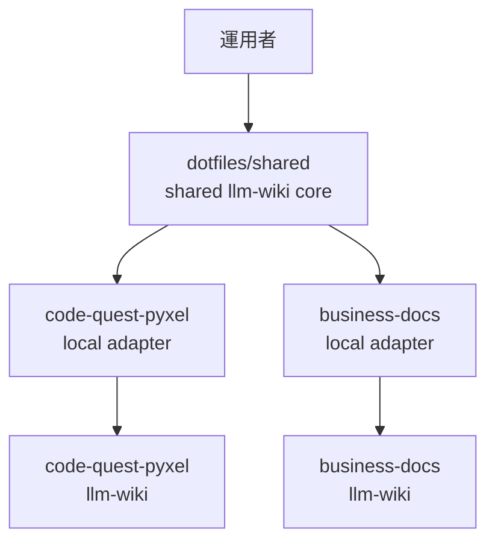

# 2026年5月24日 共有LLM Wikiコアとリポジトリアダプタ設計

> 状態：⑧ Closing
> 次のゲート：（ユーザー）`business-docs` 側 pilot をこの tasknote の続きで進めるか、別 tasknote に切り出すか 1 点だけ決める

---

## 1) Journey（どこへ行くか）

> 補足：深層的目的 別 VM の repo でも同じ LLM Wiki の運用力を再利用できる状態にする
> 補足：やらないこと 初回から batch ingest や repo 文化の統一まで広げない

1. 前提条件
   1. 💦 `code-quest-pyxel` には既存の `llm-wiki/` と skill 群がある
   2. 💦 `business-docs` は別 VM だが `dotfiles` は共有されている
   3. 💦 `business-docs` にも既存の `llm-wiki/` がある

2. Before
   1. 💦 shared にしたい skill / script / schema の境界が repo に埋まっている
   2. 💦 `query / health-check / update-schema` は共通化しやすい
   3. 💦 `tasknote ingest` は一部共通化したいが batch は repo 依存が強い
   4. ❌ 混ざりそうで不安

3. After
   1. 💦 shared core は `dotfiles/shared` に集約される
   2. ✅ 各 repo は path と required sections だけを持つ local adapter で shared core を使う
   3. ✅ `code-quest-pyxel` と `business-docs` の両方で同じ core を検証できる
   4. ❤️ 安心

4. 例外
   1. `business-docs` 側の tasknote 形式差分が大きい場合は tasknote ingest の shared 化を縮退する
   2. adapter に行動分岐が増え始めた場合は shared scope を縮める

5. 境界条件
   1. 初回共有化の対象は `query / health-check / update-schema / 単発 tasknote ingest` に限る
   2. `steering oldest 10 batch mode` のような batch helper は local に残す
   3. repo ごとの wiki の意味づけは統一しない

6. 委任度
   1. 🟡 全体としては大筋委任可だが、shared と local の境界だけは人と揃える
   2. 🟢 CCのみで可: tasknote 形式への整形と計画化
   3. 🔴 人の判断: shared core に何を入れないかの最終線引き

---

## 2) ユーザーストーリーマップ

> 今回は実装前に、shared core と local adapter の切り分けを先に固定する。
> 委任度：🟡 rollout の骨格は固まったが、移植先 repo の細部は実物確認が残る
> 残る曖昧さ：`business-docs` 側の tasknote section 名が `code-quest-pyxel` と一致するかは未確認

### 話題一覧

#### 話題1：shared に入れるものを絞る

##### ユーザー：llm-wiki 運用者

1. 当初計画
   1. 👀 `query / health-check / update-schema` を shared 候補として固定する
   2. 👀 単発 `tasknote ingest` を shared 候補に含める
   3. ✂️ batch ingest は local に残す

#### 話題2：repo adapter の責務を最小にする

##### ユーザー：llm-wiki 運用者

1. 当初計画
   1. 👀 adapter は path mapping だけを持つ
   2. 👀 content shape は `required sections` だけ許可する
   3. ✂️ free-form な行動上書きは adapter に入れない

#### 話題3：初回 rollout を 2 repo で通す

##### ユーザー：llm-wiki 運用者

1. 当初計画
   1. 👀 先に `code-quest-pyxel` で shared core に切り替える
   2. 👀 次に `business-docs` に local adapter を置く
   3. ✅ 両 repo で代表 workflow を 1 回ずつ通す

---

## 3) Gherkin（完了条件）

> 委任度：🟢 implementation plan の手前までは CC が進められる
> 残る曖昧さ：なし

### シナリオ一覧

- [x] シナリオ1-1：shared core の対象 workflow が 4 本に固定される

1. 🧱 既存の `llm-wiki` skill / helper に shared 候補と local 候補が混在している
2. 🎬 shared core の初回対象を整理する
3. ✅ shared core の初回対象が `query / health-check / update-schema / 単発 tasknote ingest` に固定される

```gherkin
Given `code-quest-pyxel` には既存の `llm-wiki` skill と helper script がある
And repo ごとの path や tasknote 文化が一部埋め込まれている
When shared core の初回対象を切り分ける
Then shared core に含める workflow は `query` `health-check` `update-schema` `単発 tasknote ingest` の 4 本になる
And batch ingest helper は local に残る
```

- [x] シナリオ1-2：local adapter の責務が path と required sections に限定される

1. 🧱 shared core は repo ごとの差分を吸収する必要がある
2. 🎬 local adapter に持たせる項目を定義する
3. ✅ adapter は path mapping と `required sections` だけを持つ

```gherkin
Given `code-quest-pyxel` と `business-docs` では `llm-wiki/` の運用文脈が異なる
When shared core が repo 差分を受け取る最小単位を定義する
Then local adapter は raw root や summary root などの path mapping を持つ
And tasknote の `required sections` を持つ
And repo ごとの自由な行動分岐は adapter に持ち込まない
```

- [x] シナリオ1-3：`code-quest-pyxel` が shared core に切り替わっても既存 workflow が壊れない

1. 🧱 `code-quest-pyxel` は shared 化前の基準 repo である
2. 🎬 local adapter を介して shared core を使う
3. ✅ 代表 workflow 4 本が従来どおり動く

```gherkin
Given `code-quest-pyxel` に existing `llm-wiki/` と schema がある
When repo-local path と section 情報を local adapter へ寄せて shared core を使う
Then `query` `health-check` `update-schema` `単発 tasknote ingest` の代表ケースが継続して動く
And shared core に repo 名ベースの条件分岐は増えない
```

- [ ] シナリオ1-4：`business-docs` が同じ shared core を local adapter だけで使える

1. 🧱 `business-docs` は別 VM にあるが `dotfiles` は共有されている
2. 🎬 `business-docs` 用の local adapter を追加する
3. ✅ 同じ shared core が `business-docs` の既存 `llm-wiki/` でも動く

```gherkin
Given `business-docs` は別 VM にあり、既存の `llm-wiki/` を持っている
And `dotfiles/shared` は両 VM から参照できる
When `business-docs` に local adapter を置いて shared core を使う
Then `query` `health-check` `update-schema` `単発 tasknote ingest` の最小ケースが動く
And `business-docs` は `code-quest-pyxel` の note 文化をそのまま採用しなくてもよい
```

---

## 4) Design（どうやるか）

### 責務分担概要

- shared core は `dotfiles/shared` に置き、workflow と deterministic helper を持つ
- local adapter は各 repo に置き、path mapping と `required sections` だけを持つ
- local schema は人向けの運用ルールとして残し、adapter は機械向けの薄い設定にする
- batch ingest は初回 shared 対象から外し、repo ごとの helper に残す

### 責務分担概要図



### 責務分担詳細

- `/home/exedev/dotfiles/shared/llm-wiki-core/skills/` （➕：shared `llm-wiki` skills の置き場）
- `/home/exedev/dotfiles/shared/llm-wiki-core/python/` （➕：shared helper script の置き場）
- `/home/exedev/dotfiles/shared/llm-wiki-core/README.md` （➕：別 repo 導入手順の正本）
- `docs/llm-wiki-ops-schema.md` （✏️：schema と adapter の関係を明記する）
- `tools/llm_wiki_health_check_helper.py` （✏️：shared helper へ移せる部分を切り出す元実装）
- `tools/llm_wiki_tasknote_helper.py` （✏️：shared helper へ移せる単発 tasknote ingest の元実装）
- `tools/llm_wiki_steering_batch_helper.py` （✏️：初回は local のまま残す batch helper）

### 【参照】

- CurrentSchema: `docs/llm-wiki-ops-schema.md`
- SharedSkillQuery: `~/dotfiles/claude/.claude/skills/llm-wiki-query/SKILL.md`
- SharedSkillHealthCheck: `~/dotfiles/claude/.claude/skills/llm-wiki-health-check/SKILL.md`
- SharedSkillUpdateSchema: `~/dotfiles/claude/.claude/skills/llm-wiki-update-schema/SKILL.md`
- SharedSkillIngest: `~/dotfiles/claude/.claude/skills/llm-wiki-capture-and-ingest-source/SKILL.md`
- KarpathyRaw: `llm-wiki/raw/knowledge/2026-04-04-karpathy-llm-wiki.md`

### 変更範囲

- やること:
  - shared 化できる workflow と helper の境界を明文化する
  - local adapter の責務を path と `required sections` に固定する
  - `code-quest-pyxel` と `business-docs` を通す rollout 順序を決める
- やらないこと:
  - batch ingest helper の共通化
  - repo ごとの wiki の意味づけ統一
  - adapter に複雑な行動分岐を入れること

### 検証

- 検証コマンド:
  - `python tools/llm_wiki_health_check_helper.py --repo-root . --current-date 2026-05-24`
  - `python tools/llm_wiki_tasknote_helper.py llm-wiki/raw/tasknotes/done/20260412-g12-rebuild-codemaker-zip.md`
  - `python -m pytest test/test_llm_wiki_health_check_helper.py -q`
  - `python -m pytest test/test_llm_wiki_tasknote_helper.py -q`
- 成功条件:
  - `code-quest-pyxel` で health-check helper と tasknote helper の基準挙動を再確認できる
  - この tasknote の Tasklist だけで shared 化対象と local 残し対象を曖昧なく実行できる
- 未実施時の扱い:
  - 今回は design tasknote のため未実施でもよいが、implementation 前には必ず実行する

---

## 5) Tasklist

> 実装時は `superpowers:subagent-driven-development` か `superpowers:executing-plans` を必ず使う。
> 方針は `TDD`、repo ごとの差分は `llm-wiki/adapter.yml` の path と section 名だけに閉じる。
> 実績: Task 1 から Task 5 までは完了。Task 6 は別 VM のため handoff 待ち。

### Task 1：adapter 契約と shared core の骨組みを作る

**Files:**
- Create: `/home/exedev/dotfiles/shared/llm-wiki-core/README.md`
- Create: `/home/exedev/dotfiles/shared/llm-wiki-core/python/adapter.py`
- Create: `llm-wiki/adapter.yml`
- Test: `test/test_llm_wiki_adapter.py`

- [x] **Step 1: adapter loader の failing test を書く**

```python
from pathlib import Path
import sys
import textwrap

SHARED_CORE = Path.home() / "dotfiles/shared/llm-wiki-core/python"
if str(SHARED_CORE) not in sys.path:
    sys.path.insert(0, str(SHARED_CORE))

from adapter import load_adapter


def test_load_adapter_reads_named_tasknote_sections(tmp_path: Path) -> None:
    adapter_path = tmp_path / "llm-wiki/adapter.yml"
    adapter_path.parent.mkdir(parents=True, exist_ok=True)
    adapter_path.write_text(
        textwrap.dedent(
            """\
            raw_root: llm-wiki/raw
            summary_root: llm-wiki/wiki/summaries
            master_index_path: llm-wiki/wiki/indexes/master-index.md
            source_inbox_path: llm-wiki/wiki/logs/source-inbox.md
            ingest_log_path: llm-wiki/wiki/logs/ingest-log.md
            health_check_log_path: llm-wiki/wiki/logs/health-check-log.md
            area_root: llm-wiki/wiki/areas
            query_root: llm-wiki/wiki/query
            candidate_root: llm-wiki/wiki/candidates
            tasknote_required_sections:
              result: Result
              discussion: Discussion
              closing: Closing
            """
        ),
        encoding="utf-8",
    )

    adapter = load_adapter(tmp_path)

    assert adapter.raw_root == "llm-wiki/raw"
    assert adapter.tasknote_required_sections["discussion"] == "Discussion"
    assert adapter.tasknote_summary_root == "llm-wiki/wiki/summaries/tasknotes"
```

- [x] **Step 2: test が落ちることを確認する**

Run: `python -m pytest test/test_llm_wiki_adapter.py::test_load_adapter_reads_named_tasknote_sections -q`
Expected: `ModuleNotFoundError` か `FileNotFoundError` で fail する。

- [x] **Step 3: shared adapter loader を最小実装する**

```python
from __future__ import annotations

from dataclasses import dataclass
from pathlib import Path

import yaml

_REQUIRED_KEYS = (
    "raw_root",
    "summary_root",
    "master_index_path",
    "source_inbox_path",
    "ingest_log_path",
    "health_check_log_path",
    "area_root",
    "query_root",
    "candidate_root",
    "tasknote_required_sections",
)


@dataclass(frozen=True)
class LlmWikiAdapter:
    raw_root: str
    summary_root: str
    master_index_path: str
    source_inbox_path: str
    ingest_log_path: str
    health_check_log_path: str
    area_root: str
    query_root: str
    candidate_root: str
    tasknote_required_sections: dict[str, str]

    @property
    def knowledge_summary_root(self) -> str:
        return f"{self.summary_root}/knowledge"

    @property
    def tasknote_summary_root(self) -> str:
        return f"{self.summary_root}/tasknotes"


def load_adapter(repo_root: Path, relpath: str = "llm-wiki/adapter.yml") -> LlmWikiAdapter:
    payload = yaml.safe_load((repo_root / relpath).read_text(encoding="utf-8")) or {}
    missing = [key for key in _REQUIRED_KEYS if key not in payload]
    if missing:
        raise ValueError(f"missing adapter keys: {', '.join(missing)}")
    return LlmWikiAdapter(**payload)
```

- [x] **Step 4: code-quest-pyxel 用 adapter を追加する**

```yaml
raw_root: llm-wiki/raw
summary_root: llm-wiki/wiki/summaries
master_index_path: llm-wiki/wiki/indexes/master-index.md
source_inbox_path: llm-wiki/wiki/logs/source-inbox.md
ingest_log_path: llm-wiki/wiki/logs/ingest-log.md
health_check_log_path: llm-wiki/wiki/logs/health-check-log.md
area_root: llm-wiki/wiki/areas
query_root: llm-wiki/wiki/query
candidate_root: llm-wiki/wiki/candidates
tasknote_required_sections:
  result: Result
  discussion: Discussion
  closing: Closing
```

- [x] **Step 5: shared core README を追加する**

```md
# llm-wiki-core

Cross-repo shared helpers for llm-wiki workflows.

## Shared now
- adapter contract
- health-check helper
- raw tasknote helper

## Still local
- steering oldest 10 batch ingest
- repo-specific batch selection policy
- repo-specific related page ranking rules

## Import rule
Repo-local wrappers add `/home/exedev/dotfiles/shared/llm-wiki-core/python`
to `sys.path` and import shared modules from there.
```

- [x] **Step 6: adapter test を再実行する**

Run: `python -m pytest test/test_llm_wiki_adapter.py -q`
Expected: `1 passed` と出る。

- [x] **Step 7: commit する**

```bash
git add /home/exedev/dotfiles/shared/llm-wiki-core/README.md
git add /home/exedev/dotfiles/shared/llm-wiki-core/python/adapter.py
git add llm-wiki/adapter.yml test/test_llm_wiki_adapter.py
git commit -m "feat: add llm-wiki adapter contract"
```

### Task 2：health-check helper を shared core へ切り出す

**Files:**
- Create: `/home/exedev/dotfiles/shared/llm-wiki-core/python/llm_wiki_health_check_helper.py`
- Modify: `tools/llm_wiki_health_check_helper.py`
- Modify: `test/test_llm_wiki_health_check_helper.py`
- Test: `test/test_llm_wiki_health_check_helper.py`

- [x] **Step 1: adapter 対応の failing test を先に足す**

```python
def test_prepare_health_check_material_uses_adapter_paths(tmp_path: Path) -> None:
    adapter_path = tmp_path / "llm-wiki/adapter.yml"
    adapter_path.parent.mkdir(parents=True, exist_ok=True)
    adapter_path.write_text(
        "\n".join(
            [
                "raw_root: llm-wiki/raw",
                "summary_root: llm-wiki/wiki/summaries",
                "master_index_path: knowledge/wiki/indexes/start.md",
                "source_inbox_path: knowledge/wiki/logs/source-inbox.md",
                "ingest_log_path: knowledge/wiki/logs/ingest-log.md",
                "health_check_log_path: knowledge/wiki/logs/health-check-log.md",
                "area_root: knowledge/wiki/areas",
                "query_root: knowledge/wiki/query",
                "candidate_root: knowledge/wiki/candidates",
                "tasknote_required_sections:",
                "  result: Result",
                "  discussion: Discussion",
                "  closing: Closing",
            ]
        ),
        encoding="utf-8",
    )
    _write_page(
        tmp_path / "knowledge/wiki/indexes/start.md",
        "# Start\n\n- [Topic A](../areas/topic-a.md)\n",
    )
    _write_page(tmp_path / "knowledge/wiki/areas/topic-a.md", "# Topic A\n")
    _write_page(tmp_path / "knowledge/wiki/logs/health-check-log.md", "# Log\n")

    payload = prepare_health_check_material(tmp_path, current_date="2026-05-24")

    assert payload["graph_entrypoints"] == ["knowledge/wiki/indexes/start.md"]
    assert payload["scope_paths"][0] == "knowledge/wiki/indexes/start.md"
```

- [x] **Step 2: 新しい test が落ちることを確認する**

Run: `python -m pytest test/test_llm_wiki_health_check_helper.py::test_prepare_health_check_material_uses_adapter_paths -q`
Expected: 既定 path 固定のため assertion error で fail する。

- [x] **Step 3: shared helper を追加し、adapter 優先の scope 解決へ変える**

```python
from adapter import load_adapter


def _default_scope_paths(repo_root: Path) -> tuple[tuple[str, ...], list[str]]:
    adapter_path = repo_root / "llm-wiki/adapter.yml"
    if adapter_path.exists():
        adapter = load_adapter(repo_root)
        return (
            (
                adapter.master_index_path,
                f"{adapter.area_root}/*.md",
                f"{adapter.query_root}/*.md",
                f"{adapter.knowledge_summary_root}/*.md",
                adapter.health_check_log_path,
            ),
            [adapter.master_index_path],
        )
    return _DEFAULT_SCOPE_PATHS, [_GRAPH_ENTRYPOINT]


def _detect_scope(
    repo_root: Path,
    scope_hint: str | None,
) -> tuple[str, list[str], list[Path], list[str]]:
    if scope_hint:
        hinted_path = repo_root / scope_hint
        candidate_paths = _expand_scope_hint(hinted_path)
        relative_scope = _to_repo_relative(repo_root, hinted_path)
        graph_entrypoints = [relative_scope] if hinted_path.is_file() else []
        return scope_hint, [relative_scope], candidate_paths, graph_entrypoints

    scope_paths, graph_entrypoints = _default_scope_paths(repo_root)
    candidate_paths: list[Path] = []
    for scope_path in scope_paths:
        candidate_paths.extend((repo_root / "dummy").parent.glob(scope_path))
    candidate_paths = sorted({path.resolve(): path for path in candidate_paths}.values())
    return "current wiki", list(scope_paths), candidate_paths, graph_entrypoints
```

- [x] **Step 4: repo-local wrapper を thin wrapper に置き換える**

```python
from __future__ import annotations

import sys
from pathlib import Path

_SHARED_CORE = Path.home() / "dotfiles/shared/llm-wiki-core/python"
if str(_SHARED_CORE) not in sys.path:
    sys.path.insert(0, str(_SHARED_CORE))

from llm_wiki_health_check_helper import main, prepare_health_check_material


if __name__ == "__main__":
    raise SystemExit(main())
```

- [x] **Step 5: health-check helper の test 全体を通す**

Run: `python -m pytest test/test_llm_wiki_health_check_helper.py -q`
Expected: 既存 3 件 + adapter 追加分が pass する。

- [x] **Step 6: CLI の smoke を取る**

Run: `python tools/llm_wiki_health_check_helper.py --repo-root . --current-date 2026-05-24 | head`
Expected: JSON 先頭に `"scope_label": "current wiki"` と `"log_scaffold"` が含まれる。

- [x] **Step 7: commit する**

```bash
git add /home/exedev/dotfiles/shared/llm-wiki-core/python/llm_wiki_health_check_helper.py
git add tools/llm_wiki_health_check_helper.py
git add test/test_llm_wiki_health_check_helper.py
git commit -m "feat: share llm-wiki health-check helper"
```

### Task 3：tasknote helper を shared core へ切り出す

**Files:**
- Create: `/home/exedev/dotfiles/shared/llm-wiki-core/python/llm_wiki_tasknote_helper.py`
- Modify: `tools/llm_wiki_tasknote_helper.py`
- Modify: `test/test_llm_wiki_tasknote_helper.py`
- Test: `test/test_llm_wiki_tasknote_helper.py`

- [x] **Step 1: section 名 mapping の failing test を足す**

```python
def test_prepare_raw_tasknote_uses_adapter_section_mapping(tmp_path: Path) -> None:
    adapter_path = tmp_path / "llm-wiki/adapter.yml"
    adapter_path.parent.mkdir(parents=True, exist_ok=True)
    adapter_path.write_text(
        "\n".join(
            [
                "raw_root: llm-wiki/raw",
                "summary_root: llm-wiki/wiki/summaries",
                "master_index_path: llm-wiki/wiki/indexes/master-index.md",
                "source_inbox_path: llm-wiki/wiki/logs/source-inbox.md",
                "ingest_log_path: llm-wiki/wiki/logs/ingest-log.md",
                "health_check_log_path: llm-wiki/wiki/logs/health-check-log.md",
                "area_root: llm-wiki/wiki/areas",
                "query_root: llm-wiki/wiki/query",
                "candidate_root: llm-wiki/wiki/candidates",
                "tasknote_required_sections:",
                "  result: Outcome",
                "  discussion: Notes",
                "  closing: Wrap Up",
            ]
        ),
        encoding="utf-8",
    )
    raw_path = tmp_path / "llm-wiki/raw/tasknotes/done/20260524-sample.md"
    raw_path.parent.mkdir(parents=True, exist_ok=True)
    raw_path.write_text(
        "---\nstatus: open\n---\n\n# Sample\n\n## 4) Tasklist\n- [ ] one\n\n## 6) Outcome\n- fixed\n\n## 7) Notes\n- explain why\n\n## 8) Wrap Up\n- next gate\n",
        encoding="utf-8",
    )

    payload = prepare_raw_tasknote(raw_path)

    assert payload["result_facts"] == ["fixed"]
    assert payload["discussion_points"] == ["explain why"]
    assert payload["closing_points"] == ["next gate"]
    assert payload["missing_sections"] == []
```

- [x] **Step 2: test が落ちることを確認する**

Run: `python -m pytest test/test_llm_wiki_tasknote_helper.py::test_prepare_raw_tasknote_uses_adapter_section_mapping -q`
Expected: `Outcome` / `Notes` / `Wrap Up` を拾えず fail する。

- [x] **Step 3: shared helper に adapter aware な section 解決を入れる**

```python
from adapter import load_adapter


def _load_tasknote_section_names(raw_tasknote_path: Path) -> dict[str, str]:
    for parent in (raw_tasknote_path.resolve(), *raw_tasknote_path.resolve().parents):
        adapter_path = parent / "llm-wiki/adapter.yml"
        if adapter_path.exists():
            return load_adapter(parent).tasknote_required_sections
    return {
        "result": "Result",
        "discussion": "Discussion",
        "closing": "Closing",
    }


def _normalize_section_name(heading: str, section_names: dict[str, str]) -> str:
    stripped = heading.strip()
    matched = re.match(r"^\d+[\.\)]\s*(.+)$", stripped)
    if matched:
        stripped = matched.group(1).strip()
    if "Tasklist" in stripped:
        return "Tasklist"
    for semantic_name, section_label in section_names.items():
        if section_label.lower() in stripped.lower():
            return semantic_name.capitalize()
    return stripped
```

- [x] **Step 4: repo-local wrapper を thin wrapper に置き換える**

```python
from __future__ import annotations

import sys
from pathlib import Path

_SHARED_CORE = Path.home() / "dotfiles/shared/llm-wiki-core/python"
if str(_SHARED_CORE) not in sys.path:
    sys.path.insert(0, str(_SHARED_CORE))

from llm_wiki_tasknote_helper import main, prepare_raw_tasknote, prepare_tasknote_material


if __name__ == "__main__":
    raise SystemExit(main())
```

- [x] **Step 5: tasknote helper の test 全体を通す**

Run: `python -m pytest test/test_llm_wiki_tasknote_helper.py -q`
Expected: 既存 4 件 + adapter 追加分が pass する。

- [x] **Step 6: 実データで CLI smoke を取る**

Run: `python tools/llm_wiki_tasknote_helper.py llm-wiki/raw/tasknotes/done/20260412-g12-rebuild-codemaker-zip.md | head`
Expected: JSON 先頭に `"source_id"` と `"summary_draft_path"` が含まれる。

- [x] **Step 7: batch helper 非共有を固定したまま commit する**

```bash
git add /home/exedev/dotfiles/shared/llm-wiki-core/python/llm_wiki_tasknote_helper.py
git add tools/llm_wiki_tasknote_helper.py
git add test/test_llm_wiki_tasknote_helper.py
git commit -m "feat: share llm-wiki tasknote helper"
```

### Task 4：schema と skill を adapter 前提へそろえる

**Files:**
- Modify: `docs/llm-wiki-ops-schema.md`
- Modify: `~/dotfiles/claude/.claude/skills/llm-wiki-query/SKILL.md`
- Modify: `~/dotfiles/claude/.claude/skills/llm-wiki-health-check/SKILL.md`
- Modify: `~/dotfiles/claude/.claude/skills/llm-wiki-update-schema/SKILL.md`
- Modify: `~/dotfiles/claude/.claude/skills/llm-wiki-capture-and-ingest-source/SKILL.md`
- Test: `rg` による文面確認

- [x] **Step 1: schema に adapter の役割を明記する**

```md
## Adapter Contract

- machine-readable path と tasknote section 名は `llm-wiki/adapter.yml` に置く
- human-readable な運用 rule は `docs/llm-wiki-ops-schema.md` に置く
- skill / helper は adapter を path 解決の SSoT とし、運用判断は schema を読む
- adapter に repo 名条件分岐や workflow policy を入れない
```

- [x] **Step 2: skill 4 本の internal helper 記述を揃える**

```md
- local adapter は `llm-wiki/adapter.yml` を優先して読む
- local schema の優先順は `AGENTS.md` `CLAUDE.md` `docs/llm-wiki-ops-schema.md`
- adapter は path と tasknote section 名だけを決め、route の意味判断は skill に残す
```

- [x] **Step 3: capture skill の tasknote helper 前提を書き換える**

```md
- tasknote の `raw-source-path mode` では
  `python tools/llm_wiki_tasknote_helper.py <raw_tasknote_path>` を先に実行し、
  adapter が返す section 名 mapping に従って
  `result_facts` `discussion_points` `closing_points` を構造化材料として受け取る
```

- [x] **Step 4: skill / schema 文面を grep で確認する**

Run: `rg -n "adapter.yml|tasknote section|tasknote_required_sections" docs/llm-wiki-ops-schema.md ~/dotfiles/claude/.claude/skills/llm-wiki-*.md`
Expected: schema 1 箇所以上、skill 4 本すべてで adapter 記述が見つかる。

- [x] **Step 5: commit する**

```bash
git add docs/llm-wiki-ops-schema.md
git add ~/dotfiles/claude/.claude/skills/llm-wiki-query/SKILL.md
git add ~/dotfiles/claude/.claude/skills/llm-wiki-health-check/SKILL.md
git add ~/dotfiles/claude/.claude/skills/llm-wiki-update-schema/SKILL.md
git add ~/dotfiles/claude/.claude/skills/llm-wiki-capture-and-ingest-source/SKILL.md
git commit -m "docs: document llm-wiki adapter contract"
```

### Task 5：code-quest-pyxel 側の切替を検証する

**Files:**
- Modify: `test/test_llm_wiki_steering_batch_helper.py`（変更が必要な場合のみ）
- Test: `test/test_llm_wiki_adapter.py`
- Test: `test/test_llm_wiki_health_check_helper.py`
- Test: `test/test_llm_wiki_tasknote_helper.py`
- Test: `test/test_llm_wiki_steering_batch_helper.py`

- [x] **Step 1: shared 化した 3 本の test をまとめて回す**

Run: `python -m pytest test/test_llm_wiki_adapter.py test/test_llm_wiki_health_check_helper.py test/test_llm_wiki_tasknote_helper.py -q`
Expected: すべて pass する。

- [x] **Step 2: batch helper が壊れていないことも確認する**

Run: `python -m pytest test/test_llm_wiki_steering_batch_helper.py -q`
Expected: 既存 test がそのまま pass する。

- [x] **Step 3: helper CLI を 2 本とも smoke する**

Run: `python tools/llm_wiki_health_check_helper.py --repo-root . --current-date 2026-05-24 > /tmp/health.json`
Expected: `/tmp/health.json` に `scope_paths` `active_page_paths` `log_scaffold` が入る。

Run: `python tools/llm_wiki_tasknote_helper.py llm-wiki/raw/tasknotes/done/20260412-g12-rebuild-codemaker-zip.md > /tmp/tasknote.json`
Expected: `/tmp/tasknote.json` に `source_id` `summary_draft_path` `discussion_points` が入る。

- [x] **Step 4: repo 名分岐の混入を grep で止める**

Run: `rg -n "repo ==|business-docs|code-quest-pyxel" /home/exedev/dotfiles/shared/llm-wiki-core/python tools/llm_wiki_*.py`
Expected: `business-docs` と `code-quest-pyxel` の文字列は test か tasknote 以外に出ない。

- [x] **Step 5: commit する**

```bash
git add test/test_llm_wiki_adapter.py
git add test/test_llm_wiki_health_check_helper.py
git add test/test_llm_wiki_tasknote_helper.py
git add test/test_llm_wiki_steering_batch_helper.py
git commit -m "test: verify shared llm-wiki helpers in code-quest-pyxel"
```

### Task 6：business-docs で pilot を通す

**Files:**
- Create: `business-docs/llm-wiki/adapter.yml`
- Create: `business-docs/llm-wiki/raw/tasknotes/done/20260524-adapter-smoke.md`
- Modify: `business-docs/docs/llm-wiki-ops-schema.md`
- Test: `business-docs/tools/llm_wiki_health_check_helper.py`
- Test: `business-docs/tools/llm_wiki_tasknote_helper.py`

- [ ] **Step 1: business-docs 用 adapter を置く**

```yaml
raw_root: llm-wiki/raw
summary_root: llm-wiki/wiki/summaries
master_index_path: llm-wiki/wiki/indexes/master-index.md
source_inbox_path: llm-wiki/wiki/logs/source-inbox.md
ingest_log_path: llm-wiki/wiki/logs/ingest-log.md
health_check_log_path: llm-wiki/wiki/logs/health-check-log.md
area_root: llm-wiki/wiki/areas
query_root: llm-wiki/wiki/query
candidate_root: llm-wiki/wiki/candidates
tasknote_required_sections:
  result: Result
  discussion: Discussion
  closing: Closing
```

- [ ] **Step 2: pilot 用の smoke tasknote を 1 本作る**

```md
---
status: done
dateCreated: 2026-05-24T09:00:00.000+00:00
scheduled: 2026-05-24T09:00:00.000+00:00
---

# 2026年5月24日 Adapter Smoke

## 4) Tasklist
- [x] adapter smoke を実行した

## 6) Result
- shared helper が business-docs の raw tasknote を読めることを確認した

## 7) Discussion
- adapter 導入だけで section 抽出は壊れなかった

## 8) Closing
- 状態: done
```

- [ ] **Step 3: helper 2 本の smoke を取る**

Run: `python tools/llm_wiki_health_check_helper.py --repo-root . --current-date 2026-05-24 | head`
Expected: `scope_label` と `log_scaffold` を含む JSON が出る。

Run: `python tools/llm_wiki_tasknote_helper.py llm-wiki/raw/tasknotes/done/20260524-adapter-smoke.md | head`
Expected: `source_id` と `summary_draft_path` を含む JSON が出る。

- [ ] **Step 4: 代表 workflow 4 本を 1 回ずつ通す**

Run: `llm-wiki-query`
Expected: adapter path から `master-index` `areas` `summaries` を辿って answer preview を返せる。

Run: `llm-wiki-health-check`
Expected: adapter path を使った `health-check-log` preview を組み立てられる。

Run: `llm-wiki-update-schema`
Expected: adapter path を使いながら、人向け rule source は schema 文書を読む。

Run: `llm-wiki-capture-and-ingest-source`
Expected: raw tasknote ingest で section 名 mapping が崩れない。

- [ ] **Step 5: pilot 結果を 4 行で残す**

```md
- shared で動いたもの: `query` `health-check` `update-schema` `tasknote ingest`
- local adapter だけで吸収できた差分: tasknote section label が違う場合は `tasknote_required_sections` の値だけを変える
- local のまま残したもの: `steering oldest 10 batch ingest`
- 次に shared 化しないもの: repo 名条件分岐を shared core に入れる案
```

- [ ] **Step 6: business-docs 側で commit する**

```bash
git add llm-wiki/adapter.yml llm-wiki/raw/tasknotes/done/20260524-adapter-smoke.md
git add docs/llm-wiki-ops-schema.md
git commit -m "feat: adopt shared llm-wiki adapter"
```

---

## 6) Result

- `code-quest-pyxel` には `llm-wiki/adapter.yml` と `test/test_llm_wiki_adapter.py` を追加した。
- `tools/llm_wiki_health_check_helper.py` と `tools/llm_wiki_tasknote_helper.py` は shared helper を読む thin wrapper に置き換えた。
- `tools/llm_wiki_steering_batch_helper.py` は local のまま残しつつ、shared adapter 契約に合わせた CLI fallback を追加した。
- `/home/exedev/dotfiles/shared/llm-wiki-core/` に `README.md`、`python/adapter.py`、`python/llm_wiki_health_check_helper.py`、`python/llm_wiki_tasknote_helper.py` を追加した。
- `docs/llm-wiki-ops-schema.md` と `~/dotfiles/claude/.claude/skills/llm-wiki-*.md` は adapter aware に更新済みで、pilot checklist も shared README に追加した。
- helper 系の targeted test は `python -m pytest test/test_llm_wiki_adapter.py test/test_llm_wiki_health_check_helper.py test/test_llm_wiki_tasknote_helper.py test/test_llm_wiki_steering_batch_helper.py -q` で `14 passed in 0.36s` だった。
- merge 後の repo 全体検証は `python -m pytest test/ -q` で `692 passed, 2 skipped, 38 deselected, 14233 subtests passed in 3.41s` だった。
- local 実装は `main` に merge 済みで、merge commit は `38d9f22` だった。
- `business-docs` 側 pilot は未実施で、この VM では実物確認できていない。

---

## 7) Discussion

- `query / health-check / update-schema` は repo 文化差分が小さく、shared core に切り出しても repo 名条件分岐を増やさずに済んだ。
- `tasknote ingest` も section 名差分を `tasknote_required_sections` に閉じ込めれば shared 化できたので、adapter の責務は path と required sections で足りた。
- `steering oldest 10 batch mode` は `code-quest-pyxel` 文化との結合が強く、local に残した判断は妥当だった。
- schema は人向け運用ルール、adapter は機械向け設定として分けたことで、repo ごとの llm-wiki の意味づけは混ぜずに済んだ。
- `business-docs` 側は別 VM なので、この tasknote では shared core の local 実装完了と remote pilot handoff を分けて扱うのが安全だった。

---

## 8) Closing

- 状態: open
- 次のゲート: `business-docs` 側 pilot をこの tasknote の続きで進めるか、別 tasknote へ handoff するかを決める
- close 条件:
  - [x] `code-quest-pyxel` 側の shared core 実装と merge が完了している
  - [x] local 検証結果が tasknote に事実として残っている
  - [ ] `business-docs` 側 pilot を実行するか、別 tasknote へ handoff する整理が終わっている

---

## 9) 参考文献

- `docs/llm-wiki-ops-schema.md`
- `llm-wiki/raw/knowledge/2026-04-04-karpathy-llm-wiki.md`
- `llm-wiki/wiki/summaries/knowledge/2026-04-04-karpathy-llm-wiki-summary.md`
- `llm-wiki/wiki/areas/ingest-query-lint-loop.md`
- `llm-wiki/wiki/areas/schema-driven-wiki-maintainer.md`
- `~/dotfiles/claude/.claude/skills/llm-wiki/SKILL.md`
- `~/dotfiles/claude/.claude/skills/llm-wiki-query/SKILL.md`
- `~/dotfiles/claude/.claude/skills/llm-wiki-health-check/SKILL.md`
- `~/dotfiles/claude/.claude/skills/llm-wiki-update-schema/SKILL.md`
- `~/dotfiles/claude/.claude/skills/llm-wiki-capture-and-ingest-source/SKILL.md`
- `~/dotfiles/claude/.claude/skills/manage-tasknotes/TEMPLATE.md`
- https://gist.github.com/karpathy/442a6bf555914893e9891c11519de94f
