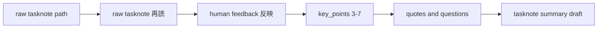

# 2026年5月24日 開発基盤：capture-and-ingest-sourceでraw tasknoteからsummary draftを作る

> 状態：① Journey
> 次のゲート：（ユーザー）output を `llm-wiki/wiki/summaries/tasknotes/done/` の curated summary 形式でよいか確認

---

## 1) Journey（どこへ行くか）

> 補足：深層的目的 raw tasknote を読んだあとの人の返答を、毎回ぶれずに summary draft へ落とせるようにする
> 補足：やらないこと URL 取得、raw 保存、related page 更新、index 更新、ingest log 更新までは広げない
> 補足：責務分担厳格度 basic

1. 前提条件
   1. 💦 skill 名は `capture-and-ingest-source` を使う
   2. 💦 dry-run source は raw tasknote 3 本で固定する
   3. 💦 入力は raw tasknote path と human feedback を想定する
   4. 💦 出力は `summary` `key_points` `important_quotes` `open_questions` を持つ draft である

2. Before
   1. 💦 `llm-wiki/raw/tasknotes/done/` に source はあるが、ingest 入口が定まっていない
   2. 💦 既存の `summaries/tasknotes` は TL;DR 中心である
   3. 💦 強調点や保留点を残しにくい
   4. 💦 人の返答を `key_points` や引用へ落とす手順が毎回ぶれる
   5. ❌ もやもや

3. After
   1. 💦 raw tasknote path から curated summary draft を作る skill の責務が読める
   2. ✅ 人の返答を反映して `key_points` を 3 から 7 個に絞る流れが固定される
   3. ✅ sample source 3 本で dry-run する入口が決まる
   4. ❤️ 安心

4. 例外
   1. tasknote の根拠が薄いときは、無理に 3 個へ埋めず追加確認で止めてよい
   2. 引用候補が弱いときは、`important_quotes` を最小限にしてよい
   3. その理由は `open_questions` へ逃がしてよい

5. 境界条件
   1. この note は parent note の [18]-[21] 相当の工程だけを扱う
   2. raw tasknote は既に存在する前提で、capture 自体は別 route に残す
   3. summary draft は human review 前の仮置きとして扱う

6. 委任度
   1. 🟢 raw tasknote ingest の draft workflow は CC 単独で組み立てられる
   2. 🟢 CCのみで可：sample source と output 形式を tasknote に固定する
   3. 🟡 人の判断: curated summary を既存 TL;DR 形式と併存させるかは確認が要る

---

## 2) ユーザーストーリーマップ

> raw tasknote を読んだあと、人の返答を curated summary draft に変換する部分だけを tasknote ingest の subflow として切り出す。
> 委任度：🟢 draft の起票と subflow 整理までは CC が進められる
> 残る曖昧さ：tasknote summary の既存 TL;DR 形式と curated 形式をどう併存させるか

### 事前確認

- [x] tasknote確認済み
- [x] skill・tool・MCP確認済み
  - [x] `manage-tasknotes`
  - [x] `brainstorming`
  - [x] `create-skill`
  - [x] shared `tasknote-lint`
- [x] 永続的ドキュメント確認済み
  - [x] `AGENTS.md`
  - [x] `manage-tasknotes/TEMPLATE.md`
  - [x] `manage-tasknotes/RULES.md`
  - [x] `steering/done/2026年5月23日 開発基盤：Karpathy型LLM Wiki運用の親ノート.md`
  - [x] `steering/2026年5月24日 開発基盤：URLからraw保存と対話型ingest下書きまでを一気に行うスキルを作る.md`

### 本体

#### 話題1：raw tasknote を input contract に固定する

##### ユーザー：Karpathy 型の知識キュレーター（tasknote ingest）

1. 当初計画
    1. 👀 source を `llm-wiki/raw/tasknotes/done/` の markdown から受け取る
    2. 🏷️ dry-run source を 3 本固定する
    3. 📝 input は `raw_tasknote_path` と `human_feedback` に絞る
    4. 🔗 broad な capture skill とは別に、この工程だけを subflow として切り出す

#### 話題2：人の返答を `key_points` `important_quotes` `open_questions` へ落とす

##### ユーザー：Karpathy 型の知識キュレーター（feedback reflection）

1. 当初計画
    1. 👀 AI が raw tasknote を読み直す
    2. 💬 人が返した強調点、違和感、保留点を分類する
    3. ✂️ AI が `key_points` を 3 から 7 個へ絞る
    4. 📌 AI が `important_quotes` を選ぶ
    5. ❓ AI が `open_questions` を分けて残す

#### 話題3：tasknote 向けの curated summary draft を書く

##### ユーザー：Karpathy 型の知識キュレーター（summary draft）

1. 当初計画
    1. 📝 output path を `llm-wiki/wiki/summaries/tasknotes/done/` に寄せる
    2. 🧾 draft file に `summary` `key_points` `important_quotes` `open_questions` を書く
    3. 👀 human review 前の仮 summary として止める
    4. 🔁 related page や index 更新は後続 route に渡す

#### 話題4：broad skill と dry-run へつなぐ

##### ユーザー：この repo の運用者（integration）

1. 当初計画
    1. 🔗 `capture-and-ingest-source` の中では、この note を後半 subflow として扱う
    2. 🧪 dry-run は g12 / g15 / guardrails-1 の 3 本で回す
    3. 📝 うまくいけば broad skill note 側へ relation を戻す

---

## 3) Gherkin（完了条件）

> 委任度：🟢 tasknote draft の定義と dry-run 入口の固定までは CC が進められる
> 残る曖昧さ：tasknote summary の既存 TL;DR 形式との併存方針

### シナリオ一覧

- [ ] シナリオ1：raw tasknote path と human feedback を input にできる

1. 🧱 raw tasknote 3 本が `llm-wiki/raw/tasknotes/done/` にある
2. 🎬 skill に source path と human feedback を渡す
3. ✅ raw tasknote ingest の後半工程として読める

```gherkin
Given `llm-wiki/raw/tasknotes/done/` に raw tasknote source が存在する
When `capture-and-ingest-source` の後半工程として source path と human feedback を渡す
Then AI は raw tasknote を input として読み直せる
And この工程は URL capture や raw 保存を前提にしない
```

- [ ] シナリオ2：人の返答を反映して `key_points` と引用候補を整理できる

1. 🧱 AI が raw tasknote を読めている
2. 🎬 強調点、違和感、保留点を反映する
3. ✅ `key_points` `important_quotes` `open_questions` が分かれる

```gherkin
Given AI が raw tasknote を読めている
And 人が強調点と違和感と保留点を返している
When AI がその返答を反映する
Then `key_points` は 3 から 7 個に絞られる
And `important_quotes` が選ばれる
And `open_questions` が別 section として残る
```

- [ ] シナリオ3：tasknote 向け curated summary draft を作れる

1. 🧱 反映済みの `key_points` と引用候補がある
2. 🎬 summary draft file を作る
3. ✅ required section を持つ draft が tasknote summary 配下にできる

```gherkin
Given `key_points` `important_quotes` `open_questions` が整理されている
When AI が tasknote 向け summary draft file を作る
Then output は `llm-wiki/wiki/summaries/tasknotes/done/` 配下に置かれる
And draft には `summary` `key_points` `important_quotes` `open_questions` が含まれる
And draft は human review 前の状態として扱われる
```

- [ ] シナリオ4：この工程は summary draft で止まる

1. 🧱 summary draft file ができている
2. 🎬 skill の責務範囲を確認する
3. ✅ related page や index 更新へは進まない

```gherkin
Given raw tasknote から summary draft file を作成できている
When この subflow の責務範囲を確認する
Then related page 更新と index 更新と ingest log 更新は行わない
And broad skill または後続 route に処理を渡す
```

---

## 4) Design（どうやるか）

### 責務分担概要

- この note は `capture-and-ingest-source` の中でも raw tasknote ingest の後半工程だけを扱う
- input は `raw_tasknote_path` と `human_feedback` に限定する
- output は `llm-wiki/wiki/summaries/tasknotes/done/` の curated summary draft とする
- `summary` `key_points` `important_quotes` `open_questions` を minimum contract にする

### 責務分担概要図



### 責務分担詳細

- `steering/2026年5月24日 開発基盤：capture-and-ingest-sourceでraw tasknoteからsummary draftを作る.md` （➕：raw tasknote ingest の後半 subflow を定義する）
- `steering/2026年5月24日 開発基盤：URLからraw保存と対話型ingest下書きまでを一気に行うスキルを作る.md` （➕：broad な `capture-and-ingest-source` の前半から後半までを持つ）
- `steering/done/2026年5月23日 開発基盤：Karpathy型LLM Wiki運用の親ノート.md` （➕：[18]-[21] の元になる運用タイムラインを持つ）
- `llm-wiki/raw/tasknotes/done/20260412-g12-rebuild-codemaker-zip.md` （➕：dry-run source 1）
- `llm-wiki/raw/tasknotes/done/20260412-g15-test-pinning.md` （➕：dry-run source 2）
- `llm-wiki/raw/tasknotes/done/20260412-guardrails-1-ssot-codegen.md` （➕：dry-run source 3）
- `llm-wiki/wiki/summaries/tasknotes/done/` （✏️：curated summary draft の保存先候補として扱う）
- `llm-wiki/wiki/summaries/tasknotes/steering/done/2026年5月22日 開発基盤：Karpathy方針でindexとlogの最小形を通す-summary.md` （➕：既存 tasknote summary 形式の参照例）
- `~/dotfiles/claude/.claude/skills/capture-and-ingest-source/SKILL.md` （➕：user skill の保存先候補）

### 【参照】

- Steering: `steering/done/2026年5月23日 開発基盤：Karpathy型LLM Wiki運用の親ノート.md`
- Steering: `steering/2026年5月24日 開発基盤：URLからraw保存と対話型ingest下書きまでを一気に行うスキルを作る.md`
- Architecture: `AGENTS.md`

### 変更範囲

- やること:
  - raw tasknote 3 本を sample source に固定する
  - `capture-and-ingest-source` の後半 subflow を tasknote に切り出す
  - curated summary draft の required section を固定する
- やらないこと:
  - 今この場で user skill 実装まで行うこと
  - URL capture と raw 保存まで同じ note に混ぜること
  - related page、index、ingest log 更新まで広げること

### 検証

- 検証コマンド:
  - `node /home/exedev/dotfiles/shared/linter/coding-rules/tasknote/run_tasknote_lint.mjs --config ./tasknote-lint.config.json 'steering/2026年5月24日 開発基盤：capture-and-ingest-sourceでraw tasknoteからsummary draftを作る.md'`
- 成功条件:
  - tasknote が lint を通る
  - sample source 3 本と output subtree が note から読める
  - scope が raw tasknote ingest の後半工程だけに閉じている
- 未実施時の扱い:
  - lint 未実施なら仮起票止まりとする

---

## 5) Tasklist

- [ ] tasknote summary の curated 形式を確定する
- [ ] `raw_tasknote_path` と `human_feedback` の入力形式を固める
- [ ] `summary` `key_points` `important_quotes` `open_questions` の生成手順を書く
- [ ] sample source 3 本で dry-run 手順を定義する
- [ ] broad skill note との relation を整理する

---

## 6) 作業ログ

- raw tasknote 3 本を dry-run source として固定した
- skill 名を `capture-and-ingest-source` として記録した
- raw tasknote ingest の後半工程だけを別 note に切り出した

---

## 7) 評価と成果物

> 評価：🟢 raw tasknote source、skill 名、summary draft の責務を provisional note として切り出せた

### 成果物

- `steering/2026年5月24日 開発基盤：capture-and-ingest-sourceでraw tasknoteからsummary draftを作る.md`

---

## 8) Discussion

- 関連tasknote: `steering/2026年5月24日 開発基盤：URLからraw保存と対話型ingest下書きまでを一気に行うスキルを作る.md`
- raw tasknote ingest は `raw/knowledge` ingest と違い、既存の `summaries/tasknotes` 形式との整合を先に決める必要がある
- この note は [18]-[21] 相当の「返答反映 -> summary draft」だけを後半 subflow として切り出している
- dry-run source を 3 本固定したことで、旧 TL;DR 形式との差分比較がしやすくなる

---

## 9) Closing

- 状態: open
- 次のゲート: （ユーザー）output を `llm-wiki/wiki/summaries/tasknotes/done/` の curated summary 形式でよいか確認
- close 条件:
  - [ ] tasknote summary の output subtree が確定している
  - [ ] required section が `summary` `key_points` `important_quotes` `open_questions` に固定されている
  - [ ] sample source 3 本で dry-run する入口が読める
  - [ ] broad skill note との役割分担が読める

---

## 10) 参考資料

- `steering/done/2026年5月23日 開発基盤：Karpathy型LLM Wiki運用の親ノート.md`
- `steering/2026年5月24日 開発基盤：URLからraw保存と対話型ingest下書きまでを一気に行うスキルを作る.md`
- `llm-wiki/raw/tasknotes/done/20260412-g12-rebuild-codemaker-zip.md`
- `llm-wiki/raw/tasknotes/done/20260412-g15-test-pinning.md`
- `llm-wiki/raw/tasknotes/done/20260412-guardrails-1-ssot-codegen.md`
- `llm-wiki/wiki/summaries/tasknotes/steering/done/2026年5月22日 開発基盤：Karpathy方針でindexとlogの最小形を通す-summary.md`
