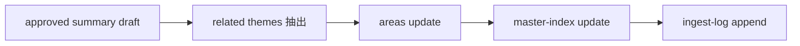

# 2026年5月24日 開発基盤：capture-and-ingest-sourceにrelated page更新とingest logを足す

> 状態：① Journey
> 次のゲート：（ユーザー）[23]-[30] を現行 repo 実態の `areas / master-index / ingest-log` に読み替えてよいか確認

---

## 1) Journey（どこへ行くか）

> 補足：深層的目的 summary draft で止まっている ingest を、wiki 全体へ編み込むところまで 1 本の skill で通せるようにする
> 補足：やらないこと query 保存、candidate source 切り出し、health-check、自動 batch ingest までは広げない
> 補足：責務分担厳格度 basic

1. 前提条件
   1. 💦 `capture-and-ingest-source` は summary draft 作成までは実装済みである
   2. 💦 親ノートの対象は [23]-[30] である
   3. 💦 今回の対象は related page と index と ingest log である
   4. 💦 現行 repo には `entities/` `concepts/` `vocaloid-index.md` は無い
   5. 💦 現行 repo の実体は `areas/` `master-index.md` `ingest-log.md` である

2. Before
   1. 💦 skill は summary draft で止まっている
   2. 💦 wiki 全体へ反映する後半が残っている
   3. 💦 親ノートは `entity / concept / vocaloid-index` を想定している
   4. 💦 だが現行 repo は別構造である
   5. 💦 tasknote source の related page 選定が毎回ぶれやすい
   6. ❌ 途切れる

3. After
   1. 💦 summary 承認後に後半工程まで続けられる
   2. ✅ related page 更新、index 更新、ingest log 追記まで通る
   3. ✅ 現行 repo では `areas` を related page の置き場として一貫利用できる
   4. ✅ sample source 3 本で後半工程の dry-run 入口が決まる
   5. ❤️ つながる

4. 例外
   1. 関連 page が 2 件に届かないときは、保留理由を log に残してよい
   2. 既存 `areas` 追記が自然なら、それを新規 page 作成より優先してよい

5. 境界条件
   1. この note は親ノートの [23]-[30] だけを扱う
   2. current repo 向けの読み替えだけを実装する
   3. `entities / concepts` の新設は行わず、まず `areas` を使う
   4. tasknote source でも knowledge source でもよい
   5. 出口は `master-index` と `ingest-log` にそろえる

6. 委任度
   1. 🟢 後半工程の tasknote 起票と scope 固定までは CC 単独で進められる
   2. 🟢 CCのみで可：`areas / master-index / ingest-log` へ読み替えた draft を作れる
   3. 🟡 人の判断: `entity / concept` 想定を `areas` へ寄せ切るかは確認が要る

---

## 2) ユーザーストーリーマップ

> summary draft 承認後の続きを、related pages、index、ingest log の 3 かたまりに分けて current repo 向けにそろえる。
> 委任度：🟢 draft の起票と後半 subflow 整理までは CC が進められる
> 残る曖昧さ：親ノートの `entity / concept` 想定を現行 repo の `areas` へ完全に読み替えるか

### 事前確認

- [x] tasknote確認済み
- [x] skill・tool・MCP確認済み
  - [x] `manage-tasknotes`
  - [x] `brainstorming`
  - [x] `create-skill`
  - [x] shared `tasknote-lint`
- [x] 永続的ドキュメント確認済み
  - [x] `AGENTS.md`
  - [x] `manage-tasknotes/TEMPLATE.md`
  - [x] `manage-tasknotes/RULES.md`
  - [x] `docs/llm-wiki-ops-schema.md`
  - [x] `steering/done/2026年5月23日 開発基盤：Karpathy型LLM Wiki運用の親ノート.md`
  - [x] `steering/2026年5月24日 開発基盤：URLからraw保存と対話型ingest下書きまでを一気に行うスキルを作る.md`
  - [x] `steering/2026年5月24日 開発基盤：capture-and-ingest-sourceでraw tasknoteからsummary draftを作る.md`

### 本体

#### 話題1：summary draft 承認後に continue mode へ入る

##### ユーザー：Karpathy 型の知識キュレーター（continue ingest）

1. 当初計画
    1. 👀 user が summary preview を承認したら後半工程へ進む
    2. 🔗 その場の `source_path` `source_id` `summary draft` を引き継ぐ
    3. 🛑 continue mode は明示的に enable されたときだけ走らせる

#### 話題2：related page を `areas` から見つけて更新する

##### ユーザー：Karpathy 型の知識キュレーター（related pages）

1. 当初計画
    1. 👀 source と summary draft から主要テーマを 2 から 4 個抜く
    2. 🧭 `llm-wiki/wiki/areas/` の既存 page から近いものを探す
    3. ✏️ 既存 page に `new_fact` `why_it_matters` `source_ref` 相当の追記を行う
    4. 📝 どうしても既存 page が無ければ新規 `areas` page を最小限で作る

#### 話題3：`master-index` を更新する

##### ユーザー：Karpathy 型の知識キュレーター（index update）

1. 当初計画
    1. 🔗 summary draft と updated area pages を index に反映する
    2. 📝 `new_page_link` `related_topics` `see_also` に相当する接続を作る
    3. 👀 tasknote source でも knowledge source と同じ入口から辿れるようにする

#### 話題4：`ingest-log` に後半工程の結果を残す

##### ユーザー：Karpathy 型の知識キュレーター（ingest chronology）

1. 当初計画
    1. 🕒 `source_id` `source_path` `created_pages` `updated_pages` `risks` を記録する
    2. 📊 related page 数と保留理由を追跡できる形にする
    3. 🔁 summary draft だけで止まった run と、後半まで通した run を見分けられるようにする

#### 話題5：sample source 3 本で dry-run 入口を固定する

##### ユーザー：この repo の運用者（dry-run）

1. 当初計画
    1. 🧪 g12 / g15 / guardrails-1 を後半工程の sample に使う
    2. 🔍 `Code Maker 配布` `テスト固定` `SSoT/codegen` のテーマで `areas` を照合する
    3. 📝 うまくいけば broad skill note と summary draft note の両方へ relation を戻す

---

## 3) Gherkin（完了条件）

> 委任度：🟢 current repo 向けの後半 subflow 定義までは CC が進められる
> 残る曖昧さ：`entity / concept` を `areas` に読み替える最終判断

### シナリオ一覧

- [ ] シナリオ1：summary 承認後に後半工程へ続けられる

1. 🧱 source と summary draft がすでにある
2. 🎬 continue mode を有効にする
3. ✅ related page、index、ingest log 更新へ進める

```gherkin
Given `capture-and-ingest-source` が summary draft まで完了している
And user が summary preview を承認している
When continue mode を有効にする
Then skill は related page 更新へ進める
And `source_path` `source_id` `summary draft path` を引き継ぐ
```

- [ ] シナリオ2：現行 repo では `areas` を related page の置き場として使う

1. 🧱 親ノートは `entity / concept` を想定している
2. 🎬 current repo 構造を確認する
3. ✅ `areas` へ読み替えて進める

```gherkin
Given 親ノートの [23]-[30] は `entity / concept` page を想定している
When 現行 repo の `llm-wiki/wiki/` 構造を確認する
Then related page の更新先は `llm-wiki/wiki/areas/` を優先する
And `entities/` や `concepts/` を新設せずに進める
```

- [ ] シナリオ3：少なくとも 2 件の related page を更新するか、保留理由を残せる

1. 🧱 source から主要テーマが見えている
2. 🎬 既存 `areas` を探して更新する
3. ✅ related page 数か保留理由が log に残る

```gherkin
Given source と summary draft から主要テーマが見えている
When skill が既存 `areas` page を探して追記する
Then 少なくとも 2 件の related page が更新される
Or 2 件に届かない理由が `ingest-log` に残る
```

- [ ] シナリオ4：`master-index` と `ingest-log` が後半工程の結果を持てる

1. 🧱 summary draft と related page 更新結果がある
2. 🎬 index と log を更新する
3. ✅ 後から source の波及先を追える

```gherkin
Given summary draft path と related page の更新結果がある
When skill が `master-index.md` と `ingest-log.md` を更新する
Then index から summary と related page への導線を辿れる
And log から `created_pages` `updated_pages` `risks` を追える
```

---

## 4) Design（どうやるか）

### 責務分担概要

- この note は `capture-and-ingest-source` の後半 continue mode だけを扱う
- related page の実体は current repo では `llm-wiki/wiki/areas/` として扱う
- `master-index.md` と `ingest-log.md` への反映を summary draft の次段に追加する
- tasknote source と knowledge source の両方で、後半工程の出口を共通にする

### 責務分担概要図



### 責務分担詳細

- `steering/2026年5月24日 開発基盤：capture-and-ingest-sourceにrelated page更新とingest logを足す.md` （➕：後半 continue mode の scope と current repo への読み替えを定義する）
- `steering/2026年5月24日 開発基盤：URLからraw保存と対話型ingest下書きまでを一気に行うスキルを作る.md` （➕：前半から後半へつなぐ broad skill note）
- `steering/2026年5月24日 開発基盤：capture-and-ingest-sourceでraw tasknoteからsummary draftを作る.md` （➕：summary draft までの tasknote source subflow）
- `steering/done/2026年5月23日 開発基盤：Karpathy型LLM Wiki運用の親ノート.md` （➕：[23]-[30] の要求元）
- `docs/llm-wiki-ops-schema.md` （➕：`areas / master-index / ingest-log` の current repo defaults）
- `llm-wiki/wiki/areas/` （✏️：related page の更新先）
- `llm-wiki/wiki/indexes/master-index.md` （✏️：summary と related page の入口更新先）
- `llm-wiki/wiki/logs/ingest-log.md` （✏️：後半工程の履歴記録先）
- `~/dotfiles/claude/.claude/skills/capture-and-ingest-source/SKILL.md` （✏️：後半 continue mode を追加する対象）

### 【参照】

- Steering: `steering/done/2026年5月23日 開発基盤：Karpathy型LLM Wiki運用の親ノート.md`
- Steering: `steering/2026年5月24日 開発基盤：URLからraw保存と対話型ingest下書きまでを一気に行うスキルを作る.md`
- Steering: `steering/2026年5月24日 開発基盤：capture-and-ingest-sourceでraw tasknoteからsummary draftを作る.md`
- Architecture: `AGENTS.md`
- Schema: `docs/llm-wiki-ops-schema.md`

### 変更範囲

- やること:
  - summary draft 後に続く continue mode を tasknote に切り出す
  - `areas` `master-index` `ingest-log` への更新ルールを定義する
  - sample source 3 本で後半工程の dry-run 入口を固定する
- やらないこと:
  - query / candidate source / health-check まで同じ skill に入れること
  - `entities/` `concepts/` `vocaloid-index.md` を新設すること
  - batch ingest や複数 source 同時反映まで扱うこと

### 検証

- 検証コマンド:
  - `node /home/exedev/dotfiles/shared/linter/coding-rules/tasknote/run_tasknote_lint.mjs --config ./tasknote-lint.config.json 'steering/2026年5月24日 開発基盤：capture-and-ingest-sourceにrelated page更新とingest logを足す.md'`
- 成功条件:
  - tasknote が lint を通る
  - [23]-[30] の current repo への読み替えが note から読める
  - 後半工程の出口が `areas / master-index / ingest-log` に固定されている
- 未実施時の扱い:
  - lint 未実施なら仮起票止まりとする

---

## 5) Tasklist

- [ ] `entity / concept` 想定を `areas` へどう写像するかを固める
- [ ] continue mode の入力 contract を固める
- [ ] `areas` 更新ルールと page 選定ルールを書く
- [ ] `master-index` 更新ルールを書く
- [ ] `ingest-log` 追記ルールを書く
- [ ] sample source 3 本で dry-run 手順を定義する

---

## 6) 作業ログ

- 親ノートの [23]-[30] を current repo 向けの後半工程として切り出した
- `entities / concepts / vocaloid-index` と repo 実態のずれを確認した
- 後半工程の実体を `areas / master-index / ingest-log` に寄せる draft を作った

---

## 7) 評価と成果物

> 評価：🟢 summary draft の先にある wiki 統合工程を、現行 repo 構造に合わせて provisional note に切り出せた

### 成果物

- `steering/2026年5月24日 開発基盤：capture-and-ingest-sourceにrelated page更新とingest logを足す.md`

---

## 8) Discussion

- 関連tasknote: `steering/2026年5月24日 開発基盤：URLからraw保存と対話型ingest下書きまでを一気に行うスキルを作る.md`
- 関連tasknote: `steering/2026年5月24日 開発基盤：capture-and-ingest-sourceでraw tasknoteからsummary draftを作る.md`
- 親ノートの [23]-[30] は `entity / concept / vocaloid-index` 想定だが、現行 repo では `areas / master-index` が実体である
- `docs/llm-wiki-ops-schema.md` も「早すぎる entity / concept 分離はせず、まず `areas` を使う」としている
- この note は後半工程だけを切り出しているので、query や health-check の route は別のままにする

---

## 9) Closing

- 状態: open
- 次のゲート: （ユーザー）[23]-[30] を現行 repo 実態の `areas / master-index / ingest-log` に読み替えてよいか確認
- close 条件:
  - [ ] current repo 向けの後半工程の出口が確定している
  - [ ] continue mode の入力と出力が note から読める
  - [ ] sample source 3 本で後半工程を試す入口が決まっている
  - [ ] broad skill note と summary draft note との役割分担が読める

---

## 10) 参考資料

- `steering/done/2026年5月23日 開発基盤：Karpathy型LLM Wiki運用の親ノート.md`
- `steering/2026年5月24日 開発基盤：URLからraw保存と対話型ingest下書きまでを一気に行うスキルを作る.md`
- `steering/2026年5月24日 開発基盤：capture-and-ingest-sourceでraw tasknoteからsummary draftを作る.md`
- `docs/llm-wiki-ops-schema.md`
- `llm-wiki/wiki/indexes/master-index.md`
- `llm-wiki/wiki/logs/ingest-log.md`
