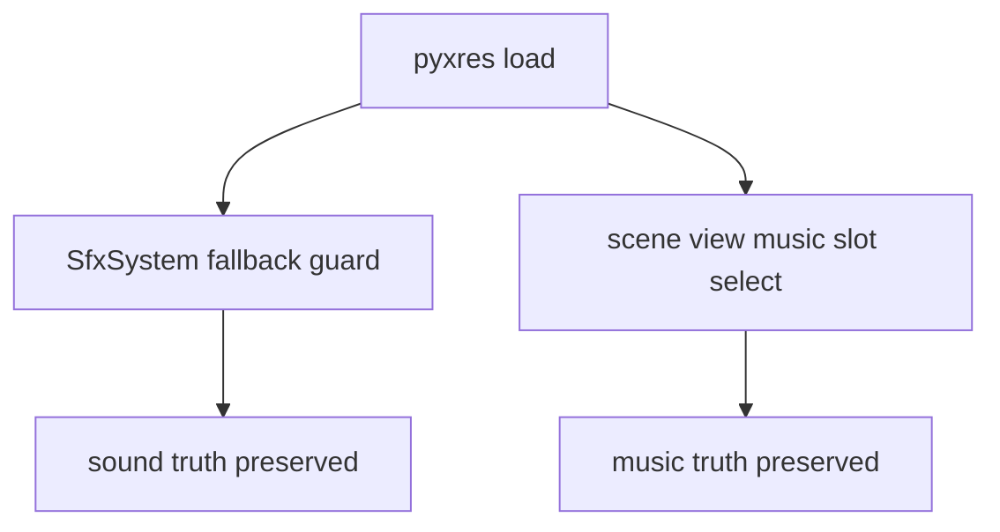
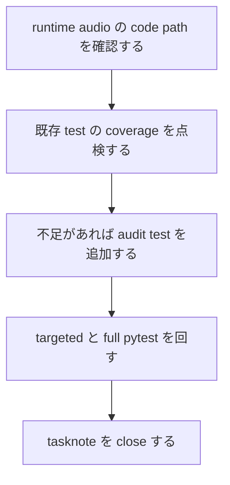

# 2026年5月26日 AV：pyxresサウンドがsystem実装から独立しているか調査する

> 状態：⑨ Closing
> 次のゲート：なし

---

## 1) Journey（どこへ行くか）

> 補足：深層的目的 Code Maker で作った音が本編でも同じ truth として鳴るかを確かめる
> 補足：やらないこと `.pyxres` 自体の手編集や新規作曲はしない
> 補足：責務分担厳格度 basic

1. 前提条件
   1. 💦 `pyxel.load()` は image だけでなく sound / music もまとめて読む
   2. 💦 runtime は `SfxSystem` を pyxres load 前後で組み直している
   3. 💦 docs は `Sound / Music は pyxres SSoT` と約束している

2. Before
   1. 💦 画像側ほど音側の独立性チェックが明文化されていない
   2. 💦 `attack` SFX 1 本以外の coverage が十分かはまだ不明
   3. ❌ 気持ち悪い

3. After
   1. 💦 sound / music の上書き経路が code 上で明文化される
   2. ✅ pyxres truth を守る test が足りない所は埋まる
   3. ✅ 調査だけで足りるなら runtime の挙動は触らずに閉じられる
   4. ❤️ 安心

4. 例外
   1. channel gain のような pyxres 外 mixer state は別扱いで記録する
   2. Web / Code Maker import 全体の E2E 追加までは今回広げない

5. 境界条件
   1. 主語は `Sound / Music が system 定義で戻されないか` に限定する
   2. scene ごとの再生タイミング設計は主語にしない
   3. 必要なら audit test と tasknote だけを追加し、本編変更は最小にする

6. 委任度
   1. 🟢 全体として code 調査と audit test 追加までは CC が完走できる
   2. 🟢 CCのみで可: worktree, tasknote, 調査, test 追加, close 判断まで進めてよい
   3. 🔴 人の判断: pyxres 外の mixer policy を変える大改造は今回の依頼外

---

## 2) ユーザーストーリーマップ

> 委任度：🟢 今回の進め方は runtime audio の独立性監査に固定できている
> 残る曖昧さ：なし

### 事前確認

- [x] tasknote確認済み
- [x] skill・tool・MCP確認済み
  - [x] `manage-tasknotes`
  - [x] `using-git-worktrees`
  - [x] `systematic-debugging`
  - [x] `verification-before-completion`
  - [x] `pyxel`
- [x] 永続的ドキュメント確認済み
  - [x] `AGENTS.md`
  - [x] `README.md`
  - [x] `docs/product-requirements-av.md`
  - [x] `docs/product-requirements-guardrails.md`
  - [x] `docs/ux-policy.md`
  - [x] `~/dotfiles/claude/.claude/skills/manage-tasknotes/TEMPLATE.md`

### 本体

#### 話題1：runtime audio の真実を 1 本にそろえる

##### ユーザー：Code Maker で音を作る親子

1. 当初計画
    1. 👀 `audio_system.py` と `runtime/app.py` の初期化順を確認する
    2. 👀 scene view の BGM 再生が pyxres music slot 直参照かを見る
    3. ✂️ 調査主語を `pyxres の Sound / Music truth` に固定する

#### 話題2：既存 test の穴を確認する

##### ユーザー：この repo の保守者

1. 当初計画
    1. 👀 `test_cj24_sound_editor_truth.py` が守っている範囲を読む
    2. 👀 `music` 側と static overwrite 禁止の coverage 有無を点検する
    3. 📝 足りない所だけ audit test で埋める

#### 話題3：close 可能な監査結果に落とす

##### ユーザー：将来の調査者

1. 当初計画
    1. 📝 実装上 independent な点と非 independent だが意図的な点を分けて書く
    2. ✅ 変更があれば targeted pytest と full pytest を回す
    3. ✅ tasknote に evidence を残して done へ送る

---

## 3) Gherkin（完了条件）

> 委任度：🟢 このまま最後まで CC が進められる
> 残る曖昧さ：なし

### シナリオ一覧

- [x] シナリオ1：pyxres の music truth を runtime が上書きしない

1. 🧱 人が Code Maker で music slot を編集済みである（Code Maker）
2. 🎬 runtime が audio を初期化して scene が BGM を再生する（runtime）
3. ✅ Python コードは music 内容を書き換えず、pyxres slot をそのまま鳴らす（runtime）

```gherkin
Given 人が pyxres の Music エディタで BGM を編集している
When runtime が起動して BGM を再生する
Then scene view は pyxres の music slot index だけを選ぶ
And Python コードに musics 内容を set / mml で上書きする経路はない
```

- [x] シナリオ2：pyxres の sound truth を fallback SFX が上書きしない

1. 🧱 人が pyxres の Sound エディタで SFX を編集済みである（Code Maker）
2. 🎬 runtime が `SfxSystem` を初期化する（runtime）
3. ✅ 既存内容のある slot は維持され、空 slot だけ fallback が埋まる（runtime）

```gherkin
Given 人が pyxres の Sound エディタで attack SFX を編集している
When runtime が `SfxSystem` を初期化する
Then 既存内容のある sound slot には fallback `set()` をしない
And 空 slot だけが fallback 定義で埋まる
```

---

## 4) Design（どうやるか）

### 責務分担概要

- 調査対象は `src/shared/services/audio_system.py`、`src/runtime/app.py`、各 scene `view.py`、Code Maker import まわりの contract test に閉じる
- 正本は `pyxres` の `Sound / Music` であり、Python 側は `slot index 選択` と `空 slot fallback` だけを持つ想定を検証する
- 既存 coverage が不足していれば test を追加し、runtime behavior 自体は必要時だけ触る
- tasknote には `独立している点` と `独立していないが意図的な点` を分けて残す

### 責務分担概要図



### 責務分担詳細

- `src/shared/services/audio_system.py` （👀：sound fallback と BGM state の責務を監査する）
- `src/runtime/app.py` （👀：pyxres load 前後の audio 初期化順を確認する）
- `src/scenes/*/view.py` （👀：music 内容ではなく slot index だけを選んでいるか確認する）
- `test/test_cj24_sound_editor_truth.py` （✏️：必要なら music truth 監査を足す）
- `test/test_cjg_sfx_system_behavior.py` （✏️：必要なら fallback guard の coverage を補う）

### 関連スキル・MCP

- `manage-tasknotes`
- `using-git-worktrees`
- `systematic-debugging`
- `verification-before-completion`
- `pyxel`

### 【参照】

- Steering: `steering/`
- Architecture: `docs/architecture.md`
- FrameworkRule: `docs/framework-rule.md`
- AVRequirements: `docs/product-requirements-av.md`
- Guardrails: `docs/product-requirements-guardrails.md`
- UXPolicy: `docs/ux-policy.md`

### 変更範囲

- やること: runtime audio の truth path を code / docs / tests で確認する
- やること: 足りない audit coverage があれば test を足す
- やらないこと: `.pyxres` の直接編集
- やらないこと: BGM 作曲や SFX デザイン変更

### 検証

- 検証コマンド: `python -m pytest test/test_cj24_sound_editor_truth.py test/test_cjg_sfx_system_behavior.py test/test_cjg_audio_runtime_truth.py -q`
- 検証コマンド: `python -m pytest test/ -q`
- 検証コマンド: `make verify`
- 成功条件: 調査結果が tasknote に evidence 付きで残り、追加 test があれば pass する
- 成功条件: independent / non-independent の境界を code ベースで説明できる
- 未実施時の扱い: 検証未実施なら Closing へ進めない

---

## 5) Tasklist



- [x] （CC）runtime audio の code path を確認する
- [x] （CC）既存 test の coverage を点検する
- [x] （CC）不足があれば audit test を追加する
- [x] （CC）targeted と full pytest を回す
- [x] （CC）tasknote に結果を残して close 判断する

### レビュー

- 原本 checklist: `docs/development-checklist.md`
- /tmp コピー: `/tmp/development-checklist-20260526-1426.md`
- レビュー結果: `make verify` の `ruff format --check` `ruff check` `python scripts/verify_cj_links.py` `python scripts/verify_scene_to_cj.py` を通し、追加 test を含む full pytest も pass した
- 未通過時の扱い: fail があれば修正して再レビューし、全部通るまで Close しない

---

## 6) 作業ログ

- `.worktrees/20260526-pyxres-sound-audit` を作成し、branch `20260526-pyxres-sound-audit` で調査を開始した
- baseline として `python -m pytest test/test_cj24_sound_editor_truth.py test/test_cjg_sfx_system_behavior.py -q` を実行し、6 passed を確認した
- `audio_system.py` では `SfxSystem._slot_has_sound` が既存 sound slot を検出して fallback `set()` を skip することを確認した
- `runtime/app.py` では `SfxSystem(pyxel)` → `ImageBanks.setup_image_banks()` → `SfxSystem(pyxel)` の順で audio を組み直すことを確認した
- `image_banks.py` では `_do_pyxres_load()` が `pyxel.load(str(pyxres_path))` を呼び、sound / music も pyxres から読むことを確認した
- `title` `explore` `battle` `ending` の各 `view.py` では BGM の内容を書かず、music slot index を `play_bgm_track()` へ渡すだけであることを確認した
- `test/test_cjg_audio_runtime_truth.py` を追加し、`music` 内容の非上書きと `src/` 配下の content writer 禁止を固定した
- targeted: `python -m pytest test/test_cj24_sound_editor_truth.py test/test_cjg_sfx_system_behavior.py test/test_cjg_audio_runtime_truth.py -q` を実行し、8 passed を確認した
- full: `python -m pytest test/ -q` を実行し、`709 passed, 2 skipped, 38 deselected, 14219 subtests passed` を確認した
- review: `make verify` を実行し、format / lint / CJ link / scene map verify がすべて通ることを確認した

---

## 7) 評価と成果物

> 評価：🟢 pyxres sound / music truth は現行 runtime で守られていると確認できた

### 成果物

- `steering/done/2026年5月26日 AV：pyxresサウンドがsystem実装から独立しているか調査する.md`
- `test/test_cjg_audio_runtime_truth.py`

---

## 8) Discussion

### 判断記録

- `Sound / Music` の content truth は `pyxel.load()` で読み込まれた pyxres 側にあり、Python 側は `music slot の選択` と `空 slot fallback` だけを担当していた
- `SfxSystem` の 2 回初期化は一見危険だが、`_slot_has_sound()` が既存 slot を見て fallback `set()` を止めるので、Code Maker で保存した sound は保護される
- `Music` 側は `src/` 配下に `musics[...].set()` / `.mml()` が存在せず、scene view も slot index を渡すだけなので、runtime が content を戻す経路は見つからなかった
- `title/view.py` の channel gain 調整と `audio_system.py` の SFX gain は pyxres content ではなく mixer policy なので、今回の「独立性」には含めないと整理した
- `docs/product-requirements-av.md` には CJG24 を「未実装」とする古い記述が残っており、現行 code / test とずれていることを確認した。今回は監査主語を外さないため docs 修正までは広げなかった

### 反省とルール化

- 記入先：`test/test_cjg_audio_runtime_truth.py`
- 次にやること：audio truth の docs 整合性を直す task が必要なら別 note で切り出す

---

## 9) Closing

- 状態: done
- 次のゲート: なし
- close 条件:
  - [x] pyxres sound / music を Python が content 上書きしない経路確認が済んでいる
  - [x] 既存 sound slot 保護と music 非上書きを固定する test が追加されている
  - [x] targeted pytest / full pytest / make verify の証跡が残っている

---

## 10) 参考資料

- `AGENTS.md`
- `README.md`
- `docs/development-checklist.md`
- `docs/framework-rule.md`
- `docs/product-requirements-av.md`
- `docs/product-requirements-guardrails.md`
- `docs/ux-policy.md`
- `src/runtime/app.py`
- `src/scenes/battle/view.py`
- `src/scenes/ending/view.py`
- `src/scenes/explore/view.py`
- `src/scenes/title/view.py`
- `src/shared/services/audio_system.py`
- `src/shared/services/image_banks.py`
- `test/test_cj24_sound_editor_truth.py`
- `test/test_cjg_audio_runtime_truth.py`
- `test/test_cjg_sfx_system_behavior.py`
