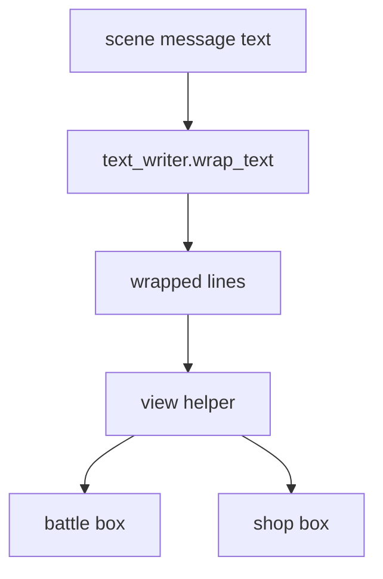
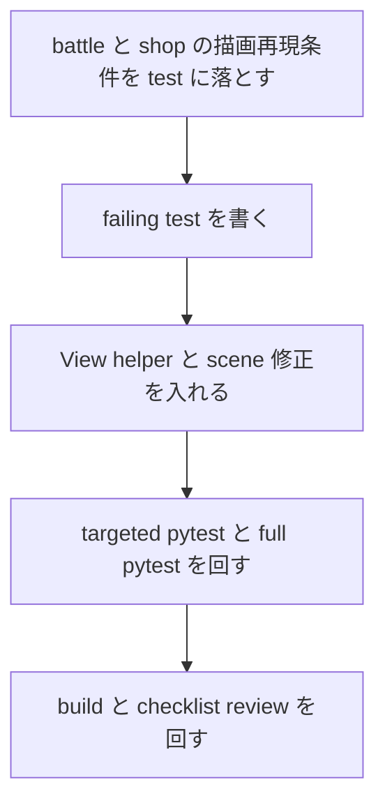

# 2026年5月26日 UI：固定幅メッセージのはみ出しを横断修正する

> 状態：⑨ Closing
> 次のゲート：なし

---

## 1) Journey（どこへ行くか）

> 補足：深層的目的 子どもが長い結果文や取得文を最後まで自然に読めるようにする
> 補足：やらないこと すべての scene を共通ウィンドウへ載せ替える大改修までは広げない
> 補足：責務分担厳格度 basic

1. 前提条件
   1. 💦 repo には `MessageDisplay.wrap_text()` がある
   2. 💦 既存の共通 message window は折返し規約を持っている
   3. 💦 一部 scene は独自の固定幅 message 枠を持つ
   4. 💦 その独自枠は `text_writer.text()` 1 回で描画している
   5. 💦 battle では既に 1 件直した
   6. 💦 shop など同型の UI が残っている

2. Before
   1. 💦 長い message が scene ごとの独自枠で右にはみ出すことがある
   2. 💦 battle だけ直しても、同じ根因の shop message が取りこぼされる
   3. ❌ まだ直し切れていない

3. After
   1. 💦 長文化しうる固定幅 message 枠がある
   2. 💦 その枠が共通 helper 経由で折返し描画される
   3. ✅ battle と shop の長文 message が枠内で読める
   4. ✅ 影響の薄い scene は inventory 確認だけに留める
   5. ✅ 不要なレイアウト変更を避ける
   6. ❤️ 安心

4. 例外
   1. 3 行以上になる極端な長文はありうる
   2. その場合は枠高さに応じて表示行数を切り詰めてよい
   3. title / splash / menu の固定文言は inventory のみでよい
   4. 高リスクでなければ変更しない

5. 境界条件
   1. 今回の主語は fixed-width message の overflow 対策に絞る
   2. scene 遷移や message 文言そのものの生成規則は変えない
   3. 共通 helper は View 層の責務に閉じ、Presenter / Model へ広げない

6. 委任度
   1. 🟢 全体として long message overflow の横断修正は CC が完走できる
   2. 🟢 CCのみで可: worktree と tasknote を自律で進めてよい
   3. 🟢 CCのみで可: TDD と検証と close 可否判断まで進めてよい
   4. 🔴 人の判断: 全 scene を共通 message window に統一する大改修は範囲外

---

## 2) ユーザーストーリーマップ

> Gherkin の前に、今回の仕事をどの順番で進めるかだけをそろえる。
> 委任度：🟢 battle と shop を主対象にした進め方で最後まで進められる
> 残る曖昧さ：なし

### 事前確認

- [x] tasknote確認済み
- [x] skill・tool・MCP確認済み
  - [x] `manage-tasknotes`
  - [x] `using-git-worktrees`
  - [x] `brainstorming`
  - [x] `writing-plans`
  - [x] `systematic-debugging`
  - [x] `test-driven-development`
- [x] 永続的ドキュメント確認済み
  - [x] `AGENTS.md`
  - [x] `README.md`
  - [x] `docs/framework-rule.md`
  - [x] `docs/ux-policy.md`
  - [x] `docs/development-checklist.md`
  - [x] `~/.claude/skills/manage-tasknotes/TEMPLATE.md`

### 本体

#### 話題1：battle 修正の root cause を他 scene へ照らし直す

##### ユーザー：Block Quest のプレイヤー

1. 当初計画
    1. 👀 battle 修正 note と実装を読み、根因が `wrap_text` 未使用だと固定する
    2. 👀 他 scene の固定幅 message 描画を横断で見て、同型箇所を洗い出す
    3. ✂️ battle と shop を主対象、title / splash / menu は inventory 対象に分ける

#### 話題2：View 層だけで使える共通 wrap helper を作る

##### ユーザー：この repo の保守者

1. 当初計画
    1. ✏️ View 専用 helper に「折返し + 最大行数カット」を閉じる
    2. 🧭 `text_writer.wrap_text()` が無い test double では 1 行 fallback を残す
    3. ✅ battle と shop の描画だけを helper 利用側へ寄せる

#### 話題3：長文 message を regression test で固定する

##### ユーザー：この repo の保守者（回帰防止）

1. 当初計画
    1. 🧪 battle の長文 / 短文描画を helper 経由で再固定する
    2. 🧪 shop の長い `buy_msg` が複数行描画になる failing test を先に書く
    3. ✅ targeted pytest、full pytest、build を通して done 条件を満たす

---

## 3) Gherkin（完了条件）

> 委任度：🟢 このまま最後まで CC が進められる
> 残る曖昧さ：なし

### シナリオ一覧

- [x] シナリオ1：battle の長い結果 message は枠内で改行される

1. 🧱 プレイヤーが長い結果 message を出す battle 状態にいる（battle）
2. 🎬 battle の main message 枠を描画する（battle）
3. ✅ 文字列は複数行へ分かれ、右にはみ出さない（battle）

```gherkin
Given battle の main message に 1 行では収まらない長い文言が入っている
When battle view が main message 枠を描画する
Then 文字列は複数行に分けて描画される
And 1 行のまま右端へ流し込まない
```

- [x] シナリオ2：shop の長い購入 message は下部枠で改行される

1. 🧱 プレイヤーが長文 `buy_msg` を持つ装備を shop で購入する（shop）
2. 🎬 shop の下部 message 枠を描画する（shop）
3. ✅ 文字列は複数行へ分かれ、右にはみ出さない（shop）

```gherkin
Given shop の下部 message に 1 行では収まらない長い購入文言が入っている
When shop view がその message 枠を描画する
Then 文字列は複数行に分けて描画される
And 1 行のまま右端へ流し込まない
```

- [x] シナリオ3：短い message の表示位置は壊れない

1. 🧱 プレイヤーが短い message を出す状態にいる（battle / shop）
2. 🎬 各 scene の message 枠を描画する（battle / shop）
3. ✅ 既存どおり先頭行だけが描画される（battle / shop）

```gherkin
Given battle または shop の message に短い文言が入っている
When view が対応する message 枠を描画する
Then 先頭行の描画位置は既存どおりである
And 余計な追加行は描画されない
```

---

## 4) Design（どうやるか）

### 責務分担概要

- root cause は `MessageDisplay.wrap_text()` があるのに、battle / shop の独自固定幅 message 枠が `text_writer.text()` 1 回で長文を描いていること
- 正本の折返し規約は `src/shared/services/message_display.py` にあるため、今回の入口は View 層 helper に閉じる
- 修正の入口は `src/shared/ui/` の小 helper と `src/scenes/battle/view.py` `src/scenes/shop/view.py` に絞る
- 先に failing test で long message の複数行描画を固定する

### 責務分担概要図



### 責務分担詳細

- `src/shared/ui/wrapped_text.py` （➕：wrap helper を View 専用の共通部品として持つ）
- `src/scenes/battle/view.py` （✏️：battle main message の行解決を helper 利用へ寄せる）
- `src/scenes/shop/view.py` （✏️：shop 下部 message の複数行描画を追加する）
- `src/shared/services/message_display.py` （❌：既存 `wrap_text()` を利用するだけでロジック変更しない）
- `test/test_cjg_battle_message_wrap.py` （✏️：battle の helper 利用後も長文 / 短文が固定されることを保つ）
- `test/test_cjg_shop_message_wrap.py` （➕：shop の長文 / 短文描画を固定する）

### 関連スキル・MCP

- `manage-tasknotes`
- `using-git-worktrees`
- `writing-plans`
- `systematic-debugging`
- `test-driven-development`

### 【参照】

- Steering: `steering/done/2026年5月26日 戦闘：結果メッセージが枠からはみ出す不具合を直す.md`
- Architecture: `docs/architecture.md`
- FrameworkRule: `docs/framework-rule.md`
- UXPolicy: `docs/ux-policy.md`

### 変更範囲

- やること: battle / shop の fixed-width message を枠内で改行表示にする
- やること: View 専用の共通 wrap helper を追加する
- やること: battle / shop の regression test を追加する
- やらないこと: title / splash / menu のレイアウトを一括で多行化する
- やらないこと: message 文言の内容や scene 遷移を変える

### 検証

- 検証コマンド: `python -m pytest test/test_cjg_battle_message_wrap.py test/test_cjg_shop_message_wrap.py -q`
- 検証コマンド: `python -m pytest test/ -q`
- 検証コマンド: `PYTHONPATH=. python tools/build_web_release.py`
- 成功条件: long message が battle / shop の枠内で複数行描画され、短文の位置回帰がない
- 成功条件: targeted pytest と full pytest と build が通る
- 未実施時の扱い: いずれか未実施なら Closing へ進めない

---

## 5) Tasklist



- [x] （CC）battle と shop の再現条件を test fixture に落とす
- [x] （CC）failing test を書く
- [x] （CC）View helper と scene 修正を入れる → 作業ログに事実を書く → Discussion に判断を書く
- [x] （CC）targeted pytest と full pytest を回す
- [x] （CC）`PYTHONPATH=. python tools/build_web_release.py` と checklist review を回す

### レビュー

- 原本 checklist: `docs/development-checklist.md`
- /tmp コピー: `/tmp/development-checklist-20260526-1426.md`
- レビュー結果: pass（B4-1 の build、C3-1 の描画責務、C4-1 の ViewModel 入力、D2-1 の可読性を確認）
- 未通過時の扱い: fail があれば修正して再レビューし、全部通るまで Close しない

---

## 6) 作業ログ

- battle overflow 修正の完了 note と現行実装を読み、根因が `wrap_text` 未使用だと確認した
- `src/scenes/shop/view.py` は下部 message を 1 回の `text_writer.text()` で描いており、長い `buy_msg` が再発候補だと確認した
- `.worktrees/20260526-message-wrap-sweep` を作成し、baseline として `python -m pytest test/test_cjg_battle_message_wrap.py test/test_cjg_shop_owned_message.py -q` が 8 passed になった
- `test/test_cjg_shop_message_wrap.py` を追加し、shop 長文 message が 1 行のまま描画される failing test を先に確認した
- `src/shared/ui/wrapped_text.py` を追加し、battle / shop が同じ wrap helper を使う形へそろえた
- `python -m pytest test/test_cjg_battle_message_wrap.py test/test_cjg_shop_message_wrap.py -q` は 4 passed
- `python -m pytest test/ -q` は 709 passed, 2 skipped, 38 deselected, 14219 subtests passed
- `make verify` は module docstrings / CJ link / scene_to_cj verify まで通過した
- `PYTHONPATH=. python tools/build_web_release.py` は成功し、`dist/` 配布物を再生成した
- `/tmp/battle_message_wrap_preview.py` と `/tmp/shop_message_wrap_preview.py` を Pyxel harness として `run_and_capture` し、実画面で battle / shop の長文が 2 行表示されることを確認した

---

## 7) 評価と成果物

> 評価：🟢 期待通り完了した

### 成果物

- `src/shared/ui/wrapped_text.py`
- `src/scenes/battle/view.py`
- `src/scenes/shop/view.py`
- `test/test_cjg_shop_message_wrap.py`
- `dist/pyxel.html`
- `dist/pyxel.pyxapp`
- `dist/code-maker.zip`
- `steering/done/2026年5月26日 UI：固定幅メッセージのはみ出しを横断修正する.md`

---

## 8) Discussion

- battle 単体修正をそのまま複製せず、View helper を足して battle / shop の 2 scene に opt-in する案を採った
- title / splash / menu は現時点で高リスク message source が見当たらず、無理な多行化のほうが regression になりやすいので inventory の事実確認に留めた
- `wrap_text()` の正本は service 側に残しつつ、View helper 側で fallback を持たせることで test double 互換を維持した

### 反省とルール化

- 記入先：observe-situation / manage-tasknotes / CLAUDE.md
- 次にやること：新しい固定幅 message 枠を増やすときは `resolve_wrapped_lines()` 利用を先に検討する

---

## 9) Closing

- 状態: done
- 次のゲート: なし
- close 条件:
  - [x] battle と shop の long message regression test が追加されている
  - [x] targeted pytest と full pytest と build が通っている
  - [x] checklist review の結果が記録されている
  - [x] close 後に `steering/done/` へ移動している

---

## 10) 参考資料

- ユーザー提供 screenshot: battle の結果 message が右端ではみ出す事実
- `steering/done/2026年5月26日 戦闘：結果メッセージが枠からはみ出す不具合を直す.md`
