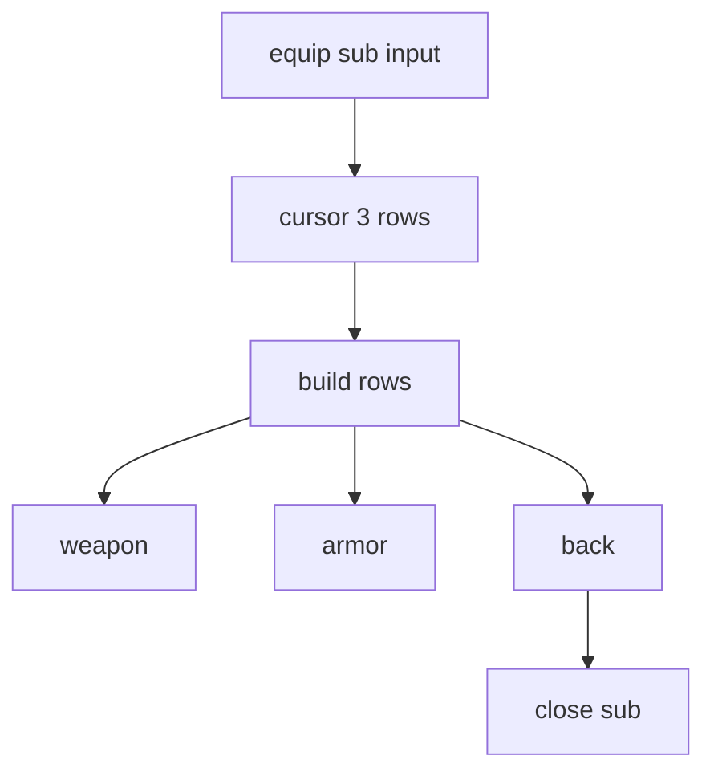
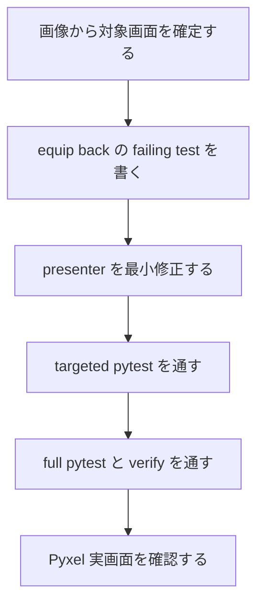

# 2026年5月26日 メニュー：そうび画面の最後にもどるを追加する

> 状態：⑨ Closing
> 次のゲート：（ユーザー）close 済みの差分を確認する

---

## 1) Journey（どこへ行くか）

> 補足：深層的目的 子どもが見えているメニューだけで自然に戻れるようにする
> 補足：やらないこと 装備変更機能の新設や shop/town の別 menu 改修までは広げない
> 補足：責務分担厳格度 basic

1. 前提条件
   1. 💦 menu の equip sub は今は 2 行だけ表示する
   2. 💦 閉じる導線は cancel 入力に隠れている
   3. 💦 画像では行末に visible な もどる が欲しい

2. Before
   1. 💦 そうび画面では戻り先が画面に書かれていない
   2. 💦 子どもは cancel を知らないと抜け方が分かりにくい
   3. ❌ 迷う

3. After
   1. 💦 equip sub の最後の行に もどる が見える
   2. ✅ 上下と決定だけで root menu へ戻れる
   3. ✅ 既存の cancel でも同じように閉じられる
   4. ❤️ 安心

4. 例外
   1. 英字表示時は BACK を出してよい
   2. weapon / armor 行の表示内容は今のまま維持する
   3. 装備変更の決定処理は今回追加しない

5. 境界条件
   1. 主語は `src/scenes/menu` の equip sub に絞る
   2. main menu の項目数や map への閉じ方は変えない
   3. shop / town / battle の別 menu には波及させない

6. 委任度
   1. 🟢 全体として local menu UI の最小修正なので CC 単独で進められる
   2. 🟢 CCのみで可: screenshot と実装箇所の対応は確定した
   3. 🟢 CCのみで可: tasknote 起票から close 候補まで連続で進めてよい

---

## 2) ユーザーストーリーマップ

> 委任度：🟢 equip sub の visible back 導線まではこのまま固められる
> 残る曖昧さ：なし

### 事前確認

- [x] tasknote確認済み
- [x] skill・tool・MCP確認済み
  - [x] `manage-tasknotes`
  - [x] `brainstorming`
  - [x] `test-driven-development`
  - [x] `pyxel`
- [x] 永続的ドキュメント確認済み
  - [x] `AGENTS.md`
  - [x] `docs/framework-rule.md`
  - [x] `docs/repository-structure.md`
  - [x] `docs/ux-policy.md`

### 本体

#### 話題1：対象を equip sub へ固定する

##### ユーザー：Block Quest のプレイヤー

1. 当初計画
    1. 👀 screenshot と scene の対応を確認する
    2. 👀 `マウス` `キーボード` を出す panel を特定する
    3. ✂️ 修正範囲を `src/scenes/menu` に絞る

#### 話題2：見える戻り導線を 1 行足す

##### ユーザー：そうび画面で迷いたくない子ども

1. 当初計画
    1. ✏️ equip rows の最後に `もどる` を追加する
    2. ✏️ cursor 移動数を 2 から 3 に広げる
    3. ✅ `もどる` 決定で root menu へ戻るようにする

#### 話題3：回帰を test で固定する

##### ユーザー：この repo の保守者

1. 当初計画
    1. ✅ equip rows に `もどる` が出る test を置く
    2. ✅ 下移動と confirm で戻れる test を置く
    3. ✅ cancel 既存挙動が残る test を維持する

---

## 3) Gherkin（完了条件）

> 委任度：🟢 このまま最後まで CC が進められる
> 残る曖昧さ：なし

### シナリオ一覧

- [x] シナリオ1：そうび画面の最後に もどる が見える

1. 🧱 プレイヤーが menu の equip sub を開いている（menu）
2. 🎬 そうび panel を表示する（menu）
3. ✅ weapon / armor の下に `もどる` が表示される（menu）

```gherkin
Given プレイヤーが menu の equip sub を開いている
When equip panel の rows を組み立てる
Then rows は weapon と armor と もどる の 3 行になる
And 最後の行は もどる と表示される
```

- [x] シナリオ2：もどる を選んで決定すると root menu へ戻る

1. 🧱 プレイヤーが equip sub の 2 行目にいる（menu）
2. 🎬 下へ 1 回移動して決定する（menu）
3. ✅ equip sub が閉じて root menu へ戻る（menu）

```gherkin
Given プレイヤーが menu の equip sub を開いている
And cursor は armor 行を指している
When プレイヤーが下入力して もどる 行へ進み決定する
Then equip sub は閉じる
And main menu はそのまま表示される
```

- [x] シナリオ3：cancel でも今までどおり戻れる

1. 🧱 プレイヤーが equip sub を開いている（menu）
2. 🎬 cancel 入力をする（menu）
3. ✅ 既存どおり equip sub だけ閉じる（menu）

```gherkin
Given プレイヤーが menu の equip sub を開いている
When プレイヤーが cancel を押す
Then equip sub は閉じる
And game.state は map へ飛ばない
```

---

## 4) Design（どうやるか）

### 責務分担概要

- root cause は equip sub に visible な戻り行がなく、cancel 操作が前提なこと
- 正本は `src/scenes/menu/presenter.py` の rows 組立てと入力解釈である
- 修正入口は equip sub の rows 数と confirm 分岐に閉じる
- 先に `test/test_cjg_menu_navigation.py` で不足を固定する

### 責務分担概要図



### 責務分担詳細

- `src/scenes/menu/presenter.py` （✏️：equip rows と confirm 動作を back 行対応にする）
- `src/scenes/menu/view.py` （❌：layout は既存 panel 描画のまま使う）
- `src/scenes/menu/model.py` （❌：新しい state は足さない）
- `test/test_cjg_menu_navigation.py` （➕：back 行表示と遷移の回帰を固定する）

### 関連スキル・MCP

- `manage-tasknotes`
- `test-driven-development`
- `pyxel`

### 【参照】

- Steering: `steering/done/2026年5月26日 メニュー：そうび画面の最後にもどるを追加する.md`
- Architecture: `docs/architecture.md`
- UXPolicy: `docs/ux-policy.md`
- Runtime: `src/scenes/menu/presenter.py`

### 変更範囲

- やること: equip sub の表示行を 3 行にする
- やること: `もどる` 選択時の confirm で sub を閉じる
- やること: menu navigation test を追加更新する
- やらないこと: 装備変更機能の追加
- やらないこと: shop / town / battle menu の UI 変更

### 検証

- 検証コマンド: `python -m pytest test/test_cjg_menu_navigation.py -q`
- 検証コマンド: `python -m pytest test/ -q`
- 検証コマンド: `make verify`
- 検証コマンド: `pyxel MCP validate_script / run_and_capture`
- 成功条件: equip sub に back 行が見え、決定で root menu へ戻れる
- 成功条件: 既存の cancel close と main menu 遷移に回帰がない
- 未実施時の扱い: 未実施なら close しない

---

## 5) Tasklist



- [x] 画像から `src/scenes/menu` の equip sub と特定する
- [x] equip back の failing test を書く
- [x] presenter を最小修正する
- [x] `python -m pytest test/test_cjg_menu_navigation.py -q` を通す
- [x] `python -m pytest test/ -q` と `make verify` を通す
- [x] Pyxel 実画面で rows を確認する

### レビュー

- 原本 checklist: `docs/development-checklist.md`
- `/tmp コピー`: `/tmp/code-quest-pyxel-checklists/development-checklist-menu-modoru.md`
- レビュー結果: scene 境界と UI scope を確認し、今回該当の open は残らなかった
- 未通過時の扱い: open を残して close しない

---

## 6) 作業ログ

- screenshot を `view_image` で確認し、対象を menu の equip sub に固定した
- `test/test_cjg_menu_navigation.py` に 3 件の回帰 test を追加した
- 初回 `python -m pytest test/test_cjg_menu_navigation.py -q` では 3 fail を確認した
- `src/scenes/menu/presenter.py` で equip rows を 3 行化し、back confirm を追加した
- 再実行した `python -m pytest test/test_cjg_menu_navigation.py -q` は 16 passed だった
- `python -m pytest test/ -q` は 691 passed, 2 skipped, 38 deselected だった
- `make verify` は `76 files OK` `CJ link OK` `scene_to_cj map OK` で通過した
- Pyxel MCP で `/tmp/menu_equip_preview.py` を validate し、issue なしを確認した
- Pyxel MCP の `run_and_capture` で equip sub の `> もどる` 表示を確認した

---

## 7) 評価と成果物

> 評価：🟢 equip sub に visible な戻り導線を追加し、test と実画面確認まで完了した

### 成果物

- `steering/done/2026年5月26日 メニュー：そうび画面の最後にもどるを追加する.md`
- `src/scenes/menu/presenter.py`
- `test/test_cjg_menu_navigation.py`

---

## 8) Discussion

- screenshot は shop ではなく menu の equip sub だった
- `weapon / armor` は現状でも情報表示のみで、今回は back 導線だけ足す
- main menu の `とじる` や map への戻り方は変えず、equip sub だけを局所修正した
- back 行の confirm は `select` SFX で閉じ、cancel 入力の既存操作も残した

---

## 9) Closing

- 状態: done
- 次のゲート: （ユーザー）必要なら branch の扱いを決める
- close 条件:
  - [x] `もどる` 表示の test がある
  - [x] `もどる` 決定で sub が閉じる
  - [x] targeted pytest と full pytest が通る
  - [x] 実画面で rows を確認する

---

## 10) 参考資料

- `AGENTS.md`
- `docs/architecture.md`
- `docs/framework-rule.md`
- `docs/repository-structure.md`
- `docs/ux-policy.md`
- `src/scenes/menu/presenter.py`
- `test/test_cjg_menu_navigation.py`
