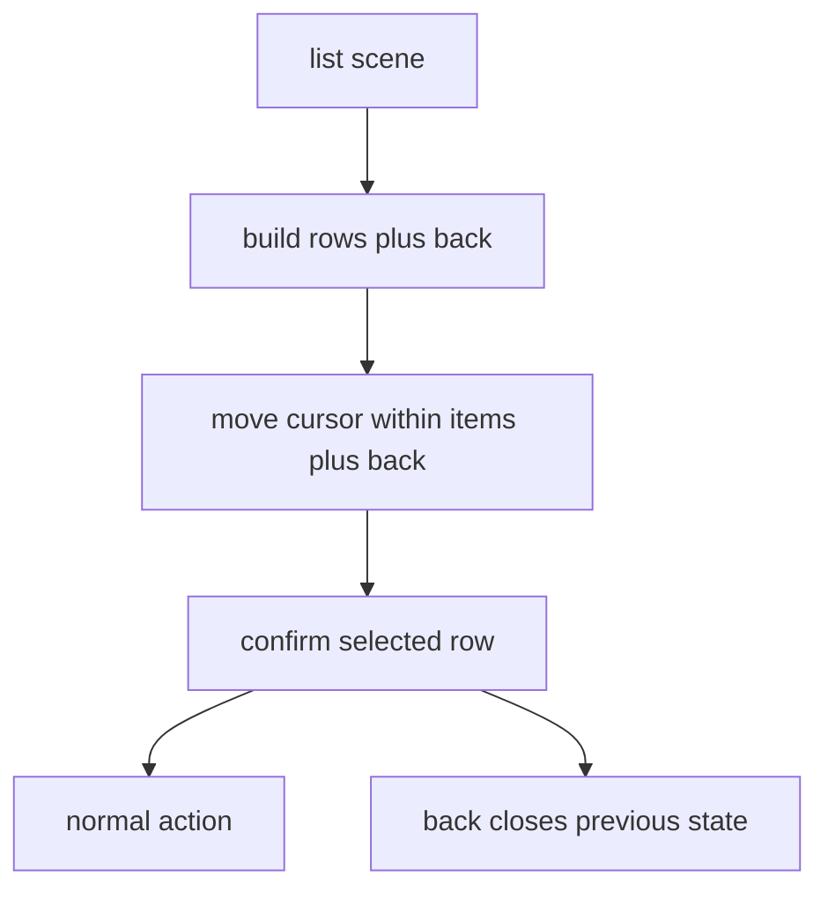
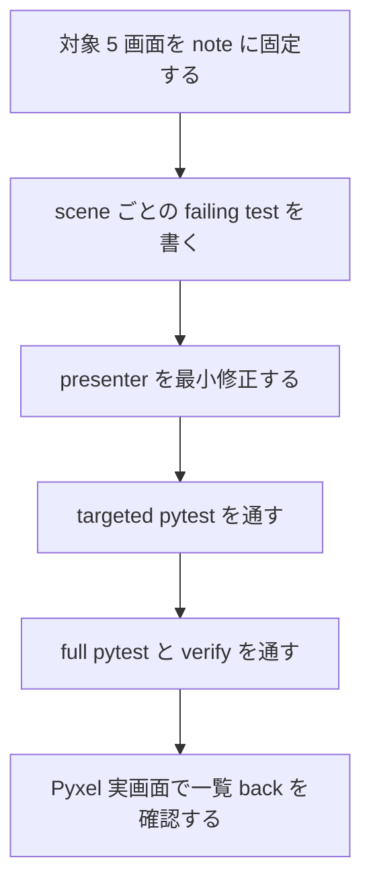

# 2026年5月26日 メニュー：一覧UIのもどる導線をまとめて揃える

> 状態：⑨ Closing
> 次のゲート：（ユーザー）merge 済み差分を確認する

---

## 1) Journey（どこへ行くか）

> 補足：深層的目的 子どもが cancel を知らなくても見えている行だけで前の画面へ戻れるようにする
> 補足：やらないこと 装備変更や購買仕様の新設、town main menu 全体の再設計までは広げない
> 補足：責務分担厳格度 basic

1. 前提条件
   1. 💦 `menu/items` `menu/equip` `shop` は一覧 UI を持つ
   2. 💦 `battle/spell_select` `battle/item_select` も一覧 UI を持つ
   3. 💦 これらの一部は cancel 入力だけで前画面へ戻る
   4. 💦 前回は equip sub だけに `もどる` を追加した
   5. 💦 `menu/items` と `battle/item_select` は visible window 制約も持つ

2. Before
   1. 💦 画面によって visible な戻り行があったり無かったりする
   2. 💦 一覧末尾に back 行が無い画面では抜け方が分かりにくい
   3. 💦 単純 append すると行数上限や scroll が壊れる画面もある
   4. ❌ ちぐはぐ

3. After
   1. 💦 一覧 UI の最後に `もどる` / `BACK` が一貫して見える
   2. ✅ 上下と決定だけで前の段階へ戻れる
   3. ✅ cancel 入力の既存挙動も保持される
   4. ✅ back 行追加後も visible window と highlight が壊れない
   5. ❤️ 安心

4. 例外
   1. `status` のような一覧でない情報 panel は対象外でよい
   2. 在庫なし / 未習得の empty message 画面は対象外でよい
   3. それらは既存どおり confirm/cancel close を許容してよい
   4. 英字 fallback は `BACK` 表記でよい

5. 境界条件
   1. 主語は `menu` `shop` `battle` の一覧 sub UI に絞る
   2. `town_menu` の `でる` や main menu の `とじる` は別役割なので変えない
   3. battle の攻撃/魔法/アイテム効果そのものは変えない

6. 委任度
   1. 🟢 全体として一覧 UI の一貫性修正なので CC 単独で進められる
   2. 🟢 CCのみで可: 対象画面はコード棚卸しで 5 か所に固定できた
   3. 🟢 CCのみで可: 起票から merge 候補まで自律進行してよい
   4. 🟢 CCのみで可: visible window helper 追加を含めても局所修正で閉じられる

---

## 2) ユーザーストーリーマップ

> 委任度：🟢 対象 5 画面と検証方針まではこのまま固められる
> 残る曖昧さ：なし

### 事前確認

- [x] tasknote確認済み
- [x] skill・tool・MCP確認済み
  - [x] `manage-tasknotes`
  - [x] `using-git-worktrees`
  - [x] `test-driven-development`
  - [x] `verification-before-completion`
  - [x] `pyxel`
- [x] 永続的ドキュメント確認済み
  - [x] `AGENTS.md`
  - [x] `docs/framework-rule.md`
  - [x] `docs/repository-structure.md`
  - [x] `docs/ux-policy.md`

### 本体

#### 話題1：visible back が不足している画面を 5 か所に固定する

##### ユーザー：Block Quest のプレイヤー

1. 当初計画
    1. 👀 `cancel` でだけ戻る一覧 UI を scene ごとに棚卸しする
    2. ✂️ 対象を `menu/items` `menu/equip` `shop` `battle/spell_select` `battle/item_select` に絞る
    3. 📝 一覧でない panel と main menu は除外すると明記する

#### 話題2：back 行と visible window を同時に整える

##### ユーザー：一覧の最後まで見て戻りたい子ども

1. 当初計画
    1. ✏️ 各一覧 UI の最後に `もどる` / `BACK` を置く
    2. ✏️ confirm on back で前段階へ戻る分岐を追加する
    3. ✏️ `menu/items` と `battle/item_select` は back 行込みで window を再計算する

#### 話題3：scene ごとの回帰 test で挙動を固定する

##### ユーザー：この repo の保守者

1. 当初計画
    1. ✅ menu navigation test に items/equip back を追加する
    2. ✅ shop input test に back row 表示と confirm close を追加する
    3. ✅ battle list test を追加し spell/item の back row と window を固定する

---

## 3) Gherkin（完了条件）

> 委任度：🟢 このまま最後まで CC が進められる
> 残る曖昧さ：なし

### シナリオ一覧

- [x] シナリオ1：menu/items は back 行込みでも一覧と戻りを両立する

1. 🧱 プレイヤーが menu の items sub を開いている（menu）
2. 🎬 item 一覧を下へ進めて末尾の back 行で決定する（menu）
3. ✅ visible item rows と back 行が壊れず root menu に戻れる（menu）

```gherkin
Given プレイヤーが 8 個以上の item を持って menu の items sub を開いている
When 一覧の最後の back 行まで進んで決定する
Then items sub は閉じる
And visible rows は item window と back 行を両立している
And cancel 入力でも従来どおり items sub は閉じる
```

- [x] シナリオ2：shop 一覧の最後に back 行が見え、決定で town menu に戻れる

1. 🧱 プレイヤーが町の shop 一覧を開いている（shop）
2. 🎬 商品一覧の最後の back 行へ進んで決定する（shop）
3. ✅ shop を買わずに town_menu へ戻れる（shop）

```gherkin
Given プレイヤーが shop inventory を開いている
When 一覧の最後の back 行へ進んで決定する
Then game.state は town_menu になる
And 商品行の purchase 挙動には影響しない
```

- [x] シナリオ3：battle の spell/item select は back 行込みでも window を見失わない

1. 🧱 プレイヤーが battle の spell または item 一覧を開いている（battle）
2. 🎬 visible items を越えて進み、最後の back 行まで移動する（battle）
3. ✅ 選択中行が画面内に見えたまま menu phase に戻れる（battle）

```gherkin
Given プレイヤーが battle の spell_select または item_select を開いている
And 一覧件数が visible rows より多い
When プレイヤーが最後の back 行まで進んで決定する
Then battle phase は menu に戻る
And visible rows は選択中の項目か back 行を見失わない
And cancel 入力でも従来どおり menu に戻る
```

---

## 4) Design（どうやるか）

### 責務分担概要

- root cause は一覧 UI ごとに戻り導線の扱いがばらばらで、cancel 操作に隠れた画面が残っていること
- 正本は `src/scenes/menu/presenter.py` `src/scenes/shop/presenter.py` `src/scenes/battle/presenter.py` の入力解釈と row 組立て
- 修正入口は row builder と confirm/cursor 分岐に閉じ、View は既存描画をなるべく保つ
- failing test で `back 行表示` `confirm close` `window 維持` を先に固定する

### 責務分担概要図



### 責務分担詳細

- `src/scenes/menu/presenter.py` （✏️：items/equip の back 行と items window helper を持たせる）
- `src/scenes/shop/presenter.py` （✏️：inventory rows に back 行を足し confirm close を分岐させる）
- `src/scenes/battle/presenter.py` （✏️：spell/item list に back 行を統一し item window helper を追加する）
- `src/scenes/menu/view.py` （❌：既存 panel 高さのまま描画し、必要最小限なら触る）
- `src/scenes/shop/view.py` （❌：rows を描くだけに留める）
- `src/scenes/battle/view.py` （❌：rows を縦に描くだけに留める）
- `test/test_cjg_menu_navigation.py` （➕：items/equip back と close を固定する）
- `test/test_cjg_shop_scene_input_navigation.py` （➕：shop back row と confirm close を固定する）
- `test/test_cjg_battle_back_rows.py` （➕：spell/item back と window を固定する）

### 関連スキル・MCP

- `manage-tasknotes`
- `test-driven-development`
- `verification-before-completion`
- `pyxel`

### 【参照】

- Steering: `steering/done/2026年5月26日 メニュー：一覧UIのもどる導線をまとめて揃える.md`
- Architecture: `docs/architecture.md`
- UXPolicy: `docs/ux-policy.md`
- Runtime: `src/scenes/menu/presenter.py`
- Runtime: `src/scenes/shop/presenter.py`
- Runtime: `src/scenes/battle/presenter.py`

### 変更範囲

- やること: 5 画面の一覧末尾に visible back 行を追加する
- やること: confirm on back で前段階へ戻る分岐を追加する
- やること: back 行込みで items/spells の visible window を整える
- やること: scene 別 regression test を追加更新する
- やらないこと: 購買仕様、装備仕様、battle 効果の変更
- やらないこと: town main menu や status panel の再設計

### 検証

- 検証コマンド: `python -m pytest test/test_cjg_menu_navigation.py -q`
- 検証コマンド: `python -m pytest test/test_cjg_shop_scene_input_navigation.py -q`
- 検証コマンド: `python -m pytest test/test_cjg_battle_back_rows.py -q`
- 検証コマンド: `python -m pytest test/ -q`
- 検証コマンド: `make verify`
- 検証コマンド: `pyxel MCP validate_script / run_and_capture`
- 成功条件: 5 画面すべてで visible back と confirm close が動く
- 成功条件: items/spells の window と highlight が壊れない
- 成功条件: 既存 cancel close と通常 action に回帰がない
- 未実施時の扱い: 未実施なら close しない

---

## 5) Tasklist



- [x] 対象 5 画面を棚卸しして note に固定する
- [x] scene ごとの failing test を書く
- [x] presenter を最小修正する
- [x] targeted pytest 群を通す
- [x] `python -m pytest test/ -q` と `make verify` を通す
- [x] Pyxel 実画面で一覧 back を確認する

### レビュー

- 原本 checklist: `docs/development-checklist.md`
- /tmp コピー: `/tmp/code-quest-pyxel-checklists/development-checklist-menu-back-all.md`
- レビュー結果: scene 境界、window 整合、回帰 test の観点で今回該当の open は残らなかった
- 未通過時の扱い: fail があれば修正して再レビューし、全部通るまで Close しない

---

## 6) 作業ログ

- `feat/20260526-menu-modoru` を土台に `feat/20260526-menu-back-all` worktree を切った
- `menu` `shop` `battle` の presenter を棚卸しし、visible back が不足する 5 画面を固定した
- `test/test_cjg_menu_navigation.py` に items back と 8 件 window の回帰 test を追加した
- `test/test_cjg_shop_scene_input_navigation.py` に shop back row と confirm close test を追加した
- `test/test_cjg_battle_back_rows.py` を追加し spell/item back と view 下端 clipping を固定した
- 初回 targeted pytest では 11 fail を確認し、row 数不足と back confirm の `IndexError` を根因に固定した
- `src/scenes/menu/presenter.py` に items back 行と 7+1 window helper を追加した
- `src/scenes/shop/presenter.py` に inventory back 行と confirm close 分岐を追加した
- `src/scenes/battle/presenter.py` に spell/item back 行と item window helper を追加した
- Pyxel preview で battle back 行が切れる事実を確認し、`test/test_cjg_battle_back_rows.py` に layout test を追加した
- `src/scenes/battle/view.py` で 5 行 list 時の row_step を詰め、back 行 clipping を解消した
- `python -m pytest test/test_cjg_menu_navigation.py test/test_cjg_shop_scene_input_navigation.py test/test_cjg_battle_spell_select_window.py test/test_cjg_battle_back_rows.py -q` は 37 passed だった
- `python -m pytest test/ -q` は 703 passed, 2 skipped, 38 deselected, 14219 subtests passed だった
- `make verify` は `76 files OK` `CJ link OK` `scene_to_cj map OK` で通過した
- Pyxel MCP の `validate_script` で `/tmp/menu_back_all_preview.py` が issue なしだった
- Pyxel MCP の `capture_frames` で 5 画面すべての `もどる` / `BACK` 表示を確認した

---

## 7) 評価と成果物

> 評価：🟢 5 画面の一覧 UI に visible back を揃え、window 整合と実画面確認まで完了した

### 成果物

- `steering/done/2026年5月26日 メニュー：一覧UIのもどる導線をまとめて揃える.md`
- `src/scenes/menu/presenter.py`
- `src/scenes/shop/presenter.py`
- `src/scenes/battle/presenter.py`
- `src/scenes/battle/view.py`
- `test/test_cjg_menu_navigation.py`
- `test/test_cjg_shop_scene_input_navigation.py`
- `test/test_cjg_battle_spell_select_window.py`
- `test/test_cjg_battle_back_rows.py`

---

## 8) Discussion

- 前回の equip-only 修正はこの branch の土台として取り込み、今回は不足分を横展開する
- `menu/items` は 8 行 panel 制約があるため、単純 append ではなく window helper を前提にする
- `battle/item_select` は back 行追加と同時に off-screen item 問題も押さえる必要がある
- shop は既存の `up` wrap expectation を保ちつつ、`down` 側で back 行へ到達できる遷移にした
- battle は presenter だけでなく view の row_step も 5 行対応にしないと実画面で back 行が切れる

---

## 9) Closing

- 状態: done
- 次のゲート: （ユーザー）必要なら main 上の結果だけ見ればよい
- close 条件:
  - [x] 5 画面すべてに visible back の test がある
  - [x] confirm on back の close が scene ごとに通る
  - [x] items/spells の window 崩れが test で防がれる
  - [x] full pytest と verify と Pyxel 実画面確認が終わる

---

## 10) 参考資料

- `AGENTS.md`
- `docs/architecture.md`
- `docs/framework-rule.md`
- `docs/repository-structure.md`
- `docs/ux-policy.md`
- `steering/done/2026年5月26日 メニュー：そうび画面の最後にもどるを追加する.md`
