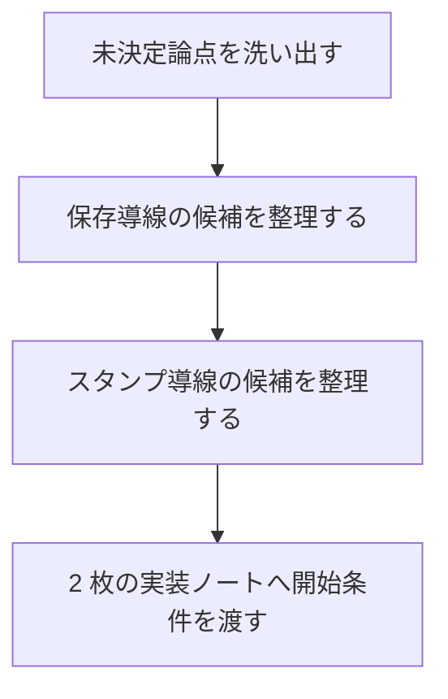
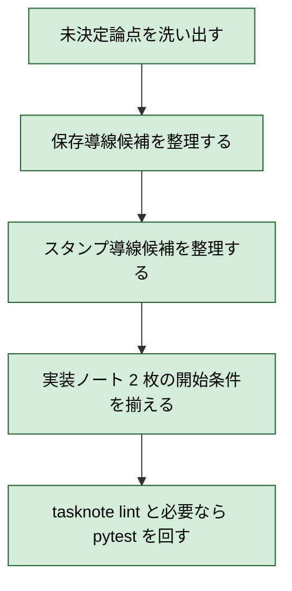

# 2026年5月26日 共有：つっこみスクショの体験仕様を決める

> 状態：✅ close
> 次のゲート：なし

---

## 1) Journey（どこへ行くか）

> 補足：深層的目的 子どもが迷わず `撮る -> 印を付ける -> 保存する -> 見つけ直す` を回せる体験を先に決める
> 補足：やらないこと 今回はコード実装や upload 機能の追加までは進めない
> 補足：責務分担厳格度 basic

1. 前提条件
   1. 💦 主な利用端末は Chromebook である
   2. 💦 保存ファーストが先行し、共有は後段でもよい
   3. 💦 スクショには絵文字スタンプ最大 50 個を載せたい
   4. 💦 現在は実装ノートが 2 枚あるが、仕様がまだ固まり切っていない

2. Before
   1. 💦 保存導線とスタンプ導線の大枠は見えている
   2. 💦 ただし保存ボタン位置や保存後導線など重要点が未決定である
   3. ❌ 実装へ入ると手戻りしそうで判断しづらい

3. After
   1. 💦 仕様上の未決定論点が一覧化される
   2. ✅ 保存導線ノートとスタンプノートの前提が揃う
   3. ✅ 実装へ進める最小仕様が言語化される
   4. ❤️ 手戻りを減らして着手できる

4. 例外
   1. 実機で見ないと最終確定できない点は残る
   2. Chromebook の管理ポリシー差で保存 UX が揺れる場合がある

5. 境界条件
   1. `Code Maker` を主役から外さない
   2. まずは `保存できる` と `印を残せる` の分離を守る
   3. 仕様ノートでは UI の大枠を決め、細かな文言は実装時に微調整可とする

6. 委任度
   1. 🟢 全体として仕様候補の整理までは CC が自走できる
   2. 🟢 CCのみで可: 未決定論点の整理、候補比較、実装ノートとの整合化
   3. 🔴 人の判断: どの体験を最優先にするかの最終選択

---

## 2) ユーザーストーリーマップ

> Gherkin の前に、仕様決めをどの順番で進めるかだけをそろえる。
> 委任度：🟢 仕様候補の整理まではこの順で進められる
> 残る曖昧さ：なし

### 事前確認

- [ ] tasknote確認済み
- [ ] skill・tool・MCP確認済み
  - [ ] `manage-tasknotes`
  - [ ] `manage-tasknotes-create`
  - [ ] `brainstorming`
- [ ] 永続的ドキュメント確認済み
  - [ ] `AGENTS.md`
  - [ ] `docs/architecture.md`
  - [ ] `docs/framework-rule.md`
  - [ ] `docs/customer-jobs.md`
  - [ ] `docs/customer-journeys.md`
  - [ ] `templates/wrapper.html`
  - [ ] `steering/done/2026年5月26日 調査：Chromebook向けつっこみスクショの保存導線を比較する.md`
  - [ ] `steering/2026年5月26日 共有：Chromebook向けスクショ保存導線を実装する.md`
  - [ ] `steering/2026年5月26日 共有：つっこみスクショに絵文字スタンプ書き出しを加える.md`

### 本体

#### 話題1：保存導線の仕様を決める

##### ユーザー：保存先を見失いたくない子ども

1. 当初計画
   1. 👀 保存ボタンの位置と押したあとの流れを決める
   2. ✂️ `save picker` と `download fallback` の役割を分ける
   3. 📝 保存後に何を見せるかを決める

#### 話題2：スタンプ導線の仕様を決める

##### ユーザー：気になった場所へすぐ印を付けたい子ども

1. 当初計画
   1. 👀 どのタイミングでスタンプ UI を見せるかを決める
   2. ✂️ 操作量を `置く` 中心に絞る
   3. 📝 削除ややり直しの最小導線を決める

#### 話題3：2枚の実装ノートの境界を決める

##### ユーザー：手戻りなく実装を進めたい担当者

1. 当初計画
   1. 👀 保存導線ノートに入れる責務を固定する
   2. ✂️ スタンプ書き出しノートに渡す条件を明文化する
   3. 📝 実装開始条件をそれぞれに残す

---

## 3) Gherkin（完了条件）

> 委任度：🟢 仕様案の整理までなら CC が進められる
> 残る曖昧さ：なし

### シナリオ一覧

- [ ] シナリオ1：保存導線の仕様候補が比較できる

1. 🧱 保存体験の未決定論点を洗い出している（tasknote）
2. 🎬 保存前後の流れを候補比較する（tasknote）
3. ✅ save picker 主導線と fallback の役割が明文化される（tasknote）

```gherkin
Given 保存体験の未決定論点を洗い出している
When 保存前後の流れを候補比較する
Then save picker 主導線と fallback の役割を明文化できる
And 保存導線ノートへ渡す前提を固定できる
```

- [ ] シナリオ2：スタンプ導線の仕様候補が比較できる

1. 🧱 スタンプ導線の未決定論点を洗い出している（tasknote）
2. 🎬 スタンプ UI とやり直し導線を候補比較する（tasknote）
3. ✅ 50 個上限と最小操作量の前提が明文化される（tasknote）

```gherkin
Given スタンプ導線の未決定論点を洗い出している
When スタンプ UI とやり直し導線を候補比較する
Then 50 個上限と最小操作量の前提を明文化できる
And スタンプ実装ノートへ渡す前提を固定できる
```

- [ ] シナリオ3：実装ノート2枚の境界が揃う

1. 🧱 2 枚の実装ノートを見ている（steering）
2. 🎬 仕様ノートから責務分担を見直す（tasknote）
3. ✅ 保存導線ノートとスタンプノートの開始条件が揃う（tasknote）

```gherkin
Given 保存導線ノートとスタンプノートを見ている
When 仕様ノートから責務分担を見直す
Then 2 枚の開始条件を揃えられる
And 手戻りしにくい実装順を残せる
```

---

## 4) Design（どうやるか）

### 責務分担概要

- root cause は `実装ノート作成が仕様確定より先に進み、未決定論点が残っている` である
- 正本は `docs/customer-jobs.md` `docs/customer-journeys.md` と調査ノートに置く
- 今回の入口は tasknote 間の役割整理であり、コードには触らない
- 出口は `保存導線ノート` と `スタンプノート` の開始条件がそろった状態である

### 責務分担概要図



### 責務分担詳細

- `steering/done/2026年5月26日 調査：Chromebook向けつっこみスクショの保存導線を比較する.md` （👀：事例調査の前提）
- `steering/2026年5月26日 共有：Chromebook向けスクショ保存導線を実装する.md` （✏️：仕様待ちへ揃える）
- `steering/2026年5月26日 共有：つっこみスクショに絵文字スタンプ書き出しを加える.md` （✏️：仕様待ちへ揃える）
- `templates/wrapper.html` （👀：仕様候補が置かれる実装面を確認する）

### 関連スキル・MCP

- `manage-tasknotes`
- `brainstorming`

### 【参照】

- Steering: `steering/done/2026年5月26日 調査：Chromebook向けつっこみスクショの保存導線を比較する.md`
- Architecture: `docs/architecture.md`
- UXPolicy: `docs/customer-jobs.md` / `docs/customer-journeys.md`

### 変更範囲

- やること: 未決定論点の整理、仕様候補の比較、実装ノート境界の調整
- やらないこと: コード実装、save picker 実装、スタンプ overlay 実装

### 検証

- 検証コマンド: tasknote lint と必要なら `python -m pytest test/ -q`
- 成功条件: 仕様候補と実装ノート境界が tasknote に残る
- 未実施時の扱い: pytest 既知 fail は原因を分けて記録する

---

## 5) Tasklist



> 必ず上から順に実施。CCがCoVeで自力検証しながら進める。

- [x] （CC）未決定論点を洗い出す
- [x] （CC）保存導線候補を整理する
- [x] （CC）スタンプ導線候補を整理する → **作業ログに事実を記録** → **Discussionに判断を記録**
- [x] （CC）実装ノート 2 枚の開始条件を揃える
- [x] （CC）tasknote lint と必要なら `python -m pytest test/ -q` を回す

### 記録の分け方

#### 作業ログ に書く

- 仕様候補として洗い出した論点
- 実装ノートへ移した条件
- 実行した確認コマンドと結果

#### Discussion に書く

- なぜその順で決めるか
- どこを user 判断に残すか
- 実装ノートへどの条件を固定で渡すか

---

## 6) 作業ログ

- 起票した
  - 実装ノート 2 枚より先に仕様ノートを置く方針に切り替えた
  - 保存導線ノートとスタンプノートの親になる判断材料をまとめる
- 未決定論点を洗い出した
  - 保存導線側:
    `ほぞん` ボタン位置、保存前 preview の要否、
    保存後メッセージ量、`Show in folder` 相当の見せ方、
    fallback 時にどこまで案内するか
  - スタンプ導線側:
    palette の出し方、選択中スタンプの見せ方、
    `けす` `ひとつもどす` `ぜんぶけす` のどこまで入れるか、
    50 個上限の見せ方、保存導線へ渡すタイミング
- 保存導線候補を 3 案に絞った
  - `スマート保存`
    save picker を優先し、非対応時だけ download fallback に落とす
  - `案内パネル保存`
    先に `Downloads に保存されるよ` を説明してから download する
  - `一時アルバム`
    まずゲーム内アルバムへ追加し、あとで端末保存する
- 保存導線の採用案を確定した
  - `スマート保存` を採る
  - 第1段階では `保存する -> save picker -> 保存完了表示` を主導線にする
  - `Show in folder` 相当は後段へ回し、最初は保存先の手がかり表示に絞る
- スタンプ導線候補を 3 案に絞った
  - `タップしてポン`
    気になった場所をタップして、その場に小さな絵文字メニューを出して 1 個置く
  - `ツールバーからドラッグ`
    画面下の絵文字列から選んでドラッグ配置する
  - `フローティングパレット`
    浮いている絵文字パレットから選んで置く
- スタンプ導線の推奨案を決めた
  - 第1候補は `タップしてポン`
  - 第1段階のやり直しは `ひとつもどす` のみ入れる
  - 個別移動や拡大縮小は後段へ回す
- 実装ノート 2 枚の開始条件を揃えた
  - 保存導線ノートは `スマート保存` 前提で `open` に上げる
  - スタンプ書き出しノートは `タップしてポン` 前提で `later` を維持する
- 検証した
  - tasknote lint を 3 枚まとめて実行し、`0 error(s)` だった
  - `python -m pytest test/ -q` はコード未変更のため今回は省略した

---

## 7) 評価と成果物

> 評価：🟢 仕様候補整理まで完了

### 成果物

- `steering/done/2026年5月26日 共有：つっこみスクショの体験仕様を決める.md` （仕様決めタスク）
- `スマート保存` を保存導線の採用案として固定した
- `タップしてポン` をスタンプ導線の第1候補として固定した

---

## 8) Discussion

### 反省とルール化

- 記入先：manage-tasknotes
- 次にやること：保存導線ノートを `スマート保存` 前提で実装段階へ進める
- 関連tasknote: `steering/2026年5月26日 共有：Chromebook向けスクショ保存導線を実装する.md`
- 関連tasknote: `steering/2026年5月26日 共有：つっこみスクショに絵文字スタンプ書き出しを加える.md`

### 判断メモ

1. 仕様を先に切るべき理由
   - 保存導線ノートだけでも、保存後導線の設計しだいで UI 配置が変わる
   - スタンプ導線ノートは、保存前 preview の有無で入口が変わる
   - 先に未決定論点を外へ出すほうが、あとで `なんとなく実装` しにくい

2. 今の分割で固定できたこと
   - 保存導線ノートは `保存できる` までを責務にする
   - スタンプ導線ノートは `印を残せる` を責務にする
   - ただし両者の境界にある `保存前 preview` は仕様ノートで先に決める

3. 保存導線の候補比較
   - `スマート保存`
     最有力。`保存場所を自分で選ぶ` と `非対応時でも保存できる` の両立ができる。
     保存後は `保存したよ` と `Downloads / フォルダ` の手がかりだけ足す。
   - `案内パネル保存`
     分かりやすいが、毎回説明を挟むのでテンポが落ちやすい。
     Chromebook に慣れた子には少し過保護になる。
   - `一時アルバム`
     楽しいが、今回のスコープには重い。
     `保存` の前に別の概念を増やすので第1段階には向かない。

4. いまの推奨案
   - 第1候補は `スマート保存`
   - 位置は `スクショ確定画面の主ボタン`
   - 流れは `保存する -> save picker -> 保存完了表示`
   - fallback は `download + Downloads を見てね`

5. スタンプ導線の候補比較
   - `タップしてポン`
     最有力。`遊ぶ -> 判断する -> 共有する` の切り替えが最短で、`JCT` と `CJ22` の
     `自分で気づいて直したい` にいちばん合う。置くたびに画面へ戻れる。
   - `ツールバーからドラッグ`
     PC らしくはあるが、Chromebook のタッチ運用では手数が増えやすい。
     `置く前に選ぶ` `動かす` の2段が子どもには少し重い。
   - `フローティングパレット`
     見た目は楽しいが、常に画面へ浮く UI がプレイ画面の印象を邪魔しやすい。
     第1段階としては情報量が多い。

6. 今回固定した仕様
   - 保存導線は `スマート保存`
   - スタンプ導線は `タップしてポン`
   - 保存前 preview は置く
   - スタンプ上限は 50 個
   - 第1段階の修正は `ひとつもどす` のみ
   - `Show in folder` 相当や個別移動は次段で検討する

---

## 9) Closing

- 状態: done
- 次のゲート: なし
- close 条件:
  - [x] 保存導線候補が整理される
  - [x] スタンプ導線候補が整理される
  - [x] 実装ノート 2 枚の開始条件が揃う

---

## 10) 参考資料

- Local: `docs/architecture.md`
- Local: `docs/framework-rule.md`
- Local: `docs/customer-jobs.md`
- Local: `docs/customer-journeys.md`
- Local: `templates/wrapper.html`
- Local: `steering/done/2026年5月26日 調査：Chromebook向けつっこみスクショの保存導線を比較する.md`
- Local: `steering/2026年5月26日 共有：Chromebook向けスクショ保存導線を実装する.md`
- Local: `steering/2026年5月26日 共有：つっこみスクショに絵文字スタンプ書き出しを加える.md`
