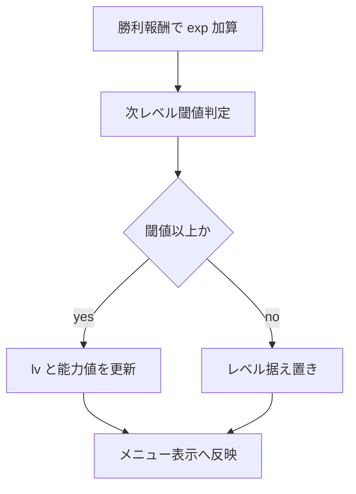
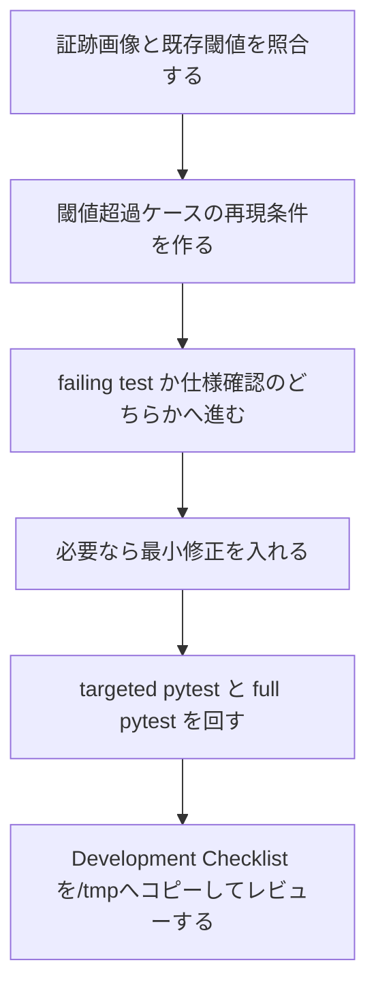

# 2026年5月26日 成長：レベルが上がらない報告を切り分ける

> 状態：⑨ Closing
> 次のゲート：なし

---

## 1) Journey（どこへ行くか）

> 補足：深層的目的 子どもが戦闘後に「強くなった」を自然に実感できる状態へ戻す
> 補足：やらないこと 今回の note 起票時点では成長カーブ全体の再調整や呪文習得テーブル変更までは広げない
> 補足：責務分担厳格度 basic

1. 前提条件
   1. 💦 証跡画像は `Lv2 / EXP102` を示している
   2. 💦 既存 test は `exp_for_level(3)=108` を固定している
   3. 💦 閾値の正本候補は `player_model.py::exp_for_level`
   4. 💦 報酬加算と level up は `battle/scene.py` にある
   5. 💦 メニューは `player.lv / player.exp` を表示する

2. Before
   1. 💦 ユーザーは「レベルが上がらない」と感じている
   2. 💦 ただし `102EXP` は `108EXP` 未満で意味が未確定
   3. 💦 `108EXP` 超過でも上がらないなら実不具合である
   4. ❌ もやもや

3. After
   1. 💦 `102EXP` 表示が仕様か不具合か説明できる
   2. ✅ 閾値到達直後に level up する実装であることを再現確認できる
   3. ✅ 仕様どおりなら期待値ずれを別論点へ切り出せる
   4. ❤️ 安心

4. 例外
   1. 旧 save の `lv / exp` 不整合は別で扱う
   2. Code Maker 差分は runtime と分けて残す
   3. 経験値カーブ変更要求は別判断にする

5. 境界条件
   1. 主語は level up 判定と表示整合に絞る
   2. `.pyxres` や敵配置改修には広げない
   3. まず runtime と既存 test を正として切り分ける

6. 委任度
   1. 🟢 全体として再現と切り分けは CC が進められる
   2. 🟢 CCのみで可: 証跡・test・実装を突き合わせて整理する
   3. 🟡 人の判断: `100EXP` で上げる仕様変更かは人が決める

---

## 2) ユーザーストーリーマップ

> Gherkin の前に、まず「この報告が何を意味するか」を 1 本にそろえる。
> 委任度：🟢 切り分け順と確認対象までは CC が固められる
> 残る曖昧さ：`102EXP` 時点の期待値が仕様変更要求なのか既存不具合報告なのかは未確定

### 事前確認

- [x] tasknote確認済み
- [x] skill・tool・MCP確認済み
  - [x] `manage-tasknotes`
  - [x] `systematic-debugging`
  - [x] `test-driven-development`
  - [x] `pyxel` MCP
  - [x] `view_image`
  - [x] `rg`
- [x] 永続的ドキュメント確認済み
  - [x] `AGENTS.md`
  - [x] `docs/framework-rule.md`
  - [x] `docs/product-requirements-battle.md`
  - [x] `~/dotfiles/claude/.claude/skills/manage-tasknotes/TEMPLATE.md`

### 本体

#### 話題1：証跡画像の意味を既存仕様へ照らして切り分ける

##### ユーザー：Block Quest のプレイヤー

1. 当初計画
   1. 👀 ステータス画面の `レベル 2 / けいけん 102` を事実として固定する
   2. 👀 `exp_for_level(3)` の既存閾値と突き合わせる
   3. ✂️ この時点で仕様どおりか、追加再現が必要な報告かを切り分ける

#### 話題2：経験値加算からレベルアップ処理までの責務境界を確認する

##### ユーザー：この repo の保守者（root cause 切り分け）

1. 当初計画
   1. 👀 勝利報酬で `player.exp` がどこで増えるかを確認する
   2. 👀 レベルアップ処理がどこで呼ばれるかを確認する
   3. 👀 メニュー表示が `player.lv` / `player.exp` をそのまま表示しているかを確認する

#### 話題3：実不具合なら再現 test を先に固定する

##### ユーザー：この repo の保守者（回帰防止）

1. 当初計画
   1. ✅ `102EXP` ではレベル 2 のままかどうかを test で明文化する
   2. ✅ 閾値到達直後にレベル 3 へ上がる test を追加する
   3. ✅ ステータス画面の表示が `player_model` の値と一致することを確認する

---

## 3) Gherkin（完了条件）

> 委任度：🟢 既存仕様の明文化と、必要なら failing test の追加方針までは CC が進められる
> 残る曖昧さ：仕様どおりで close するか、期待値調整の follow-up を切るか

### シナリオ一覧

- [x] シナリオ1：`102EXP` がまだ閾値未満ならレベル 2 のまま表示される

1. 🧱 プレイヤーがレベル 2 で経験値 102 を持っている（menu）
2. 🎬 ステータス画面を開く（menu）
3. ✅ レベル 2 のまま表示され、既存の `exp_for_level(3)` 定義と矛盾しない（menu）

```gherkin
Given プレイヤーがレベル 2 で経験値 102 を持っている
And `exp_for_level(3)` の既存仕様が 108 である
When プレイヤーがステータス画面を開く
Then 表示されるレベルは 2 のままである
And この表示は既存仕様と矛盾しない
And 次レベルまで残り 6EXP と分かる
```

- [x] シナリオ2：閾値へ到達した直後はレベルが上がる

1. 🧱 プレイヤーが次レベル直前の経験値を持っている（battle）
2. 🎬 戦闘勝利などで閾値以上の経験値を得る（battle）
3. ✅ レベル・能力値・全回復・必要ならレベルアップ演出が更新される（battle）

```gherkin
Given プレイヤーがレベル 2 で次レベル直前の経験値を持っている
When プレイヤーが戦闘勝利で閾値以上の経験値を得る
And レベルアップ処理まで完了する
Then プレイヤーのレベルは 3 になる
And 能力値と HP/MP はレベル 3 の定義へ更新される
```

- [x] シナリオ3：ステータス画面は更新後の `player_model` をそのまま表示する

1. 🧱 プレイヤーが閾値到達後のレベルを持っている（menu）
2. 🎬 ステータス画面を開く（menu）
3. ✅ `player.lv` と `player.exp` に対応した表示になる（menu）

```gherkin
Given プレイヤーの `player_model.lv` と `player_model.exp` が更新済みである
When プレイヤーがステータス画面を開く
Then 表示されるレベルと経験値は `player_model` の値と一致する
And 画面だけ古いレベルを表示し続けない
```

---

## 4) Design（どうやるか）

### 責務分担概要

- 現時点の第一仮説は「実不具合」ではなく「証跡 102EXP が既存仕様 108EXP 未満で、報告の意味が未確定」である
- ただし本当に閾値超過後も上がらないなら、`src/scenes/battle/scene.py` の経験値加算と `check_level_up` のつなぎ込みが主語になる
- 閾値の正本は `src/shared/state/player_model.py::exp_for_level` と既存 test 群に置き、メニュー表示は `src/scenes/menu/presenter.py` の read-only 責務として扱う
- 実装修正が必要なら、まず failing test で `閾値未満では上がらない / 閾値到達で上がる` を固定してから最小修正を入れる

### 責務分担概要図



### 責務分担詳細

- `src/shared/state/player_model.py` （✏️：`exp_for_level` と level-up 判定の正本候補を確認する）
- `src/scenes/battle/scene.py` （✏️：勝利報酬加算から `check_level_up` までの接続を確認する）
- `src/scenes/menu/presenter.py` （✏️：表示が `player_model` の値をそのまま使っているか確認する）
- `test/test_player_factory.py` （➕：`exp_for_level(3) == 108` の既存仕様確認）
- `test/test_cjg_battle_flow_smoke.py` （➕：閾値到達時のレベルアップ動作確認）

### 関連スキル・MCP

- `manage-tasknotes`
- `systematic-debugging`
- `test-driven-development`

### 【参照】

- Steering evidence: `steering/2026年5月26日（ブロクエ）レベルが上がらない.png`
- Architecture: `docs/framework-rule.md`
- ProductRequirements: `docs/product-requirements-battle.md`
- Runtime: `src/shared/state/player_model.py`
- Runtime: `src/scenes/battle/scene.py`
- Runtime: `src/scenes/menu/presenter.py`

### 変更範囲

- やること: 既存閾値と実画面の切り分け、必要ならレベルアップ処理の再現 test 追加
- やること: レベルアップ直後の表示整合を確認する
- やらないこと: 成長カーブ全体の再設計、呪文習得レベルの調整、`.pyxres` 編集

### 検証

- 検証コマンド: `python -m pytest test/test_cjg_menu_status_panel_next_level.py -q`
- 検証コマンド: `python -m pytest test/test_cjg_menu_navigation.py -q`
- 検証コマンド: `python -m pytest test/test_cjg_battle_flow_smoke.py -q`
- 検証コマンド: `python -m pytest test/test_player_factory.py -q`
- 検証コマンド: `python -m pytest test/test_llm_wiki_tasknote_helper.py -q`
- 検証コマンド: `python -m pytest test/test_llm_wiki_steering_batch_helper.py -q`
- 検証コマンド: `python -m pytest test/ -q`
- 検証コマンド: `make verify`
- 成功条件: `102EXP` の扱いが既存仕様として説明できる
- 成功条件: 閾値到達時のレベルアップ動作とメニュー表示整合が崩れていない
- 未実施時の扱い: full pytest か `make verify` が未通過なら close しない

---

## 5) Tasklist



- [x] （CC）証跡画像の `102EXP` と既存 `108EXP` 閾値の差を確認する
- [x] （CC）閾値到達直後の再現条件を作る
- [x] （CC）仕様確認で閉じるか、failing test を足して修正へ進むかを決める
- [x] （CC）必要なら最小修正を入れる
- [x] （CC）targeted pytest と full pytest を回す
- [x] （CC）Development Checklist を `/tmp` へコピーしてレビューする

### 記録の分け方

> 実行のたびに、事実は `作業ログ`、判断は `Discussion` に分けて残す。

#### 作業ログ に書く

- 読んだ証跡画像とコード参照先
- 実行した pytest と結果
- 閾値到達時の再現事実

#### Discussion に書く

- 仕様認識ずれか実不具合かの判断理由
- 100EXP 基準へ変えたい等の別要求を切り出す必要
- save 互換や配布物差分の扱い

### レビュー

- 原本 checklist: `docs/development-checklist.md`
- /tmp コピー: `/tmp/development-checklist-20260526-1241.md`
- レビュー結果: targeted pytest / full pytest / `make verify` / Pyxel status panel 収まり確認まで完了
- 未通過時の扱い: fail があれば修正して再レビューし、全部通るまで Close しない

---

## 6) 作業ログ

- `view_image` で `steering/2026年5月26日（ブロクエ）レベルが上がらない.png` を確認し、`レベル 2 / けいけん 102` の表示を事実として読んだ
- `rg` と既存 test で `exp_for_level(2)=26` / `exp_for_level(3)=108` を確認した
- 補助スクリプトで `EXP102 -> Lv2`、`EXP107 -> Lv2`、`EXP108 -> Lv3`、`EXP109 -> Lv3` を確認した
- 戦闘勝利の再現で、`Lv2 / EXP102` から敵撃破後に `EXP202 / Lv4` まで正しく上がることを確認した
- `test/test_cjg_menu_status_panel_next_level.py` を追加し、`レベル 2  けいけん 102` と `つぎまで 6` の両表示を regression test に固定した
- `src/scenes/menu/presenter.py` に次レベルまでの残り EXP 計算を追加し、status panel に `つぎまで {next_level_gap}` を表示するよう修正した
- Pyxel preview で status panel の 7 行表示がパネル内に収まることを確認した
- full pytest の途中で `tools/llm_wiki_tasknote_helper.py` の wrapper 残骸が self-import を起こす repo 既存不整合を検出した
- `tools/llm_wiki_tasknote_helper.py` を repo 内 deterministic helper として置き換え、`Discussion（...）` のような見出し揺れも扱えるよう正規化を追加した
- 検証結果:
  - `python -m pytest test/test_cjg_menu_status_panel_next_level.py -q`
  - `python -m pytest test/test_cjg_menu_navigation.py -q`
  - `python -m pytest test/test_cjg_battle_flow_smoke.py -q`
  - `python -m pytest test/test_player_factory.py -q`
  - `python -m pytest test/test_llm_wiki_tasknote_helper.py -q`
  - `python -m pytest test/test_llm_wiki_steering_batch_helper.py -q`
  - `python -m pytest test/ -q`
  - `make verify`
  - すべて通過

---

## 7) 評価と成果物

> 評価：🟢 切り分け・改善・回帰防止・repo 検証まで完了

### 成果物

- `src/scenes/menu/presenter.py`
- `test/test_cjg_menu_status_panel_next_level.py`
- `tools/llm_wiki_tasknote_helper.py`
- `steering/done/2026年5月26日 成長：レベルが上がらない報告を切り分ける.md`

---

## 8) Discussion

- **root cause**: 証跡の `102EXP` は現行仕様 `exp_for_level(3)=108` をまだ満たしておらず、レベルアップ処理そのものは正常だった
- **今回の修正方針**: 成長カーブ自体は既存 test とデータが支えているため、その場で閾値を 100 に寄せる変更はしなかった。代わりに「あと何 EXP で上がるか」を menu に明示して、子ども側の観測可能性を上げた
- **回帰防止**: `つぎまで 6` 表示を test で固定したので、再度 status panel から残り EXP 表示が消えても検知できる
- **検証ブロッカー対応**: 本件とは別に full pytest を塞いでいた `tools/llm_wiki_tasknote_helper.py` の self-import 問題を同時に除去した。これは本件を「通ったことにする」ためではなく、repo の done 条件を満たすための前提整備
- **別論点として残すもの**: 本当に `100EXP` 前後でレベルアップさせたいなら、今回の bugfix とは別に成長カーブ調整 note を起票して進めるのが妥当

---

## 9) Closing

- 状態: done
- 次のゲート: なし
- close 条件:
  - [x] `102EXP` 時点の扱いを仕様として説明できるか確認した
  - [x] 閾値到達時のレベルアップ動作を test または実機で確認した
  - [x] status panel で次レベルまでの残り EXP を見せる改善を入れた
  - [x] targeted pytest / full pytest / `make verify` を通した

---

## 10) 参考資料

- `steering/2026年5月26日（ブロクエ）レベルが上がらない.png`
- `test/test_player_factory.py`
- `test/test_cjg_battle_flow_smoke.py`
- `src/shared/state/player_model.py`
- `src/scenes/battle/scene.py`
- `src/scenes/menu/presenter.py`
