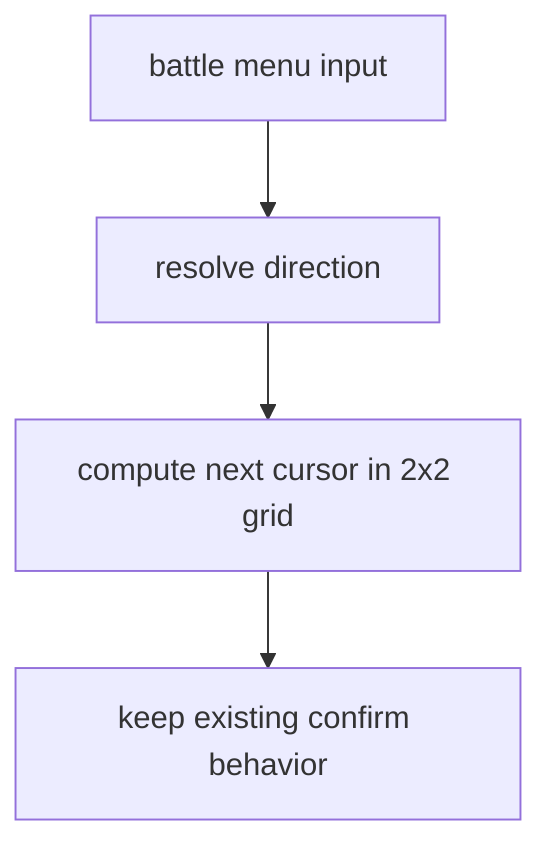
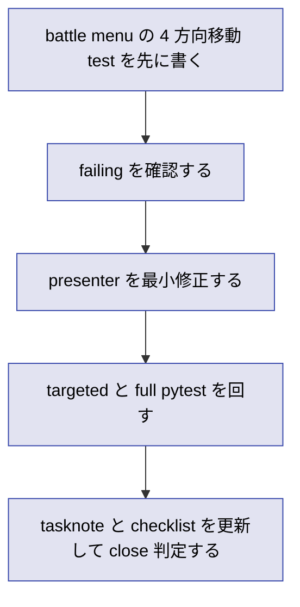

# 2026年5月26日 戦闘：先頭メニューを上下左右で選べるようにする

> 状態：⑨ Closing
> 次のゲート：（ユーザー）merge 済み差分を確認する

---

## 1) Journey（どこへ行くか）

> 補足：深層的目的 子どもが見た目どおり battle の 2x2 コマンドを直感的に動かせるようにする
> 補足：やらないこと spell/item 一覧や battle レイアウト全面改修までは広げない
> 補足：責務分担厳格度 basic

1. 前提条件
   1. 💦 battle の menu phase には 4 項目がある
   2. 💦 項目は `たたかう / じゅもん / アイテム / にげる` である
   3. 💦 実画面では 4 項目が 2 列 2 行に見える
   4. 💦 現状の cursor 更新は 4 項目を直列循環していた
   5. 💦 添付 screenshot が要求の現物である

2. Before
   1. 💦 左右に並んで見える選択肢でも左右入力が効かない
   2. 💦 子どもは見た目の配置と入力結果が一致せず迷いやすい
   3. ❌ ちぐはぐ

3. After
   1. 💦 battle menu で上下左右のどちらでも隣接項目へ移動できる
   2. ✅ 既存の決定とキャンセル挙動は壊れない
   3. ✅ spell/item list の入力仕様は従来どおり保たれる
   4. ❤️ 直感的

4. 例外
   1. 英字 fallback でも 4 方向移動の規則は同じでよい
   2. root menu 以外の縦一覧 UI は今回変えない

5. 境界条件
   1. 主語は `src/scenes/battle/presenter.py` の menu cursor 移動に限る
   2. View の見た目は現状維持を基本とする
   3. `confirm` の遷移先と spell/item sub の仕様は変更しない

6. 委任度
   1. 🟢 全体として局所的な入力仕様修正である
   2. 🟢 CCのみで可: CC 単独で完了まで進められる
   3. 🟢 CCのみで可: 起票 実装 close merge 候補まで進めてよい
   4. 🔴 人の判断: 実画面レイアウト変更は別 task に分ける

---

## 2) ユーザーストーリーマップ

> 委任度：🟢 対象 scene と完了条件は固定できている
> 残る曖昧さ：なし

### 事前確認

- [x] tasknote確認済み
- [x] skill・tool・MCP確認済み
  - [x] `manage-tasknotes`
  - [x] `using-git-worktrees`
  - [x] `test-driven-development`
  - [x] `verification-before-completion`
  - [x] `pyxel`
- [x] 永続的ドキュメント確認済み
  - [x] `AGENTS.md`
  - [x] `docs/architecture.md`
  - [x] `docs/framework-rule.md`
  - [x] `docs/ux-policy.md`

### 本体

#### 話題1：見た目が 2x2 の battle menu に合わせて入力規則を揃える

##### ユーザー：Block Quest のプレイヤー

1. 当初計画
    1. 👀 現在の battle menu cursor 更新が直列である事実を test で再現する
    2. ✏️ 上下左右入力を 2x2 隣接移動へ置き換える
    3. ✅ confirm と spell/item sub 挙動が壊れていないことを regression test で残す

---

## 3) Gherkin（完了条件）

> 委任度：🟢 このまま最後まで CC が進められる
> 残る曖昧さ：なし

### シナリオ一覧

- [x] シナリオ1：battle menu の上下左右入力が見た目どおり隣接マスへ移動する

1. 🧱 プレイヤーが battle menu を開いている（battle）
2. 🎬 右 左 上 下のいずれかを押す（battle）
3. ✅ 対応する隣接項目へ cursor が移動する（battle）

```gherkin
Given プレイヤーが battle menu を開いている
And 選択肢は 2 列 2 行で表示されている
When プレイヤーが右 左 上 下のいずれかを 1 回押す
Then cursor は対応する隣接項目へ移動する
And cursor 移動時の SFX は従来どおり鳴る
```

- [x] シナリオ2：confirm と spell/item sub の既存挙動は維持される

1. 🧱 プレイヤーが battle menu を開いている（battle）
2. 🎬 confirm や sub menu 遷移を使う（battle）
3. ✅ 既存どおり攻撃や spell/item sub 遷移が行われる（battle）

```gherkin
Given プレイヤーが battle menu を開いている
When プレイヤーが confirm で各コマンドを選ぶ
Then 既存の攻撃 じゅもん アイテム にげるの分岐は保たれる
And spell_select と item_select の入力仕様は変わらない
```

---

## 4) Design（どうやるか）

### 責務分担概要

- root cause は `battle` menu cursor 更新が 4 項目を 1 列リストとして扱っていること
- 正本は `src/scenes/battle/presenter.py` の menu 入力解釈で、View は既存 2x2 表示を変えない
- 修正入口は `_move_menu_cursor()` と 2 つの helper に閉じる
- 先に `test/test_cjg_battle_menu_navigation.py` で 4 方向移動の regression を failing test として固定する

### 責務分担概要図



### 責務分担詳細

- `src/scenes/battle/presenter.py` （✏️：battle menu 専用の 2x2 cursor 移動規則を追加する）
- `src/scenes/battle/view.py` （❌：描画レイアウトは現状維持にする）
- `test/test_cjg_battle_menu_navigation.py` （➕：4 方向移動の failing test と regressions を保持する）

### 関連スキル・MCP

- `manage-tasknotes`
- `using-git-worktrees`
- `test-driven-development`
- `verification-before-completion`
- `pyxel`

### 【参照】

- Steering: `steering/2026年5月26日（ブロクエ）メニューを上下左右で選びたい.png`
- Architecture: `docs/architecture.md`
- UXPolicy: `docs/ux-policy.md`
- Runtime: `src/scenes/battle/presenter.py`
- Test: `test/test_cjg_battle_menu_navigation.py`

### 変更範囲

- やること: battle menu で上下左右入力に応じて 2x2 隣接移動を実装する
- やらないこと: spell/item list 導線変更 レイアウト再描画 他 scene の menu 操作変更

### 検証

- 検証コマンド: `python -m pytest test/test_cjg_battle_menu_navigation.py -q` `python -m pytest test/test_cjg_battle_menu_navigation.py test/test_cjg_battle_back_rows.py test/test_cjg_battle_spell_select_window.py test/test_cjg_battle_flow_smoke.py test/test_battle_run_logic.py test/test_cjg_battle_stale_spell_message.py -q` `python -m pytest test/ -q`
- 成功条件: battle menu 専用 test と関連 battle 回帰と full suite が green である
- 未実施時の扱い: どちらか未実施なら close しない

---

## 5) Tasklist



- [x] （CC）battle menu の 4 方向移動 test を追加する
- [x] （CC）新規 test が失敗することを確認する
- [x] （CC）`battle/presenter.py` を最小修正する
- [x] （CC）targeted pytest と full pytest を回す
- [x] （CC）Development Checklist を `/tmp` へコピーしてレビューする

### レビュー

- 原本 checklist: `docs/development-checklist.md`
- /tmp コピー: `/tmp/development-checklist-20260526-1458.md`
- レビュー結果: A3/C3/C5/D3 の今回関連項目を確認し、layer 逸脱と UI 退行なしで通過
- 未通過時の扱い: fail があれば修正して再レビューし、全部通るまで Close しない

---

## 6) 作業ログ

- `main` checkout は別件 `steering/` 差分で dirty だったため、新規 worktree へ隔離して着手した
- `.worktrees/20260526-menu-4way-nav` を `feat/20260526-menu-4way-nav` で作成した
- baseline として `python -m pytest test/ -q` を実行し、`711 passed, 2 skipped, 38 deselected` を確認した
- screenshot を見直し、対象が `menu` scene ではなく battle の 2x2 コマンドであると確定した
- `python -m pytest test/test_cjg_battle_menu_navigation.py -q` を実行し、4 件失敗で red を確認した
- `src/scenes/battle/presenter.py` に `LEFT_BUTTONS` `RIGHT_BUTTONS` と 2x2 helper を追加した
- `python -m pytest test/test_cjg_battle_menu_navigation.py -q` を実行し、`4 passed` を確認した
- `python -m pytest test/test_cjg_battle_menu_navigation.py test/test_cjg_battle_back_rows.py test/test_cjg_battle_spell_select_window.py test/test_cjg_battle_flow_smoke.py test/test_battle_run_logic.py test/test_cjg_battle_stale_spell_message.py -q` を実行し、`27 passed` を確認した
- `python -m pytest test/ -q` を実行し、`715 passed, 2 skipped, 38 deselected` を確認した
- `mcp__pyxel__.run_and_capture(main.py, frame=5)` で title 画面の smoke を確認した

---

## 7) 評価と成果物

> 評価：🟢 期待通り完了した

### 成果物

- `src/scenes/battle/presenter.py`
- `test/test_cjg_battle_menu_navigation.py`
- `/tmp/development-checklist-20260526-1458.md`

---

## 8) Discussion

- 最初の思い込みは `menu` scene だったが、現物 screenshot を見直して battle 主語へ切り替えた
- 2x2 かつ既存 wrap 性を保つため、上下は行反転 左右は列反転の helper に閉じた
- spell/item 一覧は別回帰 test 群で守られているため、battle menu だけの局所修正で済ませた

---

## 9) Closing

- 状態: done
- 次のゲート: （ユーザー）merge 済み差分を確認する
- close 条件:
  - [x] 4 方向移動の test が追加されている
  - [x] targeted pytest と full pytest が通っている
  - [x] checklist レビュー結果が埋まっている

---

## 10) 参考資料

- `steering/2026年5月26日（ブロクエ）メニューを上下左右で選びたい.png`
