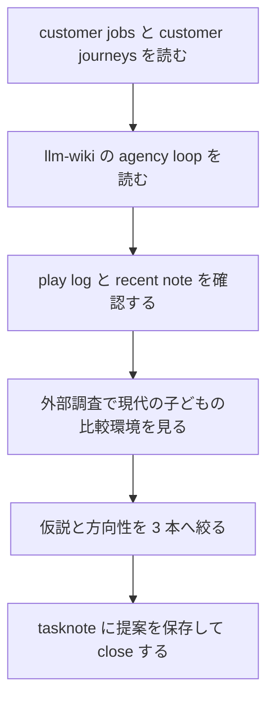

# 2026年5月26日 提案：子どもがまた遊びたくなる方向性を整理する

> 状態：⑨ Closing
> 次のゲート：なし

---

## 1) Journey（どこへ行くか）

> 補足：深層的目的 親が「飽きたのかも」で止まらず、子どもの主体性を守ったまま次の一手を選べるようにする
> 補足：やらないこと 今回は即実装や大規模リニューアル案までは決めず、方向性の提案と優先順位づけに絞る
> 補足：責務分担厳格度 basic

1. 前提条件
   1. 💦 この repo の根本価値は `子どもがゲームを編集できる` ことにある
   2. 💦 `customer-jobs.md` と `customer-journeys.md` は、価値の中心を `遊ぶ -> 作る -> 判断する -> 共有する` の連続体験として定義している
   3. 💦 llm-wiki も `child agency` `fast feedback` `low friction sharing` を中核に置いている
   4. 💦 `.runtime/play_sessions.sqlite3` には実公開の play log が残っている
   5. 💦 2026-05-26 の recent note 群には、子ども向け UI の小さな詰まりを直した記録が複数ある

2. Before
   1. 💦 親には「飽きた」のか「わかりにくくて離れた」のかが切り分けにくい
   2. 💦 競合の基準は Roblox やモバイルのような即時性と社会性を含む
   3. 💦 いま大きい機能追加へ飛ぶと、主体性の核より先に量で勝負してしまう
   4. ❌ もやもや

3. After
   1. 💦 `何が止まっているのか` を 4 仮説に分けて見られる
   2. ✅ 次に試す方向性を 3 本へ絞って優先順位を付けられる
   3. ✅ play log と customer journey を、監視ではなく会話の材料として使える
   4. ❤️ 見通しが立つ

4. 例外
   1. 飽きの原因は 1 つに限らない
   2. play log は誰が遊んだかを識別しないので、親子対話で補う必要がある
   3. 長時間 session には放置タブが混ざる可能性がある

5. 境界条件
   1. 提案は `Code Maker を主役に残す` 前提で考える
   2. `親が決めるゲーム` に寄る施策は採らない
   3. Roblox 的な大規模 UGC 量産競争ではなく、この repo 固有の価値を伸ばす方向に絞る

6. 委任度
   1. 🟢 全体として調査・要約・方向性提案までは CC が自走できる
   2. 🟢 CCのみで可: docs / llm-wiki / play log / recent tasknote を横断して仮説化する
   3. 🟡 人の判断: どの方向性を先に実装するか、家でどの遊び方を試すかは親子で決める

---

## 2) ユーザーストーリーマップ

> まず「飽きた」を 1 つの感情で片付けず、止まり方ごとに整理してから方向性を選ぶ。
> 委任度：🟢 調査対象と提案の軸までは CC が固められる
> 残る曖昧さ：実際にどの仮説が最も強いかは子どもの反応確認が必要

### 事前確認

- [x] tasknote確認済み
- [x] skill・tool・MCP確認済み
  - [x] `using-superpowers`
  - [x] `brainstorming`
  - [x] `manage-tasknotes`
  - [x] `llm-wiki-query`
  - [x] `research`
  - [x] `web`
- [x] 永続的ドキュメント確認済み
  - [x] `AGENTS.md`
  - [x] `docs/customer-jobs.md`
  - [x] `docs/customer-journeys.md`
  - [x] `llm-wiki/wiki/areas/continuous-experience-loop.md`
  - [x] `llm-wiki/wiki/areas/approval-loop-and-child-agency.md`
  - [x] `llm-wiki/wiki/areas/low-friction-sharing.md`
  - [x] `llm-wiki/wiki/areas/child-readable-ux-and-parent-assist.md`
  - [x] `llm-wiki/wiki/areas/fast-feedback-development-loop.md`
  - [x] `llm-wiki/wiki/areas/parent-support-without-control.md`

### 本体

#### 話題1：止まり方を 4 仮説に分ける

##### ユーザー：子どもの変化を理解したい親

1. 当初計画
   1. 👀 `飽きた` を `摩擦疲れ` `所有感不足` `社会的反応不足` `完走目標不足` に分けて考える
   2. 👀 play log と recent bugfix note を、その仮説の補助根拠として使う
   3. 📝 1 つの大機能追加より、どの loop が切れているかを先に見る

#### 話題2：方向性を 3 本に絞る

##### ユーザー：次に何を伸ばすか決めたい親子

1. 当初計画
   1. ✏️ `遊びやすさの回復`
   2. ✏️ `自分のゲーム感の強化`
   3. ✏️ `見せたくなる循環`

#### 話題3：親の関わり方を先に固定する

##### ユーザー：支えたいが主導しすぎたくない親

1. 当初計画
   1. 👀 play log は `どう直すかを親が決める材料` ではなく `どう声をかけるか` の材料に留める
   2. 👀 選択肢は親や AI が用意しても、採否は子どもに残す
   3. ✅ `何を増やすか` より `どれを試したいか` を子どもに聞ける状態へ寄せる

---

## 3) Gherkin（完了条件）

> 委任度：🟢 このまま提案の提出まで CC が進められる
> 残る曖昧さ：なし

### シナリオ一覧

- [x] シナリオ1：親が `飽きた` を 1 語で終わらせず loop の切れ方として見直せる

1. 🧱 親が最近子どもが遊ばないことを気にしている（家庭）
2. 🎬 docs / wiki / play log / recent note を重ねて読む（調査）
3. ✅ 原因仮説と次の方向性が分かれて見える（提案）

```gherkin
Given 親が「最近このゲームで遊ばない」と感じている
When customer jobs と customer journeys と play log を見比べる
Then 問題は単なる飽きではなく loop のどこが止まったかとして整理できる
And 次に試す方向性を複数の選択肢として持てる
```

- [x] シナリオ2：提案が子どもの主体性を壊さない

1. 🧱 親や AI は実装や提案を補助できる（運用）
2. 🎬 方向性を選ぶ場面になる（家庭）
3. ✅ 最後の採否は子どもに残る（家庭）

```gherkin
Given 親や AI が複数の改善案を用意できる
When 次に何を試すかを決める
Then 子どもが「これをやりたい」「これは違う」と言える余地が残る
And 親は決定の代行ではなく技術翻訳に留まる
```

- [x] シナリオ3：提案が repo の価値と外部環境の両方に接続している

1. 🧱 repo は Code Maker と child agency を核にしている（docs）
2. 🎬 外部調査で現代の子どものゲーム文脈を確認する（調査）
3. ✅ 提案が `レトロだからダメ` でも `もっと量を足そう` でもない形になる（提案）

```gherkin
Given この repo の核が child agency と fast feedback loop にある
And 現代の子どもはモバイル性 社会性 即時性の高いゲーム環境にも慣れている
When 次の方向性を提案する
Then 提案は retro aesthetic の否定ではなく loop の再接続に向く
And Roblox 的な量ではなく Block Quest 固有の価値を伸ばす
```

---

## 4) Design（どうやるか）

### 責務分担概要

- 今回の主語は `新機能案` ではなく `子どもが離れた理由の仮説化` と `方向性の優先順位づけ` である
- 正本は `docs/customer-jobs.md` `docs/customer-journeys.md` と llm-wiki の関連 area page に置く
- play log は `観測事実`、recent tasknote は `子ども向け UX で最近何が詰まっていたかの現物` として扱う
- 外部調査は、`今どきの子どもの比較対象は何か` を補助する根拠として使う

### 方向性の結論

#### 提案1：遊びやすさの回復を先にやる

- 一番先に見るべきは `飽き` より `小さな詰まりの累積` です
- 2026-05-26 に集中していた recent note は、`上下左右で選べない` `もどるが見えない` `AIでしゅうせいが古い` `レベルが上がらないと感じる` といった child-facing friction が複数あったことを示しています
- play log でも `2026-05-01` 以降の production 48 session のうち 19 session が short で、最初の 1 分以内に終わる比率が無視できません
- 方向性としては `新しい機能を足す前に、最初の5分で迷わない・読める・戻れる・次に何をすればいいか分かる` を毎回守る lane を優先するのがよいです

#### 提案2：毎回ひとつ `自分のゲーム感` が残る形へ寄せる

- この repo の勝ち筋は Roblox と同じ量のコンテンツではなく、`自分で触ったら今のゲームが自分のものとして変わる` 体験です
- `customer-jobs` では `JCR_CHILD_CREATOR` と `JIS_PARENT_AUTONOMY`、`customer-journeys` では `CJ01-CJ07` `CJ23` `CJ24` `CJ26` がここに当たります
- 提案の芯は、1 session ごとに `見える変更が1つ残る` ことです
- 例は `タイルを1つ増やす` `主人公の色を変える` `NPCのひとことを変える` `じぶんの効果音を1つ入れる` のような、小さくても current に痕跡が残るものです
- 重要なのは量より `自分が入れた跡が次に遊んだときも残っている` ことです

##### 深掘り：`あえてツッコませる` を loop にする

- ここで強めたいのは `作者` だけでなく `批評者` としての子どもです
- 子どもは blank から作るより、`ちょっと変` `ここだけ違う` に反応したほうが言葉が出やすいことがあります
- そのため、編集のたびに `正解を渡す` のではなく `1つだけズレた候補版` を preview で混ぜる設計はかなり相性がよいです
- 具体例は `このいろ へんじゃない？` `このセリフ なんかちがう？` `このおと おおきすぎる？` のように、1 箇所だけ違和感を入れて `どこがへん？` と聞く形です
- loop は `変更する -> 候補を2つ見る -> へんな方にツッコむ -> なおす -> その場で遊ぶ` が基本です
- これなら `作るのが難しい` 子でも `えらぶ` `なおす` `ダメ出しする` から参加できます
- しかも `親や AI が主導しても採否は子どもが決める` 構造を保ちやすいです

##### `あえてツッコませる` ときのガードレール

- ズラすのは毎回 `1箇所だけ` にする
- ズレた候補は `preview 限定` にして、本編へ勝手に確定しない
- 進行不能になる壊し方は使わず、色・見た目・セリフ・演出などの安全な領域から始める
- `まちがい探し` ではなく `きみならどうする？` の聞き方にして、正誤テスト化しない
- 1 回の session で求めるツッコミは `1 個だけ` に絞る

#### 提案3：見せたくなる循環を軽く足す

- 外部調査では、Pew 2024 が `89% of teen video game players play with others`、`72%` が遊ぶ理由に `spend time with others` を挙げています
- ESA 2024 でも `78%` が mobile device で遊び、`83%` の親が子どもとゲームをするとされています
- つまり今どきの比較対象は `ひとりで長く遊べるか` だけではなく、`すぐ見せられるか` `一緒に反応できるか` です
- この repo では `CJ21` `CJ22` `CJ43` がその loop です
- 方向性としては大げさなSNS機能ではなく、`今日の変更を1つ見せる` `親が5分だけ遊んで感想を返す` `友達にURLを送って1問だけ聞く` のような軽い反応 loop を作るのがよいです

##### 深掘り：`スクショで見せる` は相性がよい

- とくに相性がよいのは `変更直後に1枚撮る` スクショ機能です
- ただ撮るだけでなく、`ここすき` `ここへん` `もっとピカピカ` のような短い stamp を 1 個だけ乗せられると、共有が感想の入口になります
- `この画面のどこを直したい？` をスクショ上で指させると、口頭説明より負荷が下がります
- 公開SNSのような `いいね数` 競争にせず、親・きょうだい・友達へ `1枚見せて1コメント返る` くらいの軽さに留めるほうが、この repo の child agency と合っています

### いまの仮説

1. `飽きた` というより、まず `摩擦で離れやすくなっていた` 可能性が高い
2. その上で、`自分のゲーム感` と `反応が返る場` が弱いと、Roblox やモバイルの即時性に気持ちが流れやすい
3. retro style 自体が問題というより、retro style に `現代の即時性と社会性` がまだ十分乗っていないのが課題である

### 推奨する順番

1. `遊びやすさの回復`
2. `自分のゲーム感の強化`
3. `見せたくなる循環`

### 今回あえて勧めない方向

- 敵やエリアを大量追加して量で引き止めること
- 親や AI が先回りして全部決めること
- play log を監視ダッシュボード化すること
- Code Maker を脇へ寄せて別の編集面へ置き換えること

---

## 5) Tasklist



- [x] （CC）repo の顧客文書を読む
- [x] （CC）llm-wiki の関連 area と query を読む
- [x] （CC）`.runtime/play_sessions.sqlite3` を集計する
- [x] （CC）recent の child-facing 修正 note を読む
- [x] （CC）外部調査で今どきの子どものゲーム文脈を確認する
- [x] （CC）方向性を提案としてまとめる

### 記録の分け方

#### 作業ログ に書く

- 読んだ docs / wiki / note / play log / web sources
- play log の集計結果

#### Discussion に書く

- どの仮説を強く見たか
- なぜ大量追加より loop 修復を優先したか
- どの順番で試すのがよいか

---

## 6) 作業ログ

- `docs/customer-jobs.md` と `docs/customer-journeys.md` を読み、repo の正本が `遊ぶ -> 作る -> 判断する -> 共有する` の連続体験にあることを確認した
- llm-wiki の `continuous-experience-loop` `approval-loop-and-child-agency` `low-friction-sharing` `child-readable-ux-and-parent-assist` `fast-feedback-development-loop` `parent-support-without-control` を読み、提案の判断軸を repo の言葉にそろえた
- `llm-wiki/wiki/query/2026-05-24-what-protects-child-agency-in-co-development.md` を読み、親は手数を引き受けても最終判断は子どもに残すことを再確認した
- `python tools/report_play_sessions.py` を実行し、recent に production session が残っている一方で short session も多いことを確認した
- `2026-05-01` 以降の production session は `48` 件で、`short 19 / middle 12 / long 17` だった
- `2026-05-24` は production `6` 件 `avg 529s`、`2026-05-26` は production `3` 件 `avg 3519s` だった
- ただし long session には放置タブが混ざる可能性があるため、平均秒数より bucket の比率を重く見た
- 2026-05-26 の recent note として `戦闘：先頭メニューを上下左右で選べるようにする` `メニュー：そうび画面の最後にもどるを追加する` `メニュー：一覧UIのもどる導線をまとめて揃える` `アプリ：main.pyダウンロード前提のAIでしゅうせいメニューを撤去する` `成長：レベルが上がらない報告を切り分ける` を読み、child-facing friction が実在していたことを確認した
- 外部調査として `Pew Research Center` `ESA Essential Facts 2024` `Roblox newsroom` `PubMed の SDT 系論文` を読み、現代の子どもの比較環境が `社会性` `低摩擦` `即時性` `autonomy/competence/relatedness` に強く寄っていることを補強した

---

## 7) 評価と成果物

> 評価：🟢 期待通り完了した

### 成果物

- 子どもが遊ばなくなった理由の 4 仮説
  - 摩擦疲れ
  - 所有感不足
  - 社会的反応不足
  - 完走目標不足
- 次に試す方向性 3 本
  - 遊びやすさの回復
  - 自分のゲーム感の強化
  - 見せたくなる循環
- 推奨優先順位
  - 1. 遊びやすさの回復
  - 2. 自分のゲーム感の強化
  - 3. 見せたくなる循環

---

## 8) Discussion

- 一番大事なのは、`飽きたなら新要素を増やす` と短絡しないことだった。repo の docs も llm-wiki も、価値の核を `量` ではなく `連続体験` と `主体性` に置いている
- recent note 群からは、子どもが実際に引っかかるのは大きな仕様不足より `読めない` `戻れない` `見た目どおりに動かない` といった micro friction だと読めた。これは boredom より先に immersion break と捉えるべき
- 外部調査を重ねると、今どきの子どもの比較対象は `レトロゲーム` だけでなく、mobile と social を前提にしたゲーム群である。したがって retro visual のままでも、`すぐ反応が返る` `誰かに見せられる` `自分の跡が残る` を強くしないと競争力が弱い
- 逆に、この repo は `自分で変えてすぐ遊ぶ` という固有の勝ち筋を持っている。ここを伸ばさずにボリュームだけ足すのは、Roblox の土俵へ寄ってしまい不利
- 親の使い方としては、play log を `最近短いな` `ここ数日は触っているな` と会話のきっかけに留めるのがよい。`だから次はこれを入れる` と親が単独で決め始めると、repo が守ろうとしている child agency から外れやすい
- `自分のゲーム感` を深掘りする次の候補としては、`わざと1つだけズレた候補版を混ぜる` `ツッコミ用スクショを残せる` `1変更ごとに1つだけ感想を返す` の 3 点セットが有効そうだった。批評の入口を空気ではなく UI にすることで、`JCT_CHILD_CRITIC` を強めつつ `CJ31-CJ34` の approval loop とも接続しやすい
- 信頼できる発信者 cluster としては、`Mitchel Resnick` `Mizuko Ito` `Yasmin Kafai` `Katie Salen Tekinbaş` `Björn Jeffery` が強く、補助的に `Marina Bers` `Amy Jo Kim` `阿部和広` を参照すると、この repo の `主体性` `共有` `軽い反応 loop` の設計を深掘りしやすい

### 反省とルール化

- 記入先：`steering/`
- 次にやること：子どもに 3 方向のうちどれを試したいかを聞き、1 本だけ小さく試す

---

## 9) Closing

- 状態: done
- 次のゲート: なし
- close 条件:
  - [x] docs / wiki / play log / external sources を横断した
  - [x] 方向性を 3 本へ絞った
  - [x] 親が採るべき姿勢と避けるべき方向も明記した

---

## 10) 参考文献

- Local: `docs/customer-jobs.md`
- Local: `docs/customer-journeys.md`
- Local: `llm-wiki/wiki/areas/continuous-experience-loop.md`
- Local: `llm-wiki/wiki/areas/approval-loop-and-child-agency.md`
- Local: `llm-wiki/wiki/areas/low-friction-sharing.md`
- Local: `llm-wiki/wiki/areas/child-readable-ux-and-parent-assist.md`
- Local: `llm-wiki/wiki/areas/fast-feedback-development-loop.md`
- Local: `llm-wiki/wiki/areas/parent-support-without-control.md`
- Local: `llm-wiki/wiki/query/2026-05-24-what-protects-child-agency-in-co-development.md`
- Local: `steering/done/2026年5月26日 戦闘：先頭メニューを上下左右で選べるようにする.md`
- Local: `steering/done/2026年5月26日 メニュー：そうび画面の最後にもどるを追加する.md`
- Local: `steering/done/2026年5月26日 メニュー：一覧UIのもどる導線をまとめて揃える.md`
- Local: `steering/done/2026年5月26日 アプリ：main.pyダウンロード前提のAIでしゅうせいメニューを撤去する.md`
- Local: `steering/done/2026年5月26日 成長：レベルが上がらない報告を切り分ける.md`
- Local: `.runtime/play_sessions.sqlite3`
- Web: Pew Research Center, `Teens and Video Games Today`, 2024-05-09, https://www.pewresearch.org/internet/2024/05/09/teens-and-video-games-today/
- Web: Entertainment Software Association, `Essential Facts 2024`, 2024-05, https://www.theesa.com/wp-content/uploads/2024/05/Essential-Facts-2024-FINAL.pdf
- Web: Roblox, `How Roblox Is Fueling Careers Across the USA`, 2024-08-29, https://about.roblox.com/tr/newsroom/2024/08/how-roblox-is-fueling-career-opportunities-across-the-us
- Web: Ryan, Rigby, Przybylski, `The motivational pull of video games: A self-determination theory approach`, 2006/2009 系列の基礎研究参照
- Web: Ryan, Rigby, Przybylski, `Manipulating autonomy, competence, and relatedness support in a game-learning context`, https://pubmed.ncbi.nlm.nih.gov/17761025/
- Web: Mitchel Resnick official / Medium, https://www.media.mit.edu/people/mres/ , https://mres.medium.com/
- Web: Mizuko Ito / Connected Learning Alliance, https://clalliance.org/person/mimi-ito/ , https://clalliance.org/blog/summer-of-minecraft-and-the-magic-of-peer-mentorship/
- Web: Yasmin B. Kafai official, https://www.yasminkafai.com/ , https://www.yasminkafai.com/about-1
- Web: Katie Salen Tekinbaş official, https://www.katiesalen.me/
- Web: Björn Jeffery official, https://www.bjornjeffery.com/ , https://www.bjornjeffery.com/newsletter/
- Web: Marina Umaschi Bers official, https://www.marinabers.com/ , https://www.marinabers.com/bio
- Web: Amy Jo Kim official, https://amyjokim.com/ , https://amyjokim.com/about/
- Web: Jordan Shapiro official, https://www.jordanshapiro.org/
- Web: danah boyd official, https://www.danah.org/
