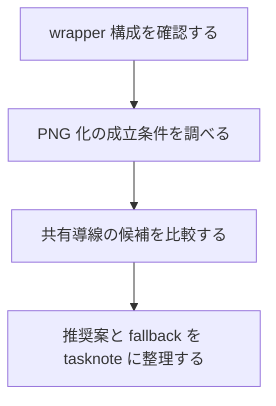
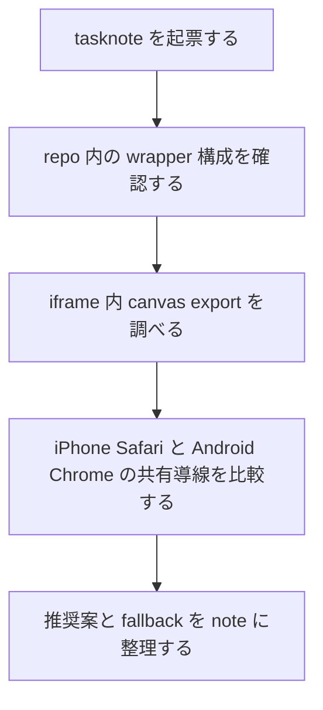

# 2026年5月26日 調査：つっこみスクショ機能の技術選定を進める

> 状態：✅ close
> 次のゲート：なし

---

## 1) Journey（どこへ行くか）

> 補足：深層的目的 子どもの `遊ぶ -> 判断する -> 見せる` を切らさずに、`つっこみスクショ` を現実的な技術で始められるようにする
> 補足：やらないこと 今回は実装着手や UI 詳細確定までは進めず、技術選定と調査で不確実性を減らす
> 補足：責務分担厳格度 basic

1. 前提条件
   1. 💦 `つっこみスクショ` は B 案、絵文字スタンプ、最大 50 回で始める
   2. 💦 Web 配布版は `play.html -> iframe(pyxel.html)` の wrapper 構成である
   3. 💦 Pyxel の入力・描画は View / 最外殻に閉じる規約がある
   4. 💦 優先論点は `PNG 化` と `Safari / Chrome 共有導線` の 2 本である

2. Before
   1. 💦 `スクショは欲しい` が、どこに実装するのが筋かまだ固まっていない
   2. 💦 Web Share API / download / clipboard など候補が多く先に比較が要る
   3. ❌ 進み方がぼやける

3. After
   1. 💦 技術候補を 2〜4 個に絞り、それぞれの成立条件とリスクが見える
   2. ✅ `まず試すべき実装面` と `後回しでよいもの` が分かる
   3. ✅ 次に実証すべき点が tasknote に固定される
   4. ❤️ 次の一歩が切れる

4. 例外
   1. ブラウザ実機差分は公式情報だけでは埋まらないことがある
   2. Safari / Chrome の仕様差は時期で変わるため、最終的には実機確認が要る

5. 境界条件
   1. `Code Maker` を主役から外さない
   2. 先に `技術の選び方` を決め、UI の細部は後段に回す
   3. まずは Web 版の wrapper 起点を優先し、Pyxel scene 側への侵入は後回しにする

6. 委任度
   1. 🟢 全体として技術調査と候補整理までは CC が自走できる
   2. 🟢 CCのみで可: repo 読み取り、公式情報の収集、候補比較、tasknote 追記
   3. 🔴 人の判断: 最終 UX と共有の開き方は user 判断が要る

---

## 2) ユーザーストーリーマップ

> Gherkin の前に、今回の調査をどの順番で進めるかだけをそろえる。
> 委任度：🟢 この順でそのまま CC が進められる
> 残る曖昧さ：なし

### 事前確認

- [ ] tasknote確認済み
- [ ] skill・tool・MCP確認済み
  - [ ] `brainstorming`
  - [ ] `manage-tasknotes`
  - [ ] `manage-tasknotes-create`
  - [ ] `manage-tasknotes-rules-core`
  - [ ] `manage-tasknotes-rules-format`
  - [ ] `research`
  - [ ] `web`
- [ ] 永続的ドキュメント確認済み
  - [ ] `AGENTS.md`
  - [ ] `docs/architecture.md`
  - [ ] `docs/framework-rule.md`
  - [ ] `docs/customer-jobs.md`
  - [ ] `docs/customer-journeys.md`
  - [ ] `templates/wrapper.html`

### 本体

#### 話題1：スクショ機能の実装面をどこに置くか決める

##### ユーザー：子どもの job を壊さず技術選定したい担当者

1. 当初計画
   1. 👀 repo 内の `wrapper / iframe / save / share` まわりの現実を確認する
   2. ✂️ 実装面を `wrapper 側` `iframe 側` `runtime 側` に分けて比較する
   3. 📝 最初に採るべき面を 1 本に絞る

#### 話題2：PNG 化の成立条件を確認する

##### ユーザー：capture の成否を先に知りたい担当者

1. 当初計画
   1. 👀 same-origin / canvas export / taint 条件を確認する
   2. 👀 ローカルで `play.html -> iframe -> canvas` の経路を実証する
   3. 📝 何を壊すと capture が失敗するかも残す

#### 話題3：共有導線の候補を広げる

##### ユーザー：iPhone Safari / Android Chrome で破綻しない導線を先に知りたい担当者

1. 当初計画
   1. 👀 `Web Share API` `download` `clipboard` の候補を比較する
   2. 👀 user activation や iframe 制約を確認する
   3. 📝 第1候補と fallback を分けて整理する

---

## 3) Gherkin（完了条件）

> 委任度：🟢 調査結果の保存まで CC が進められる
> 残る曖昧さ：なし

### シナリオ一覧

- [ ] シナリオ1：capture の技術候補が実装面つきで比較できる

1. 🧱 現在の Web 配布構成を調べている（repo）
2. 🎬 wrapper / iframe / runtime の候補を比較する（調査）
3. ✅ どこに置くのが最小かが分かる（tasknote）

```gherkin
Given 現在の Web 版が play.html の wrapper と pyxel.html の iframe で構成されている
When スクショ機能の実装面を wrapper iframe runtime で比較する
Then 最初に試すべき実装面を 1 つに絞れる
And それ以外を後回しにする理由も残る
```

- [ ] シナリオ2：iframe 内 canvas の PNG 化について成立条件が明文化される

1. 🧱 same-origin と canvas export 条件を調べている（公式情報）
2. 🎬 ローカルで iframe 内 canvas へのアクセスを試す（実証）
3. ✅ 成立条件と壊れる条件が tasknote に残る（tasknote）

```gherkin
Given 現在の Web 版が同一オリジンで play.html と pyxel.html を配信している
When iframe 内 canvas の export 条件を公式情報とローカル実証で確認する
Then PNG 化の成立条件が tasknote に明記される
And 将来壊れうる条件も注意点として残る
```

- [ ] シナリオ3：iPhone Safari / Android Chrome 向け共有導線の候補が整理される

1. 🧱 モバイル共有の候補を調べている（公式情報）
2. 🎬 Web Share API と fallback を比較する（調査）
3. ✅ 第1候補と fallback の構成が決まる（tasknote）

```gherkin
Given iPhone Safari と Android Chrome を主な共有導線の対象としている
When Web Share API download clipboard の候補を比較する
Then 第1候補の共有導線と fallback の候補が整理される
And iframe 制約や user activation 条件も明記される
```

---

## 4) Design（どうやるか）

### 責務分担概要

- root cause は `スクショ機能の実装場所と共有導線の選び方が未確定` である
- 正本は `docs/customer-jobs.md` `docs/customer-journeys.md` と repo の Web wrapper 構成に置く
- 今回の入口は `templates/wrapper.html` `tools/render_release_selector.py` `tools/web_runtime_server.py` の読み取りと、公式情報の比較である
- 先に実装せず、`capture 可否` と `share 可否` の 2 本を調査タスクとして固定する

### 責務分担概要図



### 責務分担詳細

- `templates/wrapper.html` （👀：スクショ UI を置ける最外殻かを見る）
- `tools/render_release_selector.py` （👀：wrapper の生成元として変更入口になるかを見る）
- `tools/web_runtime_server.py` （👀：共有保存 API を後から足せるかだけ確認する）
- `docs/framework-rule.md` （👀：wrapper 起点が規約に合うか確認する）
- `公式ブラウザ文書` （👀：Web Share API と canvas export の成立条件を比較する）

### 関連スキル・MCP

- `manage-tasknotes`
- `brainstorming`
- `research`

### 【参照】

- Steering: `steering/`
- Architecture: `docs/architecture.md`
- UXPolicy: `docs/customer-jobs.md` / `docs/customer-journeys.md`

### 変更範囲

- やること: 技術候補の調査、ローカル実証、推奨案と fallback の整理
- やらないこと: 実装着手、UI 細部の確定、保存 API の新設

### 検証

- 検証コマンド: repo 読み取り、必要なら headless browser で iframe/canvas の実証
- 成功条件: `capture` と `share` の第1候補 / fallback / 注意点が tasknote に残る
- 未実施時の扱い: 実証できない箇所は未確認として残し、推測と分けて書く

---

## 5) Tasklist



- [x] （CC）tasknote を起票する
- [x] （CC）repo 内の wrapper / iframe / save 導線を確認する
- [x] （CC）`iframe 内 canvas の PNG 化` を公式情報とローカル実証で確認する
- [x] （CC）`iPhone Safari / Android Chrome の共有導線` を公式情報で比較する
- [x] （CC）推奨案 / fallback / 注意点を tasknote に整理する

### 記録の分け方

#### 作業ログ に書く

- 読んだ code / docs / web sources
- 実行したローカル検証と結果

#### Discussion に書く

- なぜその候補を第1候補に置いたか
- なぜ他の候補を後回しにしたか

---

## 6) 作業ログ

1. Local docs を確認した。
   - `templates/wrapper.html` は `play.html -> iframe(pyxel.html)` の
     同一オリジン wrapper で、最外殻に UI を足せる。
   - `tools/render_release_selector.py` は wrapper 生成元で、
     `templates/wrapper.html` の変更を配布物へ流せる。
   - `docs/framework-rule.md` の M1 より、Pyxel 内部より wrapper 側が筋。

2. ローカル実証を行った。
   - `tools.web_runtime_server` で `127.0.0.1:8898` を立て、
     `/dist/play.html` を system Chrome で開いた。
   - wrapper から `iframe.contentWindow.document` へ到達できた。
   - `canvas.toDataURL("image/png")` は
     `data:image/png;base64,...` を返した。
   - `canvas.toBlob(...)` は `blob.size = 1572` を返した。
   - 実測では `sameOrigin: true` `canvas: true` だった。

3. 共有 API のローカル feature 検出を見た。
   - この desktop/headless Chrome 実測では
     `navigator.share === false`
     `navigator.canShare === false`
     `navigator.clipboard.write === true`
     `iframe allow === null` だった。
   - これは VM 上の desktop 実測であり、
     iPhone Safari / Android Chrome の最終代替ではない。

4. 公式情報を読んだ。
   - W3C Web Share API:
     `share()` / `canShare()` は secure context。
   - `share()` は transient activation が必要。
   - `files` を含む share は `canShare()` で事前判定する。
   - third-party iframe では `allow="web-share"` が要る。
   - WHATWG HTML canvas:
     `toDataURL()` / `toBlob()` は origin-clean が false だと
     `SecurityError` になる。
   - web.dev / WebKit:
     Android / iOS 系 OS では share 機構があれば Web Share を使える。
     Safari 側の clipboard は `image/png` を secure context +
     user gesture で扱える。

5. 検証系コマンドを回した。
   - tasknote lint は最終 path で通った。
   - `python -m pytest test/ -q` は
     `docs/architecture_rules.yml`
     と `docs/stakeholder_voices.yml` 欠落で
     既存 3 fail のままだった。

---

## 7) 評価と成果物

> 評価：🟢 調査完了

### 成果物

- `steering/done/2026年5月26日 調査：つっこみスクショ機能の技術選定を進める.md`
  （PNG 化と共有導線の選定結果）

### 技術選定サマリ

1. 推奨スタック
   - `capture`:
     wrapper から iframe 内 canvas を読み、
     `canvas.toBlob("image/png")` で PNG を作る。
   - `annotate`:
     wrapper 上に静止画像オーバーレイを出し、
     絵文字スタンプを最大 50 個まで置く。
     Export 時に offscreen canvas へ焼き込む。
   - `share primary`:
     wrapper のボタンから
     `navigator.canShare({ files })`
     -> `navigator.share({ files, title, text })`
   - `share fallback 1`:
     `navigator.clipboard.write([ClipboardItem])`
     で PNG をコピーする。
   - `share fallback 2`:
     `URL.createObjectURL(blob)` + `<a download>` で保存する。

2. 技術選定
   - 第1候補:
     `wrapper capture + Web Share(files)`
   - 第2候補:
     `wrapper capture + Clipboard(image/png)`
   - 第3候補:
     `wrapper capture + Download`
   - 後回し:
     `iframe / Pyxel scene 側から直接 share を呼ぶ`

3. 成立条件
   - `play.html` と `pyxel.html` が同一オリジンで配信されること。
   - canvas が `origin-clean` を保つこと。
   - share / clipboard は user gesture から呼ぶこと。
   - production は HTTPS で配ること。

4. 破綻条件
   - `pyxel.html` を別 origin / CDN へ逃がす。
   - canvas に cross-origin 画像を描いて taint する。
   - share を iframe 側へ寄せたうえで third-party 埋め込みにする。
   - `await` を挟み過ぎて user activation を失う。

5. 次の実装に向けた最小方針
   - share ボタン自体は wrapper 上位に置く。
   - capture も wrapper で完結させる。
   - Pyxel 側は必要なら `postMessage` で
     「今撮って」の通知だけ出す。
   - 第1段階では server upload を持たず、
     端末内共有に閉じる。

---

## 8) Discussion

1. wrapper を第1実装面にした理由
   - 現在の repo では wrapper が最外殻であり、
     M1 の責務分離に最も素直に合う。
   - ここへ `スクショ` `共有` `スタンプ overlay` を置けば、
     Pyxel scene を汚さずに済む。

2. Web Share(files) を第1候補にした理由
   - `JSC_CHILD_SOCIAL` と `JFR_FRIEND_LOW_FRICTION` は
     「すぐ届く」「その場で体験」が主眼であり、
     mobile の native share sheet が最も job に合う。
   - 画像をそのまま LINE / Messages / 写真などへ流せる。

3. Clipboard を第2候補にした理由
   - WebKit 公式情報で `image/png` の write が示されている。
   - share 非対応環境でも、
     `貼り付けて送る` 会話導線を残せる。
   - ただしアプリによって paste UX が揺れるので主役にはしない。

4. Download を第3候補にした理由
   - API 依存が最も少ない最後の逃げ道としては強い。
   - ただし mobile では `保存して終わり` になりやすく、
     `見せて反応をもらう` には弱い。

5. 今回の調査から出た設計ルール
   - `capture` と `share` は分ける。
   - `share` は iframe ではなく wrapper で呼ぶ。
   - mobile では feature detection 前提にする。
   - 実機 smoke は次 task で別に切る。

---

## 9) Closing

- 状態: done
- 次のゲート: なし
- close 条件:
  - [x] 技術候補が比較できる
  - [x] PNG 化の成立条件が明記される
  - [x] 共有導線の第1候補と fallback が整理される

---

## 10) 参考資料

- Local: `docs/architecture.md`
- Local: `docs/framework-rule.md`
- Local: `docs/customer-jobs.md`
- Local: `docs/customer-journeys.md`
- Local: `templates/wrapper.html`
- Local: `tools/render_release_selector.py`
- Web: [W3C Web Share API](https://www.w3.org/TR/web-share/)
- Web: [WHATWG HTML canvas](https://html.spec.whatwg.org/multipage/canvas.html)
- Web: [web.dev Web Share](https://web.dev/articles/web-share?hl=ja)
- Web: [web.dev OS Integration](https://web.dev/learn/pwa/os-integration?hl=en)
- Web: [WebKit Web Share iframe policy](https://webkit.org/blog/13708/allowing-web-share-on-third-party-sites/)
- Web: [WebKit Async Clipboard API](https://webkit.org/blog/10855/async-clipboard-api/)
- Web: [web.dev Copy Images](https://web.dev/patterns/clipboard/copy-images)
