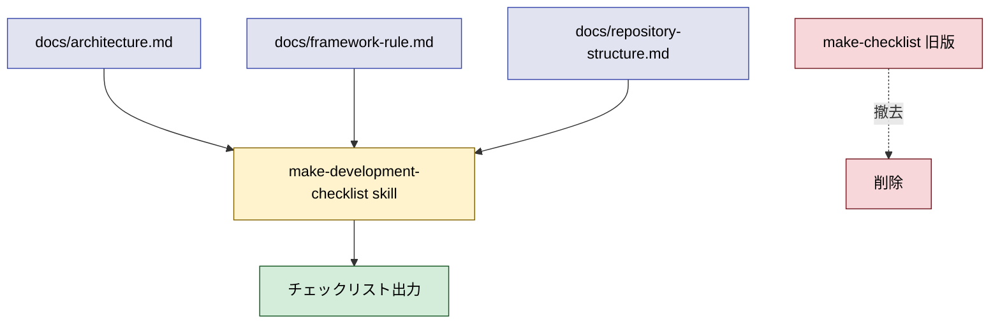

# 2026年5月26日 開発基盤：make-checklist を汎用化してリネームする

> 状態：⑨ Closing
> 次のゲート：なし

---

## 1) Journey（どこへ行くか）

> 補足：深層的目的　他プロジェクトでも docs/ 3 層からチェックリストを生成できる横展開可能な skill にする
> 補足：やらないこと　docs/ 規約本体の変更、対象 3 文書以外への拡張、code-quest-pyxel 専用ロジックの追加
> 補足：責務分担厳格度 full

1. 前提条件
    1. 💦 2026-05-26 commit `d34a6ed` で `make-checklist` skill 初版が done
    2. 💦 初版は code-quest-pyxel 固有（Pyxel / pyxres / Scene MVP / CJ44 等）を含む
    3. 💦 他プロジェクトで `/make-checklist` を呼ぶと無意味な出力になる

2. Before
    1. 💦 skill は固定 100 項目を持ち、他プロジェクトで意味をなさない
    2. 💦 skill 名 `make-checklist` も対象が不明瞭
    3. ❌ 横展開できない・名前が曖昧で混乱

3. After
    1. 💦 skill 名は `make-development-checklist` に変わる
    2. ✅ 任意プロジェクトの docs/ 3 層から汎用的にチェックリストを生成できる
    3. ❤️ 他プロジェクトでも安心して呼べる

4. 例外
    1. 対象 docs/ がそろっていない repo では警告で止める

5. 境界条件
    1. 旧 `~/.claude/skills/make-checklist/` を削除
    2. 新 `~/.claude/skills/make-development-checklist/SKILL.md` に配置
    3. `tmp/make-checklist-20260526.md` は履歴として残し触らない

6. 委任度
    1. 🟡 一部判断要：汎用化方針は人の確認
    2. 🟢 docs/ スキャン → 項目生成ロジックは CC で可
    3. 🔴 項目固定 vs 都度生成は人判断

---

## 2) ユーザーストーリーマップ

> 委任度：🟡 ドラフト化は進められるが、汎用化方針は人の確認が必要
> 残る曖昧さ：項目本体の置き場（事前テンプレ / 動的スキャン）が未確定

### 事前確認

- [ ] tasknote確認済み
- [ ] skill・tool・MCP確認済み
  - [ ] create-skill（旧 skill 修正・新 skill 配置）
  - [ ] manage-tasknotes（本起票）
- [ ] 永続的ドキュメント確認済み
  - [ ] `~/.claude/skills/make-checklist/SKILL.md`（旧 skill 本体）
  - [ ] docs/architecture.md / framework-rule.md / repository-structure.md（参照例）

### 本体

#### 話題1：汎用化方針を 1 つに絞る

##### ユーザー：開発者

1. 当初計画
    1. ❓ 3 案（事前テンプレ / 動的スキャン / ハイブリッド）を並べて選ぶ
    2. 👀 各案の長所・短所・実装コストを 1 行ずつ整理
    3. 📝 選んだ案を tasknote の Design に確定

#### 話題2：旧 skill 削除と新 skill 配置

##### ユーザー：CC（撤去・配置担当）

1. 当初計画
    1. ✂️ `~/.claude/skills/make-checklist/` を削除
    2. 📝 `~/.claude/skills/make-development-checklist/SKILL.md` を新規作成
    3. 👀 Skill 一覧で新名前が出ることを確認

#### 話題3：他プロジェクトでの動作確認

##### ユーザー：CC（動作確認担当）

1. 当初計画
    1. 👀 別 repo（候補：science-planner 等）で docs/ 3 層を仮想し動作試行
    2. 📝 ドキュメントが揃っていない場合の警告挙動を Gherkin に固定

---

## 3) Gherkin（完了条件）

> 委任度：🔴 汎用化方針未確定のため Gherkin は仮置き
> 残る曖昧さ：項目本体の置き場、対象 docs の検出方法

### シナリオ一覧

- [ ] シナリオ1-1：他プロジェクトでも `/make-development-checklist` が動く

1. 🧱 開発者が任意 repo にいて docs/ 3 層がそろっている（ターミナル）
2. 🎬 `/make-development-checklist` を呼ぶ（ターミナル）
3. ✅ その repo の docs/ から派生したチェックリストが出力される（出力）

```gherkin
Given 任意の repo に docs/architecture.md / framework-rule.md / repository-structure.md がそろっている
When `/make-development-checklist` を呼ぶ
Then その repo の docs/ から派生したチェックリストが出力される
```

- [ ] シナリオ1-2：docs/ 3 文書がそろっていない repo では警告で止める

1. 🧱 開発者が docs/ 3 層が未整備の repo にいる（ターミナル）
2. 🎬 `/make-development-checklist` を呼ぶ（ターミナル）
3. ✅ 「対象 docs が未整備です」と警告して止まる（出力）

```gherkin
Given 現在の repo に docs/architecture.md などが存在しない
When `/make-development-checklist` を呼ぶ
Then 「対象 docs が未整備です」と警告して出力を出さない
```

---

## 4) Design（どうやるか）

### 責務分担概要

| 親ディレクトリ | ファイル案 | 責務概要 | 負わせない責務 |
| --- | --- | --- | --- |
| `~/.claude/skills/make-development-checklist/` | `SKILL.md` | docs/ 3 層から汎用的にチェックリストを生成する skill 本体 | プロジェクト固有のチェック項目を直接埋め込む |
| `~/.claude/skills/make-checklist/`（撤去予定） | `SKILL.md` | 旧版（code-quest-pyxel 固有） | 引き続き使う |

### 責務分担概要図



### 責務分担詳細

- `~/.claude/skills/make-development-checklist/` （➕：新規 skill）
  - `SKILL.md` （➕：skill 本体定義）
    - `entry point`: 現在 repo の docs/ 3 層を読んでチェックリストを生成
- `~/.claude/skills/make-checklist/` （❌：撤去対象）
  - `SKILL.md` （❌：旧版、code-quest-pyxel 固有のため削除）
    - `legacy`: 履歴として参考にする以外、運用から外す
- `tmp/make-checklist-20260526.md` （❌：参照のみ、今回触らない）
  - `legacy output`: 旧 skill の出力履歴

### 関連スキル・MCP

- `create-skill`
- `manage-tasknotes`

### 【参照】

- 旧 skill: `~/.claude/skills/make-checklist/SKILL.md`
- 例示用 docs: `docs/architecture.md` / `docs/framework-rule.md` / `docs/repository-structure.md`

### 変更範囲

- やること：`~/.claude/skills/make-checklist/` を削除し `~/.claude/skills/make-development-checklist/SKILL.md` を新規作成
- やらないこと：docs/ 規約の変更、`tmp/make-checklist-20260526.md` の更新

### 検証

- 検証コマンド：（後段で確定）skill 呼び出し → 出力確認
- 成功条件：code-quest-pyxel 固有用語を含まず、対象 docs/ から派生したチェックリストが出る
- 未実施時の扱い：（① Journey と ② USM のゲート通過後に確定）

---

## 5) Tasklist

- [x] （ユーザー）汎用化方針 → **動的スキャン** を採択
- [x] （CC）旧 `~/.claude/skills/make-checklist/` を撤去
- [x] （CC）新 `~/.claude/skills/make-development-checklist/SKILL.md` を作成
- [x] （CC）動的スキャン方式で SKILL.md を書く（チェック項目本体は固定せず docs/ Read で生成する指示）
- [x] （CC）Skill 一覧で新名前が登場、旧名前が消えたことを確認

---

## 6) 作業ログ

- 2026-05-26 11:00 起票（commit `98fcce3`）
- ユーザー判断：汎用化方針は **動的スキャン**（3 案：事前テンプレ / 動的スキャン / ハイブリッド から 2 を選択）
- `rm -rf ~/.claude/skills/make-checklist` で旧版を撤去
- `~/.claude/skills/make-development-checklist/SKILL.md` を新規作成
  - description は「現在の repo の docs/ 3 層を実行時に Read してチェックリストを動的に生成する。プロジェクト非依存」
  - 動作仕様セクションで CC が呼ばれた時の処理（3 文書 Read → 観点別抽出 → チェックボックス出力 → 章別 / save 引数の挙動 → 未整備時警告）を明文化
  - code-quest-pyxel 固有用語（Pyxel / pyxres / Scene MVP / GameState / CJ44 等）を **本体から完全排除**
- skill 登録確認：Skill tool の available list で `make-development-checklist` が登場、旧 `make-checklist` は消滅

---

## 7) 評価と成果物

> 評価：🟢 期待通り完了した

### 成果物

- `~/.claude/skills/make-development-checklist/SKILL.md`（新規、動的スキャン方式）
- 旧 `~/.claude/skills/make-checklist/` 撤去
- 残置：`tmp/make-checklist-20260526.md`（旧版の固定出力例、履歴として保持）

---

## 8) Discussion

### 判断記録

- **動的スキャン採用の決め手**：他プロジェクトでも使うことが前提。固定テンプレだとプロジェクトごとに skill を分ける必要があり、横展開のしにくさが本質課題と衝突する。動的スキャンは「呼ぶたびに項目がばらつく」短所があるが、docs/ 自体が SSoT なので docs/ が安定していれば出力も安定する
- **項目品質のばらつき対策**：SKILL.md の「動作仕様」と「出力ガイドライン」で **抽出観点と出力形式を厳密に固定** した。CC が呼ばれた時に従う手順を明示することで、生成結果の品質を担保する
- **save 引数の警告**：`tmp/` が無い repo もありうるので、無い場合はユーザー確認に切り替える形にした
- **3 シーン分割は据え置き**：当面統合版、必要なら将来 `design` / `implement` / `review` 引数を追加する旨を SKILL.md に明記

### 反省とルール化

- 記入先：memory（必要なら）
- 次にやること：他プロジェクト（例：science-planner）で実際に呼んで動作確認したくなった時点で追加 tasknote を起票

### 次に起票すべきタスクノート（候補）

- なし（運用段階）

---

## 9) Closing

- 状態: done
- 次のゲート: なし
- close 条件:
  - [x] `~/.claude/skills/make-development-checklist/SKILL.md` が登録された
  - [x] code-quest-pyxel 固有用語が SKILL.md 本体から排除されている
  - [x] 旧 `~/.claude/skills/make-checklist/` が撤去されている

---

## 10) 参考資料

- 旧 skill：`~/.claude/skills/make-checklist/SKILL.md`
- 旧 tasknote：`steering/done/2026年5月26日 開発基盤：make-checklist スキルを新設する.md`
- 旧出力例：`tmp/make-checklist-20260526.md`
- 関連 commit：`d34a6ed`（make-checklist done）/ `27dc33c`（docs 3 層構造確立）
