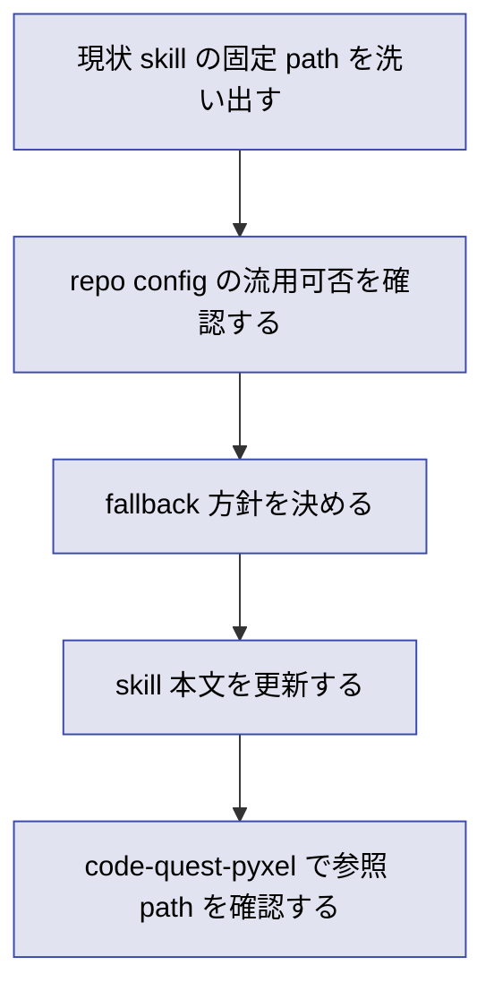

# 2026年5月26日 開発基盤：make-development-checklist を .tasknote-paths.yml 対応にする

> 状態：⑨ Closing
> 次のゲート：なし

---

## 1) Journey（どこへ行くか）

> 補足：深層的目的　repo ごとの docs 配置差分を skill から切り離し、設定を repo 側へ戻す
> 補足：やらないこと　checklist 項目自体の再設計、docs 本文の改変、`llm-wiki-update-docs` の仕様変更
> 補足：責務分担厳格度 full

1. 前提条件
    1. 💦 skill は docs 4 文書を固定 path で見ている
    2. 💦 repo root に `/.tasknote-paths.yml` がある
    3. 💦 user は repo 設定を使わせたい

2. Before
    1. 💦 `docs/` 直書き前提がある
    2. 💦 repo ごとの差分を宣言しにくい
    3. ❌ repo 設定が path 解決に使われない

3. After
    1. 💦 skill は repo config を先に見る
    2. ✅ `docs_root` から参照 doc を解決できる
    3. ✅ repo 側の設定だけで差分を表現できる
    4. ❤️ skill から project 依存を減らせる

4. 例外
    1. `/.tasknote-paths.yml` が無い repo の扱いを決める
    2. 不足キー時の fallback 順を決める

5. 境界条件
    1. 主対象は `make-development-checklist/SKILL.md`
    2. repo 側の正本は `/.tasknote-paths.yml`
    3. 出力文面の改稿は今回の主題ではない

6. 委任度
    1. 🟡 全体として fallback 方針だけ確認余地がある
    2. 🟢 CCのみで可: 現状差分と変更案を note 化できる
    3. 🔴 人の判断: stop か部分 fallback かを決める

---

## 2) ユーザーストーリーマップ

> 委任度：🟢 実装と検証まで CC が進められる
> 残る曖昧さ：なし

### 事前確認

- [x] tasknote確認済み
- [x] skill・tool・MCP確認済み
  - [x] `manage-tasknotes`
  - [x] `make-development-checklist`
- [x] 永続的ドキュメント確認済み
  - [x] `AGENTS.md`
  - [x] `README.md`
  - [x] `/.tasknote-paths.yml`
  - [x] `~/dotfiles/claude/.claude/skills/make-development-checklist/SKILL.md`
  - [x] `steering/done/2026年5月26日 開発基盤：make-checklist を汎用化してリネームする.md`

### 本体

#### 話題1：repo 設定から docs 解決する入口を 1 本にそろえる

##### ユーザー：この repo の運用者

1. 当初計画
    1. 👀 現状の固定 `docs/` 前提と repo 側設定の差分を洗い出す
    2. 🔗 `docs_root` と target doc 名の対応を skill から読める形に整理する
    3. 📝 fallback 方針を Gherkin と Design に固定する

#### 話題2：repo 固有前提を skill 本体から外す

##### ユーザー：skill 保守者

1. 当初計画
    1. ✂️ `docs/` 直書き前提を見直す
    2. 🧭 `/.tasknote-paths.yml` を優先参照するルールを定める
    3. ✅ config が無い repo でも壊れない最小動作を残す

---

## 3) Gherkin（完了条件）

> 委任度：🟢 実装と close 判定まで CC が進められる
> 残る曖昧さ：なし

### シナリオ一覧

- [x] シナリオ1：repo に `/.tasknote-paths.yml` がある場合はそこから docs を解決できる

1. 🧱 開発者が `docs_root` と target doc 対応を持つ repo にいる（repo root）
2. 🎬 `make-development-checklist` を呼ぶ（skill）
3. ✅ skill は repo 設定に従って参照 doc を決める（出力）

```gherkin
Given repo root に `/.tasknote-paths.yml` があり `docs_root` と target docs が定義されている
When `make-development-checklist` を呼ぶ
Then skill は固定 `docs/` 前提ではなく repo 設定から参照 path を解決する
And 解決した文書だけを根拠に checklist を生成する
```

- [x] シナリオ2：repo に設定が無い場合も扱いが明示されている

1. 🧱 開発者が `/.tasknote-paths.yml` を持たない repo にいる（repo root）
2. 🎬 `make-development-checklist` を呼ぶ（skill）
3. ✅ manifest 不在時は `docs/` fallback、manifest 不備時は warning stop と明示されている（出力）

```gherkin
Given repo root に `/.tasknote-paths.yml` が存在しない
When `make-development-checklist` を呼ぶ
Then skill は `docs/` を `docs_root` とみなして既定 4 文書を使う
And `/.tasknote-paths.yml` があるのに `docs_root` が無い場合だけ warning stop する
```

---

## 4) Design（どうやるか）

### 責務分担概要

| 親ディレクトリ | ファイル案 | 責務概要 | 負わせない責務 |
| --- | --- | --- | --- |
| `~/dotfiles/claude/.claude/skills/make-development-checklist/` | `SKILL.md` | repo config 優先の docs 解決と fallback ルールを持つ | repo 固有 path を直書きする |
| `./` | `.tasknote-paths.yml` | `docs_root` と対象 doc 名の正本を置く | skill 本体の分岐を直接持つ |
| `steering/done/` | `2026年5月26日 開発基盤：make-checklist を汎用化してリネームする.md` | 旧判断の経緯を参照する | 実装の正本になる |

### 責務分担概要図

```mermaid
flowchart TD
    A[repo root] --> B[/.tasknote-paths.yml]
    B --> C[make-development-checklist]
    C --> D[resolved docs paths]
    D --> E[development checklist]

    classDef io fill:#e2e3f1,stroke:#3949ab,color:#000000;
    classDef proc fill:#fff3cd,stroke:#856404,color:#000000;
    classDef out fill:#d4edda,stroke:#155724,color:#000000;

    class A,B io;
    class C,D proc;
    class E out;
```

### 責務分担詳細

- `~/dotfiles/claude/.claude/skills/make-development-checklist/` （✏️：skill 定義の置き場）
  - `SKILL.md`: repo config 優先の docs 解決と fallback ルールを書く
- `./` （✏️：repo 設定の正本置き場）
  - `.tasknote-paths.yml`: `docs_root` と対象 doc 名の正本を持つ
- `steering/done/` （❌：参照専用の履歴置き場）
  - `2026年5月26日 開発基盤：make-checklist を汎用化してリネームする.md`: 旧判断との差分を参照する

### 関連スキル・MCP

- `manage-tasknotes`
- `make-development-checklist`

### 【参照】

- Steering: `steering/done/2026年5月26日 開発基盤：make-checklist を汎用化してリネームする.md`
- Architecture: `docs/architecture.md`
- RepositoryStructure: `docs/repository-structure.md`
- FrameworkRule: `docs/framework-rule.md`
- RepoConfig: `/.tasknote-paths.yml`

### 変更範囲

- やること：skill の docs path 解決を repo config 優先へ寄せる設計と実装
- やらないこと：checklist 出力文面の全面改稿、repo docs 本文の仕様変更

### 検証

- 検証コマンド: `python3 - <<'PY' ... '/.tasknote-paths.yml' / 'docs_root' / 'llm_wiki_update_docs' marker check ... PY`
- 検証コマンド: `python3 - <<'PY' ... yaml で .tasknote-paths.yml を読み default_targets を解決して docs 実在確認 ... PY`
- 成功条件: skill 本文に manifest contract が入り、code-quest-pyxel で解決された docs path がすべて実在する
- 未実施時の扱い: 上記 2 系統の確認がそろうまで close しない

---

## 5) Tasklist



> 必ず上から順に実施。CC が現物確認を含めて前へ進める。

- [x] （CC）現状 skill の固定 path と save 先の前提を洗い出す
- [x] （CC）`/.tasknote-paths.yml` の既存 key で足りるかを確認する
- [x] （CC）config 不備時は warning stop、manifest 不在時は `docs/` fallback と決める
- [x] （CC）`make-development-checklist` の本文を更新する
- [x] （CC）code-quest-pyxel で repo 設定解決を確認する

### 記録の分け方

> 実行のたびに、事実は `作業ログ`、判断は `Discussion` に分けて残す。

#### 作業ログ に書く

- 変更した skill / config
- 確認した path と結果
- warning や fallback の実際の挙動

#### Discussion に書く

- fallback をどう決めたか
- `.tasknote-paths.yml` 既存 schema で足りるか
- 他 repo へ広げる時の制約

### レビュー（開発 task のときだけ）

- 原本 checklist: `docs/development-checklist.md`
- /tmp コピー: `未作成（原本を直接参照）`
- レビュー結果: manifest contract / save path / warning 条件の 3 点を原本 checklist に照らして確認した
- 未通過時の扱い: fail があれば修正して再レビューし、全部通るまで Close しない

---

## 6) 作業ログ

- 2026-05-26 起票
- `llm-wiki-update-docs` を参照し、既存 `llm_wiki_update_docs` contract を再利用する方針に寄せた
- red check: skill 本文に `/.tasknote-paths.yml` / `docs_root` / `llm_wiki_update_docs` / `docs/` fallback 記述が無いことを確認した
- `~/dotfiles/claude/.claude/skills/make-development-checklist/SKILL.md` を更新し、manifest 優先・manifest 不在時 fallback・manifest 不備時 warning stop を明文化した
- green check: marker 再検査で contract 文言が入ったことを確認した
- yaml 検証: `code-quest-pyxel/.tasknote-paths.yml` から `docs/architecture.md` `docs/framework-rule.md` `docs/ux-policy.md` `docs/repository-structure.md` `docs/development-checklist.md` が解決されることを確認した
- dotfiles commit: `d7a454a4` `feat: make-development-checklist use tasknote-paths`

---

## 7) 評価と成果物

> 評価：🟢 期待通り完了した

### 成果物

- `~/dotfiles/claude/.claude/skills/make-development-checklist/SKILL.md`
- `code-quest-pyxel/.tasknote-paths.yml` を使う contract
- `steering/done/2026年5月26日 開発基盤：make-development-checklist を .tasknote-paths.yml 対応にする.md`

---

## 8) Discussion

### 判断記録

- `make-development-checklist` 専用の新 schema は増やさず、既存 `llm_wiki_update_docs` contract を流用した
- fallback は 2 段に固定した
- manifest 不在: `docs/` を `docs_root` とみなす
- manifest あり + `docs_root` 欠落: warning stop
- この repo では既存 `.tasknote-paths.yml` の key で十分だったため、repo 側ファイルは編集不要と判断した

### 反省とルール化

- 記入先：`make-development-checklist` / `llm-wiki-update-docs`
- 次にやること：別 repo でも同じ contract で動くかを使う側で観察する

---

## 9) Closing

- 状態: done
- 次のゲート: なし
- close 条件:
  - [x] repo 設定優先の path 解決仕様が固まっている
  - [x] `make-development-checklist` 側の修正が実装されている
  - [x] code-quest-pyxel 上で設定解決の現物確認が済んでいる

---

## 10) 参考資料

- `AGENTS.md`
- `README.md`
- `/.tasknote-paths.yml`
- `docs/architecture.md`
- `docs/development-checklist.md`
- `docs/framework-rule.md`
- `docs/repository-structure.md`
- `~/dotfiles/claude/.claude/skills/make-development-checklist/SKILL.md`
- `~/dotfiles/claude/.claude/skills/llm-wiki-update-docs/SKILL.md`
- `steering/done/2026年5月26日 開発基盤：make-checklist を汎用化してリネームする.md`
